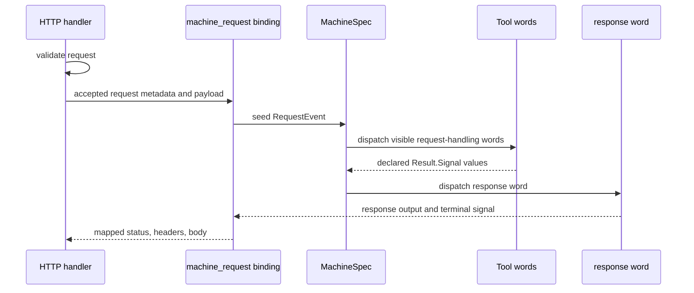
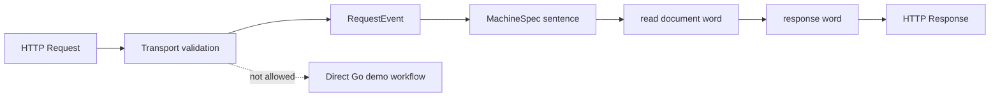

<!-- Copyright (c) 2026 Nokia -->
<!-- SPDX-License-Identifier: BSD-3-Clause -->

<!-- field: purpose -->
## Purpose

Defines how one inbound HTTP request becomes grammar input for one
short-lived MachineSpec execution. Transport validation and run startup stay
in the HTTP handler. MachineSpec composes request handling as a sentence.
Only response words bridge machine output back to HTTP.

<!-- field: requirements_source | form: "tree" -->
## Requirements source

- canonical:
  1. docs/specs/software-requirements/srd030-machine-request-rest-binding.md
- supporting:
  1. docs/specs/software-requirements/srd005-agentic-loop.md
  1. docs/specs/software-requirements/srd006-yaml-machine-config.md
  1. docs/specs/software-requirements/srd027-rest-tool-runtime.md
  1. docs/specs/software-requirements/srd029-rest-server-tools.md
  1. docs/specs/semantic-models/tool-language.md
  1. docs/specs/semantic-models/rest-tool-language.md

<!-- field: primary_entities | form: "typed table" -->
## Primary entities

| name | kind | responsibility | owns | references |
| --- | --- | --- | --- | --- |
| MachineRequestEndpoint | inbound_rest_route | Defines the route that accepts one HTTP request and starts one configured request machine run. | [route_identity, request_validation, response_policy] | [MachineRequestBinding] |
| MachineRequestBinding | rest_server_binding | Maps accepted HTTP requests to short-lived MachineSpec executions. | [request_to_machine_mapping, timeout_policy, error_mapping] | [MachineSpec, ToolDef, ResponseWord] |
| RequestEvent | grammar_input | Carries validated HTTP input, request metadata, and correlation data into the machine sentence. | [validated_payload, request_metadata] |  |
| RequestMachine | short_lived_declarative_program | Handles one request through configured states, signals, and tool words. | [request_sentence] | [MachineSpec, Registry, ToolDef] |
| ResponseWord | machine_to_http_bridge | Produces structured response output that maps to HTTP status, headers, body, and content type. | [response_shape, response_signal] |  |
| ResponseSelection | terminal_mapping | Selects which terminal signal or response word output becomes the HTTP response. | [status_mapping, header_mapping, body_mapping, error_mapping] |  |
| RequestTrace | observability_record | Correlates the HTTP request, machine run, terminal state, terminal signal, and response mapping. | [request_id, correlation_id, run_summary] |  |

<!-- field: language_model -->
## Language model

<!-- field: request_as_input -->
### Request as input

An inbound HTTP request is not a workflow. It is grammar input. After
validation, the machine_request binding seeds the configured machine with a
RequestEvent.

<!-- field: machine_sentence_as_handler -->
### Machine sentence as handler

Request handling lives in the machine sentence. MachineSpec transitions
choose the words that inspect request data, read documents, call models,
validate output, and prepare a response.

<!-- field: response_word_as_output_bridge -->
### Response word as output bridge

HTTP response data leaves the machine only through response words or
configured terminal response output. Direct Go handlers do not assemble demo
behavior after validation.

<!-- field: transport_boundary -->
### Transport boundary

At the transport boundary, the HTTP handler owns validation, cancellation,
timeouts, and response writing. Request-specific workflow composition stays
in the machine.

<!-- field: request_server_ownership -->
### Request server ownership

A request server may be launched by a parent MachineSpec through
rest_server_launch. A same-origin host proxy may also own the request
server lifecycle when the proxy only adapts browser traffic to a configured
generic REST server. In both cases, trusted REST configuration names the
route contract, request program, and response policy. The proxy must not
recompose request workflow in Go after launch.

<!-- field: request_tool_selection -->
### Request tool selection

Profile-backed request runners load ToolDefs from trusted profile
declaration roots. They then select the actions named by the request
MachineSpec transitions and register builtin factories only for the selected
init names. This combination keeps vocabulary authority in the profile while
allowing the request machine to narrow the words it needs for one
short-lived sentence.

<!-- field: generic_trace_envelope -->
### Generic trace envelope

The generic machine_request response trace belongs to internal/tools/rest.
It identifies the REST route, request machine, terminal signal, and run
outcome. Profile-specific proxies may forward or display that trace, but
they should not be the source of generic route or machine identity.

<!-- field: relationships | form: "keyed table" -->
## Relationships

| id | meaning | invariant |
| --- | --- | --- |
| MachineRequestEndpoint_to_MachineRequestBinding | An endpoint with binding machine_request delegates accepted requests to the configured binding. | The endpoint validates HTTP transport data before a machine run starts. |
| MachineRequestBinding_to_RequestMachine | The binding constructs the configured LoopParams, selected registry, initial state, and request seed data for one run. | Trusted config chooses profile, machine, tool selection, and boundary config; HTTP callers do not. |
| Profile_to_RequestToolSelection | The request runner loads declarations from trusted profile config, selects only actions named by the request MachineSpec, and registers only selected builtin init names. | Missing request-machine actions fail configuration validation before request execution, and unselected request factories remain unavailable. |
| RequestEvent_to_RequestMachine | The request event becomes structured input available to the first machine action and later response words. | RequestEvent contains only declared, validated, and redacted request fields. |
| RequestMachine_to_ResponseWord | The machine routes to response vocabulary when it needs to shape the HTTP response. | Response words are visible MachineSpec actions with declared outputs and signals. |
| ResponseWord_to_ResponseSelection | Response word output is mapped to HTTP status, headers, body, and content type. | Undeclared response fields cannot be written to the HTTP response. |
| Error_to_ResponseSelection | Validation, config, timeout, run, and response failures map through configured error responses. | Error responses redact secrets, raw prompts, credentials, internal paths, and unredacted body content. |
| RequestTrace_to_RunResult | The request trace links HTTP metadata with RunResult and RunEvent records. | Traces record generic route identity and run outcome without secret material. |

<!-- field: request_flow -->
## Request flow

<!-- field: steps -->
### Steps

| id | actor | action |
| --- | --- | --- |
| F1 | HTTP handler | Match configured route and binding machine_request. |
| F2 | HTTP handler | Validate method, path, query, headers, body, size, auth, and timeout policy. |
| F3 | MachineRequestBinding | Build RequestEvent from declared request fields and redacted metadata. |
| F4 | MachineRequestBinding | Resolve trusted profile, MachineSpec, selected ToolDefs, and response policy. |
| F4a | ProfileMachineRequestRunner | Load trusted profile declaration roots and select the request MachineSpec action names. |
| F5 | Loop | Run the short-lived request machine with RequestEvent as seed input. |
| F6 | RequestMachine | Compose request handling through visible MachineSpec transitions and selected words. |
| F7 | ResponseWord | Produce structured terminal response output. |
| F8 | ResponseSelection | Map terminal signal and response output to HTTP status, headers, content type, and body. |
| F9 | HTTP handler | Write the mapped response and clean up request-scoped state. |

<!-- field: diagrams -->
## Diagrams

<!-- field: request_to_machine_sentence -->
### Request to machine sentence

<!-- field: grammar_owns_request_behavior -->
### Grammar owns request behavior

<!-- field: invariants -->
## Invariants

- machine_request is a REST server binding, not a direct Go handler workflow.
- One accepted HTTP request starts at most one short-lived request machine run.
- MachineSpec owns request-specific sequencing, branching, retries, and response preparation.
- ToolDef owns request-handling vocabulary contracts, including response words.
- Request-machine builtin factories are registered only when their init names are selected by the trusted request ToolDefs.
- HTTP callers cannot choose profile, machine, tool declaration roots, model config, credentials, URLs, or workspace roots.
- Invalid request input does not start a machine run.
- Response words or configured terminal response output are the only bridge back to HTTP status, headers, and body.
- Request-scoped timeout cancels the machine run context.
- Generic traces identify route identity and run outcome without leaking secrets or raw prompts.
- Request metadata is command/domain state for the request run; it is not workspace state.
- Same-origin host proxies may own request server launch and shutdown only when they remain thin transport adapters over configured generic REST machine_request routes.

<!-- field: non_goals -->
## Non goals

- Defining Knowledge Manager document content.
- Defining the full implementation API for internal/tools/rest.
- Replacing long-lived REST event queues and rest_await_event.
- Allowing arbitrary public web framework handlers inside configured agent behavior.
- Generating HTTP handlers from machine.yaml.

<!-- field: related_documents -->
## Related documents

- srd030-machine-request-rest-binding
- sm-rest-tool-language
- sm-tool-language
- cfg-rest-tool-format
- srd027-rest-tool-runtime
- srd029-rest-server-tools
