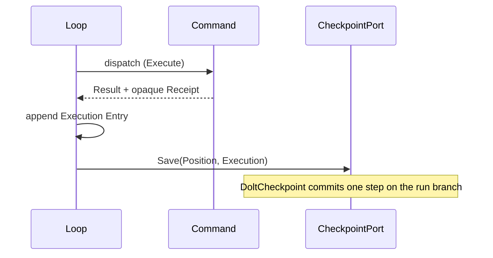
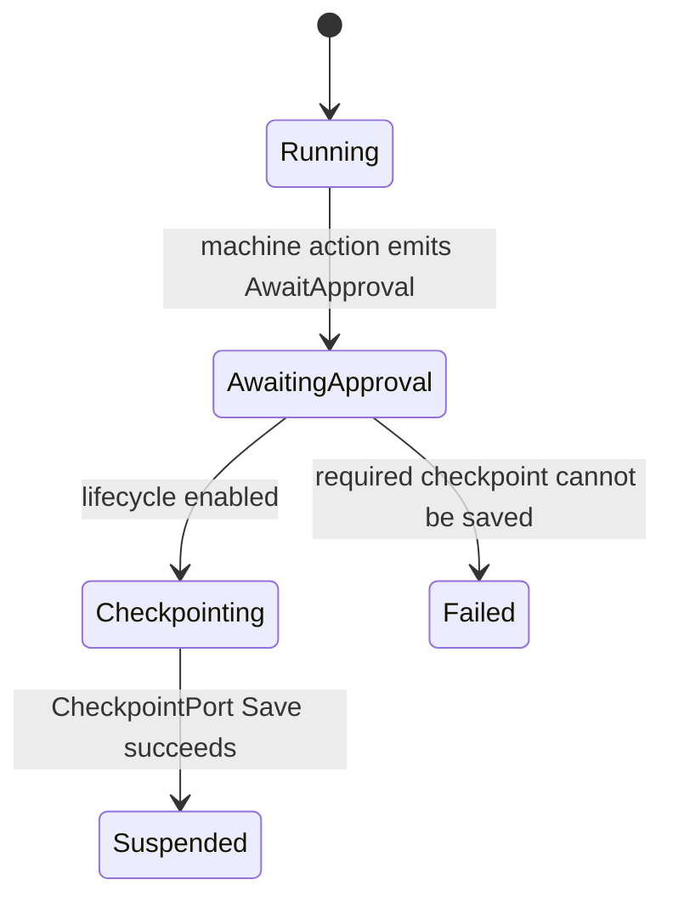
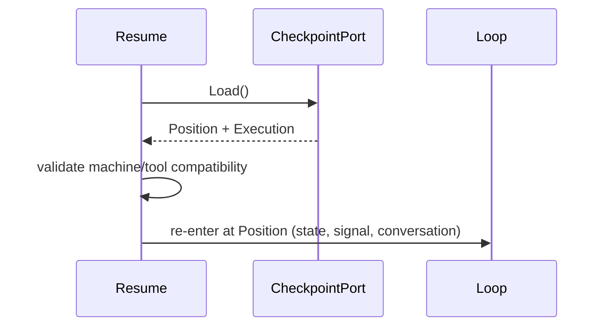
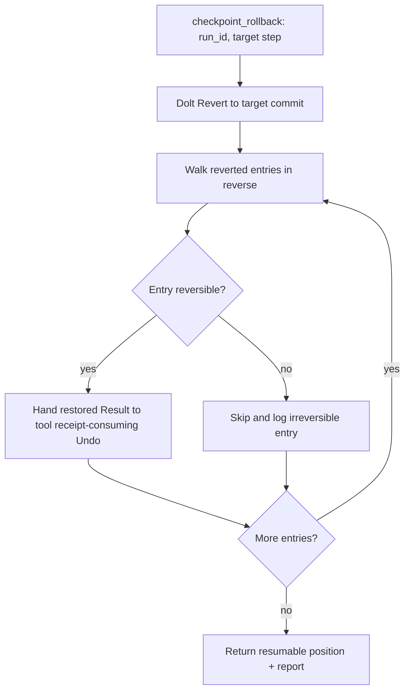
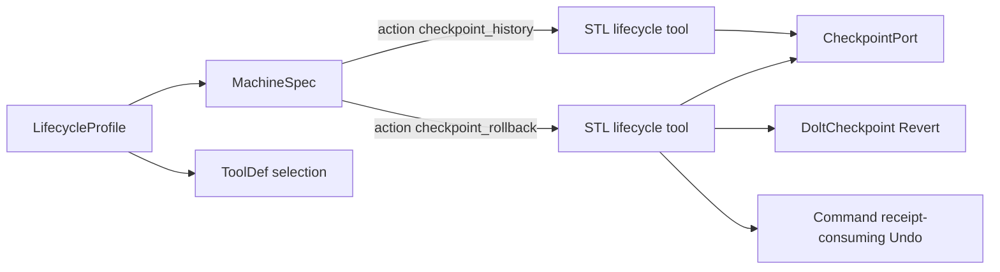
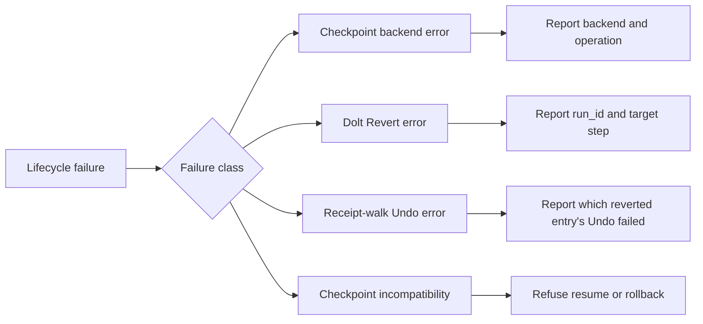

<!-- Copyright (c) 2026 Nokia -->
<!-- SPDX-License-Identifier: BSD-3-Clause -->

<!-- field: purpose -->
## Purpose

Models the runtime lifecycle for checkpointing, suspend/resume, approval
gates, and rollback on the srd035 checkpoint port. Persistence is a two-method
typed port (Save/Load) whose default backend is the srd036 Dolt adapter: each
loop step is a commit, each run is a branch, and terminal runs merge to main.
Rollback has two halves. Dolt commit history gives git-style Revert over
DB-persisted state; the opaque, tool-owned Receipt on each execution entry is
the reverse edge for external effects, replayed by a lifecycle tool into each
tool's receipt-consuming Undo. The model does not use a three-layer StateStore
or Workspace split, a CheckpointPolicy, or an engine-owned undo-walk.

<!-- field: requirements_source | form: "tree" -->
## Requirements source

- canonical:
  1. docs/specs/software-requirements/srd035-checkpoint-port.md
  1. docs/specs/software-requirements/srd036-dolt-state-persistence.md
  1. docs/specs/software-requirements/srd025-rollback-lifecycle.md
  1. docs/specs/software-requirements/srd026-lifecycle-tools.md
- historical_background:
  1. docs/guides/roll-backs.md

<!-- field: primary_entities | form: "typed table" -->
## Primary entities

| name | kind | responsibility | implements | owns | references | owned_by | not_responsible_for | calls |
| --- | --- | --- | --- | --- | --- | --- | --- | --- |
| CheckpointPort | storage_port | Two-method typed port (Save(Position, Execution) / Load) that persists the resumable position and the ordered execution log. |  | [persistence_contract] |  |  | [interpreting receipts, Cobra flags, ToolDef declarations, profile loading] |  |
| NoopCheckpoint | storage_adapter | Default adapter when persistence is disabled; Save is a no-op and Load reports not-found. | CheckpointPort |  |  |  |  |  |
| InMemoryCheckpoint | storage_adapter | Reference adapter for tests that round-trips Position and Execution in process. | CheckpointPort |  |  |  |  |  |
| DoltCheckpoint | storage_adapter | Default persistent backend; stores state as versioned SQL with commit-per-step, branch-per-run, merge-to-main on terminal, and git-style Revert. | CheckpointPort | [dolt_commit_history, revert] |  |  |  |  |
| Loop | runtime | Drives MachineSpec transitions, dispatches Command values, appends an Execution Entry per step, and calls Save after each dispatch cycle. |  | [agent_state] | [CheckpointPort] |  |  |  |
| Position | persisted_value | Resumable machine position (CurrentState, LastSignal) plus the AgentSnapshot counters and folded conversation snapshot. |  | [resumable_agent_state] |  |  |  |  |
| Execution | ordered_log | Ordered slice of Entry values preserving dispatch order for forward inspection and reverse traversal. |  |  |  |  |  |  |
| Entry | execution_record | Records one dispatched step (iteration, timestamp, command, from/to state, signal, result digest) and carries the step's opaque Receipt. |  | [step_record, receipt] |  |  |  |  |
| Receipt | opaque_memento | Tool-owned opaque payload capturing what the originating tool's Undo needs (prior content, resource ids, or a workspace commit hash). It is the reverse edge for external effects. |  |  |  | originating_tool | [engine interpretation, adapter interpretation] |  |
| Command | executable_word | Executes one tool action, encoding a Receipt during Execute, and exposes a receipt-consuming Undo that reverses the external effect from a restored Result. |  | [external_effect, receipt_encoding] |  |  |  |  |
| CheckpointHistoryTool | stl_lifecycle_tool | Adapts a Dolt commit-history read through Load into a checkpoint_history Command that prints an execution digest. |  | [history_inspection_result] |  |  |  | [CheckpointPort] |
| CheckpointRollbackTool | stl_lifecycle_tool | Runs Dolt Revert for DB state, then walks the reverted entries in reverse and hands each restored, receipt-bearing Result to its tool's receipt-consuming Undo for external effects. |  | [rollback_command_result, reverse_receipt_walk] |  |  |  | [CheckpointPort, DoltCheckpoint, Command] |
| LifecycleProfile | configured_program | Selects a lifecycle MachineSpec, lifecycle tool selection, and lifecycle tool declarations through the normal profile contract. |  |  |  |  |  |  |
| MachineSpec | declarative_program | Defines states, signals, and actions; expresses approval/suspend routing and dispatches lifecycle tools. |  |  |  |  |  |  |
| ToolDef | tool_contract | Declares tool side effects, reversibility, receipt-based undo, errors, and relationships. |  |  |  |  |  |  |

<!-- field: persisted_state | form: "keyed table" -->
## Persisted state

| id | owner | examples | storage | rollback |
| --- | --- | --- | --- | --- |
| db_persisted_state | CheckpointPort (DoltCheckpoint by default) | [current State and current Signal (Position), "iteration, token, and cost counters (AgentSnapshot)", folded conversation snapshot, ordered Execution entries with result digests and receipts] | Save(Position, Execution); one Dolt commit per step, one branch per run. | git-style Revert(run_id, step_index) resets the run branch to the target commit. |
| external_effect_state | originating Command (tool) | [files changed by write/edit, external resources created through boundary tools, child-agent or nested-machine effects] | opaque Receipt encoded during Execute and persisted verbatim on the entry. | the lifecycle tool replays each restored, receipt-bearing Result into the tool's receipt-consuming Undo. |

<!-- field: ownership_rules -->
## Ownership rules

- The CheckpointPort owns the persistence contract; adapters own serialization and storage. Only DoltCheckpoint owns commit history and Revert.
- The originating tool owns its Receipt schema and is the only decoder. The engine and adapters treat receipts as opaque.
- Commands own their own Undo semantics because only the command knows how to reverse its external effect from a receipt.
- Loop owns dispatch order, save timing (after each cycle), and lifecycle status, but not domain compensation logic.
- MachineSpec owns visible control flow such as approval gates; checkpointing is storage/lifecycle behavior around the machine.
- The reverse receipt walk is owned by CheckpointRollbackTool, not the engine.

<!-- field: split -->
## Split

<!-- field: revert_covers -->
### Revert covers

DB-persisted state (Position, Execution, conversation) through Dolt Revert.

<!-- field: receipts_cover -->
### Receipts cover

external effects (files, resources) through each tool's receipt-consuming Undo.

<!-- field: rule -->
### Rule

Revert rewinds recorded state; receipts reverse the world outside the database. Neither substitutes for the other.

<!-- field: data_flow -->
## Data flow

<!-- field: normal_execution -->
### Normal execution

Loop steps MachineSpec, dispatches Command, receives a Result carrying an
opaque Receipt, appends an Execution Entry, and calls Save(Position,
Execution) once per dispatch cycle. With DoltCheckpoint this creates one
commit per step on the run branch.

<!-- field: profile_first_history -->
### Profile first history

A LifecycleProfile selects the history MachineSpec and checkpoint_history
ToolDef. The machine dispatches CheckpointHistoryTool, which Loads the run's
Execution from Dolt commit history, formats a digest, and returns a declared
Result.Signal.

<!-- field: profile_first_rollback -->
### Profile first rollback

A LifecycleProfile selects the rollback MachineSpec and checkpoint_rollback
ToolDef. The machine dispatches CheckpointRollbackTool, which calls Revert to
rewind DB state to the target step, then walks the reverted entries in
reverse, handing each restored Result to its tool's receipt-consuming Undo,
skipping and logging irreversible entries, and returns a declared
Result.Signal.

<!-- field: suspend -->
### Suspend

A machine action emits AwaitApproval. The runtime calls Save through the
checkpoint port and marks the run suspended.

<!-- field: resume_restore -->
### Resume restore

Resume Loads Position and Execution through the port, validates
MachineSpec/tool compatibility, restores agent state and conversation from
the typed snapshot, and re-enters Loop at the checkpointed position. There is
a single resume path.

<!-- field: terminal_merge -->
### Terminal merge

On a terminal state, DoltCheckpoint merges the run branch to main and deletes
the run branch.

<!-- field: lifecycle_diagrams -->
## Lifecycle diagrams

<!-- field: checkpoint -->
### Checkpoint

<!-- field: suspend -->
### Suspend

<!-- field: resume -->
### Resume

<!-- field: rollback -->
### Rollback

<!-- field: declarative_lifecycle_boundary -->
### Declarative lifecycle boundary

<!-- field: failure_handling -->
### Failure handling

<!-- field: invariants -->
## Invariants

- Persistence is the two-method checkpoint port; the default backend is the Dolt adapter and NoopCheckpoint is the disabled-mode default.
- The engine and checkpoint adapters never interpret a Receipt; only the originating tool decodes it.
- Execution preserves dispatch order for forward inspection and reverse traversal.
- Revert rewinds DB-persisted state; receipts reverse external effects. Neither is stored in the other.
- The reverse receipt walk lives in the checkpoint_rollback lifecycle tool, not in the engine.
- Save runs after each dispatch cycle; resume is a single Load-and-re-enter path.
- Lifecycle features are opt-in and preserve existing behavior when persistence is disabled (NoopCheckpoint).
- Approval gates and suspend paths are visible as MachineSpec transitions and signals.
- History and rollback are profile-first lifecycle machine actions, not hidden Cobra workflows.

<!-- field: non_goals -->
## Non goals

- Defining exact CLI syntax for history, rollback, or resume commands.
- Retaining a three-layer StateStore/Workspace split, a CheckpointPolicy, or an engine-owned undo-walk.
- Reverting files, HTTP, or workspace state inside the Dolt adapter; Revert is DB-only and tools own external compensation through receipts.
- Defining the Dolt schema or Receipt wire format; those belong to srd036 and srd035.
- Requiring every existing command to have a receipt-consuming Undo before the port lands.

<!-- field: related_documents -->
## Related documents

- srd035-checkpoint-port
- srd036-dolt-state-persistence
- srd025-rollback-lifecycle
- srd026-lifecycle-tools
- sm-command-undo-audit
- cfg-tool-authoring-standard
