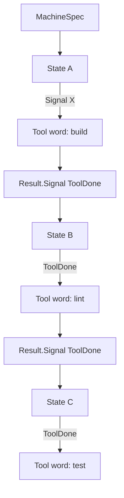
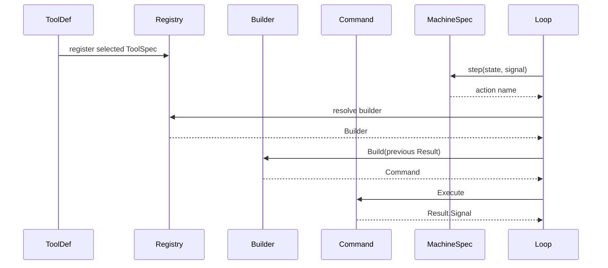
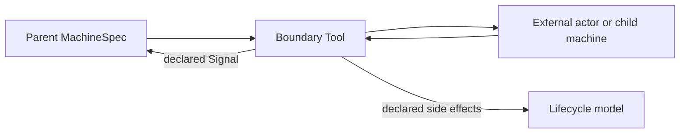
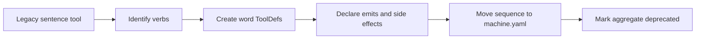
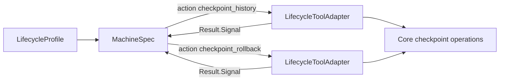

<!-- Copyright (c) 2026 Nokia -->
<!-- SPDX-License-Identifier: BSD-3-Clause -->

<!-- field: purpose -->
## Purpose

Models the language in which agent programs are written: a MachineSpec
composes tools into visible workflows, while each tool is a vocabulary item
with a declared contract. The model explains how ToolDef, ToolSpec, Command,
and MachineSpec relate, and how to classify ordinary words, stateful internal
words, boundary tools, and legacy sentence tools.

<!-- field: requirements_source | form: "tree" -->
## Requirements source

- canonical:
  1. docs/specs/config-formats/tool-authoring-standard.md
  1. docs/specs/software-requirements/srd022-builtin-tools.md
  1. docs/specs/software-requirements/srd023-cli-exec-tools.md
  1. docs/specs/software-requirements/srd024-blocking-input-tools.md
  1. docs/specs/software-requirements/srd025-rollback-lifecycle.md
  1. docs/specs/software-requirements/srd026-lifecycle-tools.md
- historical_background:
  1. docs/guides/tools-as-dsl.md

<!-- field: primary_entities -->
## Primary entities

| name | kind | responsibility |
| --- | --- | --- |
| ToolDef | declaration_contract | Declares the tool name, type, init/binary, visibility, parameters, emits, side effects, reversibility, undo, errors, and relationships. |
| ToolSpec | runtime_manifest_entry | Represents selected tool metadata and parameter schema at runtime, including LLM-visible manifest shape when applicable. |
| Command | executable_tool_instance | Executes one declared tool action with bound parameters and returns a Result.Signal. |
| MachineSpec | declarative_program | Composes tools into workflows through states, signals, and transition actions. |
| Loop | runtime_interpreter | Interprets MachineSpec by dispatching Commands and transitioning on Result.Signal. |
| Registry | runtime_catalog | Maps selected ToolSpec values to Builders that produce Commands. |
| Builder | command_factory | Converts prior Result or parsed tool input into a ready Command. |
| Result | execution_output | Carries Output, Signal, Cost, Err, CommandName, and optional ToolMetrics back to the machine. |
| StateStore | lifecycle_storage | Stores command/domain snapshots when a tool mutates internal state. |
| Workspace | lifecycle_environment | Tracks filesystem/environment state for tools with workspace side effects. |
| Checkpoint | lifecycle_record | Records tool effects across agent, command/domain, and workspace state when lifecycle features are enabled. |
| LifecycleProfile | configured_program | Selects lifecycle MachineSpec, ToolDef declarations, and runtime lifecycle ports through the normal profile contract. |
| LifecycleToolAdapter | executable_tool_instance | Exposes core lifecycle operations as declared STL builtin Commands selected by MachineSpec actions. |

<!-- field: language_model -->
## Language model

<!-- field: vocabulary_word -->
### Vocabulary word

A tool is one clear verb. It has typed input, typed output, declared side
effects, explicit error semantics, and a reversibility/undo strategy.

<!-- field: sentence -->
### Sentence

A workflow is a sequence of words. Workflows belong in MachineSpec
transitions, not hidden inside a single tool implementation.

<!-- field: grammar -->
### Grammar

MachineSpec is the grammar. States are positions in the sentence, Signals
are punctuation/outcomes, and transition actions select the next word to
execute.

<!-- field: runtime -->
### Runtime

Loop interprets the grammar by asking Registry/Builder for a Command,
dispatching it, then routing on Result.Signal.

<!-- field: tool_categories | form: "keyed table" -->
## Tool categories

| id | definition | examples | composition | undo_model |
| --- | --- | --- | --- | --- |
| word | Single deterministic verb with one primary effect and structured output. | [read, write, edit, find, parse_response, record_oracle_result] | freely composed by MachineSpec or LLM-selected $tool dispatch. | noop for read-only words; workspace_restore or command-specific undo for mutating words. |
| stateful_internal | Internal machine action that mutates agent or command/domain state rather than user-visible workspace state. | [invoke_llm, report_parse_error, reset_history, nudge_reread, record_point_failure, checkpoint_history] | named internal MachineSpec action; usually hidden from LLM tool lists. | command/domain restore, such as conversation_truncate or evaluator_session_restore. |
| boundary | Tool that crosses a program, model, human, nested-machine, child-process, external-API, or workspace boundary. | [agent, rest_server_launch, rest_await_event, self_invoke, run_agent, start_service, checkpoint_rollback] | allowed as a word only when the boundary and emitted signals are explicit. | workspace_restore, compensation, child-workspace restore, or irreversible confirmation. |
| sentence | Legacy tool that hides a multi-step workflow behind one command name. | [legacy_load_suite, legacy_check_results, deprecated_validate_sequence] | should migrate to multiple word tools with sequencing in MachineSpec. | usually ambiguous until split; must be documented before new use. |

<!-- field: relationships | form: "keyed table" -->
## Relationships

| id | meaning | invariant |
| --- | --- | --- |
| ToolDef_to_ToolSpec | ToolDef is parsed and selected into ToolSpec metadata for runtime registration and tool lists. | LLM-visible ToolSpec schemas omit implementation-only argv mapping extensions. |
| ToolSpec_to_Command | Registry and Builder use selected ToolSpec/config to build executable Commands. | A Command is an instance of one tool action, not a hidden workflow. |
| Command_to_Result | Command.Execute returns Result; Result.Signal drives the next MachineSpec transition. | Infrastructure failures use Err/CommandError; domain outcomes use explicit Signals. |
| MachineSpec_to_ToolDef | MachineSpec action names reference selected tool declarations. | Named action signals should be declared in emits and accepted by the target state transitions. |
| MachineSpec_to_dynamic_tool_availability | The transition graph defines which external ToolDefs are valid for LLM-selected $tool dispatch in each current state. | Explicit ToolSpec phases may narrow the transition-derived set, but they must not make a tool available where MachineSpec cannot route the tool's declared signals. |
| ToolDef_to_lifecycle | ToolDef side_effects, reversibility, undo, and errors tell rollback lifecycle code how to reason about effects. | Undeclared side effects are documentation bugs. |
| LifecycleProfile_to_LifecycleToolAdapter | A lifecycle profile selects the lifecycle machine and the checkpoint_history or checkpoint_rollback ToolDefs. | Lifecycle behavior is still a configured program, not a hidden CLI workflow. |
| LifecycleToolAdapter_to_CoreCheckpointOperations | Lifecycle adapters execute one declared tool action and delegate checkpoint algorithms to internal/runtime/core. | The adapter owns ToolDef config and Result signals; core owns traversal and checkpoint data rules. |

<!-- field: machine_composition -->
## Machine composition

<!-- field: static_actions -->
### Static actions

A transition action names a specific tool. This is appropriate for internal
workflow steps such as build -> lint -> test or evaluator point setup.

<!-- field: dynamic_tool_dispatch -->
### Dynamic tool dispatch

The $tool sentinel resolves a parsed LLM tool call through Registry at
dispatch time. Dynamic dispatch still executes one selected word.

The current MachineSpec state is the current grammar phase. For an LLM
boundary in that state, the tool manifest contains only external words that
the next $tool transition may dispatch and whose declared Result.Signal
values can route from the target state. Terminal target states need no
further outgoing signal routes.

ToolSpec phases are runtime metadata for registry manifests. They may
narrow the transition-derived availability set, but they do not define
workflow order. MachineSpec remains the source of truth for which words are
legal in a phase.

Runtime parsing and dispatch check the parsed tool name against the same
current-state availability set. A model request for a registered external
tool that is not valid in the current state emits ParseFailed with an
out-of-state diagnostic. Unknown tool names and schema mismatches also use
ParseFailed, with distinct diagnostic text.

<!-- field: boundary_or_nested_machine -->
### Boundary or nested machine

A boundary tool may run a child process or nested machine, but the boundary
must be explicit in ToolDef. The parent MachineSpec sees one boundary word
and declared Signals; the child MachineSpec owns the nested sentence.
Child-agent boundaries prefer config.profile and invoke children with
--profile. Legacy machine/tools/tool_declarations triples are compatibility
fallback only.

<!-- field: lifecycle_profiles -->
### Lifecycle profiles

Lifecycle history and rollback are ordinary configured programs. A profile
selects a lifecycle MachineSpec and lifecycle ToolDefs. The machine invokes
checkpoint_history or checkpoint_rollback by name. Legacy exec wrappers or
hidden Cobra subcommands are migration artifacts only.

<!-- field: validation_sequence -->
### Validation sequence

Validation is a visible sentence in machine.yaml. Atomic validation words
execute through ordinary machine transitions; no aggregate runtime path
replays skipped tools.

<!-- field: migration_states | form: "keyed table" -->
## Migration states

| id | meaning | next_action |
| --- | --- | --- |
| declared_word | Tool satisfies the vocabulary model and has complete contract metadata. | keep stable and compose in MachineSpec. |
| word_missing_contract | Tool does one thing but lacks complete side effects, output, undo, errors, or relationship metadata. | complete ToolDef contract without changing behavior. |
| boundary_documented | Tool crosses a boundary but declares why, what it emits, and how side effects are handled. | preserve if it remains a true boundary word. |
| legacy_sentence | Tool hides sequencing or multiple verbs. | split into words and move order into MachineSpec. |
| deprecated_compatibility | Tool remains for old machines but should not be used for new workflows. | hide from LLM tool lists, document replacement sequence, and remove when callers migrate. |
| transitional_cli_adapter | Command-line entry point remains only to bridge users to profile-first lifecycle programs. | replace with lifecycle profiles and first-class lifecycle ToolDefs. |

<!-- field: diagrams -->
## Diagrams

<!-- field: machine_as_sentence_composer -->
### Machine as sentence composer

<!-- field: declaration_to_execution -->
### Declaration to execution

<!-- field: boundary_tool -->
### Boundary tool

<!-- field: legacy_sentence_migration -->
### Legacy sentence migration

<!-- field: lifecycle_adapter_word -->
### Lifecycle adapter word

<!-- field: invariants -->
## Invariants

- Tools do not hide workflows; workflows are MachineSpec transitions over tool words.
- A word has one primary semantic action even if its implementation has multiple internal statements.
- Boundary tools are allowed only when the boundary is explicit and the parent machine sees declared signals.
- Active selected tools declare side effects, reversibility, undo, errors, and relationships; missing selected-tool contract fields are audit errors unless a declaration is explicitly legacy.
- Irreversible tools require explicit documentation and should require confirmation before affecting user data or shared infrastructure.
- Tool output should be structured enough for the next machine step or tool to consume without LLM interpretation.
- Child-agent boundaries are profile-first; machine/tools flags remain compatibility paths, not the canonical actor configuration.
- Lifecycle history and rollback boundaries are profile-first; hidden Cobra commands and exec wrappers are compatibility paths only.
- checkpoint_history is an internal lifecycle word with no side effect beyond Result.Output.
- checkpoint_rollback is a lifecycle boundary word because it can rewrite checkpoint state and restore workspace state.
- Legacy sentence tools migrate by splitting verbs and preserving behavior in machine.yaml.
- Dynamic $tool manifests and dispatch checks use the current MachineSpec state as the phase boundary.
- ToolSpec phases may restrict dynamic availability, but MachineSpec transitions decide whether a word is legal in a phase.

<!-- field: non_goals -->
## Non goals

- Requiring every existing legacy tool to be split in this semantic-model task.
- Prohibiting boundary tools such as LLM calls, child agents, or human approval gates.
- Treating implementation helper functions as separate tools.
- Letting ToolDef relationships prescribe a single hardcoded workflow.

<!-- field: related_documents -->
## Related documents

- cfg-tool-authoring-standard
- sm-tool-vocabulary-audit
- sm-rollback-lifecycle
- srd022-builtin-tools
- srd023-cli-exec-tools
- srd024-blocking-input-tools
- srd025-rollback-lifecycle
- srd026-lifecycle-tools
