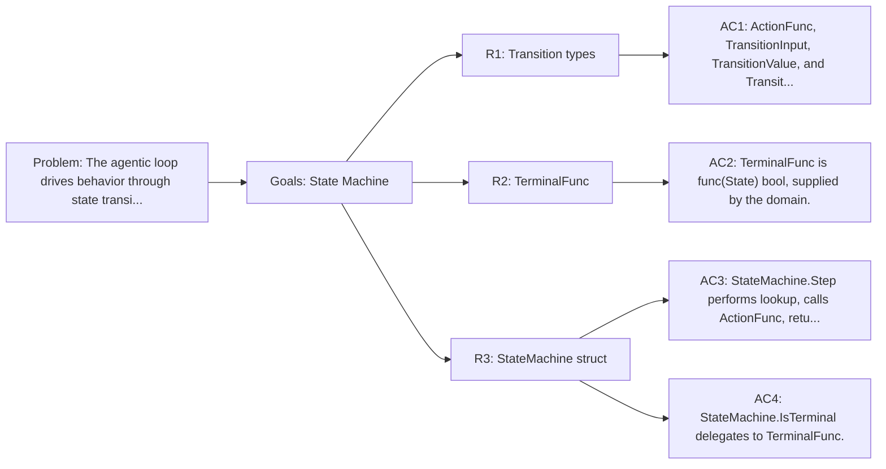

<!-- Copyright (c) 2026 Nokia -->
<!-- SPDX-License-Identifier: BSD-3-Clause -->

<!-- field: problem -->
## Problem

The agentic loop drives behavior through state transitions. Each
(State, Signal) pair maps to a next state and an action that builds
the next Command. Without a formal state machine, transition logic
scatters across if/else chains. Agent-core provides a static
transition table and a Step function that centralizes all transition
logic.

<!-- field: goals -->
## Goals

- G1: Static transition table mapping (State, Signal) pairs to (NextState, ActionFunc).
- G2: Step function performing a single lookup and returning the next state and command.
- G3: Domain-supplied terminal state predicate.

<!-- req: R1 -->
## R1 - Transition types

<!-- req: R1.1 -->
### R1.1

ActionFunc is func(Result) Command. It builds the next Command from the previous Result.

<!-- req: R1.2 -->
### R1.2

TransitionInput holds State and Signal as the lookup key.

<!-- req: R1.3 -->
### R1.3

TransitionValue holds NextState (State) and Action (ActionFunc). Action is nil for terminal transitions.

<!-- req: R1.4 -->
### R1.4

TransitionTable is map[TransitionInput]TransitionValue.

<!-- req: R2 -->
## R2 - TerminalFunc

<!-- req: R2.1 -->
### R2.1

TerminalFunc is func(State) bool, supplied by the domain layer.

<!-- req: R2.2 -->
### R2.2

The state machine does not define which states are terminal. That is the domain's responsibility.

<!-- req: R3 -->
## R3 - StateMachine struct

<!-- req: R3.1 -->
### R3.1

StateMachine holds a TransitionTable and a TerminalFunc. Both are captured at construction time.

<!-- req: R3.2 -->
### R3.2

NewStateMachine(table TransitionTable, isTerminal TerminalFunc) creates a StateMachine.

<!-- req: R3.3 -->
### R3.3

Step(current State, sig Signal, res Result) returns (State, Command, error). Missing entries return State("Failed") and an error.

<!-- req: R3.4 -->
### R3.4

When Action is nil (terminal transition), Step returns nil Command and no error.

<!-- req: R3.5 -->
### R3.5

IsTerminal(State) delegates to the domain-supplied TerminalFunc.

<!-- field: non_goals -->
## Non-goals

- Dynamic table modification during a run.
- Persistence of state machine state between runs.
- Cycle detection or deadlock analysis.

<!-- field: acceptance_criteria -->
## Acceptance criteria

<!-- ac: AC1 -->
### AC1

ActionFunc, TransitionInput, TransitionValue, and TransitionTable are exported types.

<!-- field: traces -->
#### Traces

- R1.1
- R1.2
- R1.3
- R1.4

<!-- ac: AC2 -->
### AC2

TerminalFunc is func(State) bool, supplied by the domain.

<!-- field: traces -->
#### Traces

- R2.1
- R2.2

<!-- ac: AC3 -->
### AC3

StateMachine.Step performs lookup, calls ActionFunc, returns next state and Command. Missing entries return Failed state and error. Terminal transitions return nil Command.

<!-- field: traces -->
#### Traces

- R3.1
- R3.2
- R3.3
- R3.4

<!-- ac: AC4 -->
### AC4

StateMachine.IsTerminal delegates to TerminalFunc.

<!-- field: traces -->
#### Traces

- R3.5

<!-- field: diagrams -->
## Diagrams

<!-- field: requirements_trace -->
### Requirements trace

