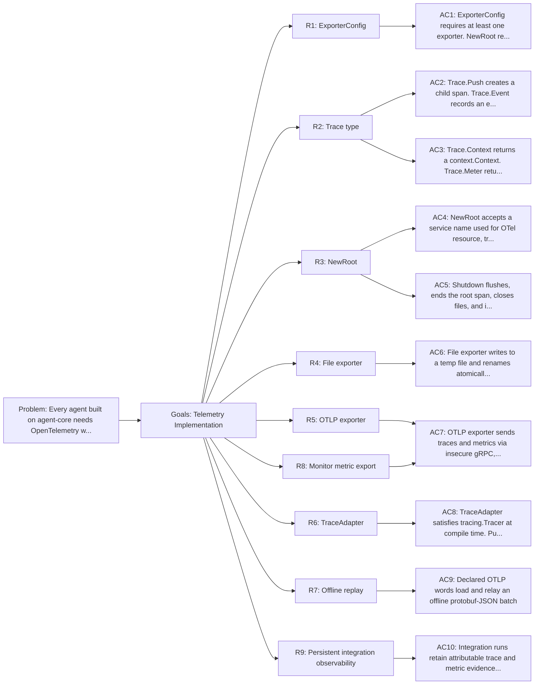

<!-- Copyright (c) 2026 Nokia -->
<!-- SPDX-License-Identifier: BSD-3-Clause -->

<!-- field: problem -->
## Problem

Every agent built on agent-core needs OpenTelemetry wiring: provider
setup, exporter configuration, root span lifecycle, shutdown
sequencing, and an implementation of the Tracer adapter. Without a shared
implementation each agent reimplements the same boilerplate.

<!-- field: goals -->
## Goals

- G1: Provide a ready-to-use OpenTelemetry setup for file and OTLP export.
- G2: Satisfy the internal/observability/tracing.Tracer interface with a TraceAdapter implementation.
- G3: Support offline replay of recorded trace files.
- G4: Provide OpenTelemetry metric export paths that can consume normalized monitor samples.
- G5: Define retained, attributable telemetry for host and kind integration runs through one shared OTLP ingress.

<!-- req: R1 -->
## R1 - ExporterConfig

<!-- req: R1.1 -->
### R1.1

ExporterConfig struct with FilePath, OTLPEndpoint, and MetricOTLPEndpoint string fields.

<!-- req: R1.2 -->
### R1.2

At least one exporter field must be non-empty. NewRoot returns an error otherwise.

<!-- req: R2 -->
## R2 - Trace type

<!-- req: R2.1 -->
### R2.1

Trace struct bundles an OTel tracer, context, and meter. Immutable after construction.

<!-- req: R2.2 -->
### R2.2

Push(name, attrs) starts a child span, returns a new Trace and a done function.

<!-- req: R2.3 -->
### R2.3

Event(name, attrs) records a span event on the current span.

<!-- req: R2.4 -->
### R2.4

SetAttributes(attrs) sets attributes on the current span.

<!-- req: R2.5 -->
### R2.5

Context() returns the underlying context.Context.

<!-- req: R2.6 -->
### R2.6

Meter() returns the OpenTelemetry Meter.

<!-- req: R2.7 -->
### R2.7

RecordError(err) records err on the current span and sets the span status to error.

<!-- req: R3 -->
## R3 - NewRoot

<!-- req: R3.1 -->
### R3.1

NewRoot accepts a service name (string), a root span name (string), ExporterConfig, and parent context.

<!-- req: R3.1b -->
### R3.1b

The service name is used for the OTel resource attribute, tracer name, meter name, and temp file prefix. Each agent supplies its own name (e.g. "generator", "planner").

<!-- req: R3.2 -->
### R3.2

Creates trace and metric providers with the configured exporters.

<!-- req: R3.3 -->
### R3.3

Starts a root span and returns a Trace, shutdown function, and error.

<!-- req: R3.4 -->
### R3.4

The shutdown function flushes providers, ends the root span, and closes file handles.

<!-- req: R3.5 -->
### R3.5

Shutdown is idempotent (sync.Once).

<!-- req: R4 -->
## R4 - File exporter

<!-- req: R4.1 -->
### R4.1

Writes traces and metrics to a temporary file in the target directory.

<!-- req: R4.2 -->
### R4.2

On shutdown, renames the temp file to the final path for atomic delivery.

<!-- req: R5 -->
## R5 - OTLP exporter

<!-- req: R5.1 -->
### R5.1

Sends traces via gRPC to the configured endpoint.

<!-- req: R5.2 -->
### R5.2

Sends metrics via gRPC to MetricOTLPEndpoint when declared, otherwise to OTLPEndpoint for compatibility.

<!-- req: R5.3 -->
### R5.3

Uses insecure credentials (no TLS).

<!-- req: R6 -->
## R6 - TraceAdapter

<!-- req: R6.1 -->
### R6.1

TraceAdapter wraps a Trace to satisfy the tracing.Tracer interface.

<!-- req: R6.2 -->
### R6.2

Push returns a TraceAdapter so the interface return type is met.

<!-- req: R6.3 -->
### R6.3

Compile-time check (var _ tracing.Tracer = TraceAdapter{}).

<!-- req: R7 -->
## R7 - Offline replay

<!-- req: R7.1 -->
### R7.1

A declared load_otlp_batch word reads one trusted OTLP protobuf-JSON file and emits the decoded batch or a distinct read/decode error.

<!-- req: R7.2 -->
### R7.2

A MachineSpec sequences load_otlp_batch before the shared relay_spans boundary; file I/O and network export are separate visible states.

<!-- req: R7.3 -->
### R7.3

Replay is idempotent; replaying the same file produces duplicate spans on the collector.

<!-- req: R7.4 -->
### R7.4

The imperative ReplayFile helper is not part of the telemetry implementation.

<!-- req: R8 -->
## R8 - Monitor metric export

<!-- req: R8.1 -->
### R8.1

Telemetry setup SHALL preserve the existing Tracer interface and span export behavior while exposing a Meter for metric instruments.

<!-- req: R8.2 -->
### R8.2

Monitor metric export SHALL consume normalized samples from the monitor recorder or store instead of reading tool internals.

<!-- req: R8.3 -->
### R8.3

Metric export SHALL use the same service resource identity as tracing so spans and metrics can be correlated by the collector.

<!-- req: R8.4 -->
### R8.4

Metric export SHALL apply the low-cardinality and redaction rules from sm-tool-metrics-monitoring before emitting attributes.

<!-- req: R8.5 -->
### R8.5

Metric export failure SHALL be reported as telemetry or monitor diagnostics and SHALL NOT change command Result.Signal.

<!-- req: R9 -->
## R9 - Persistent integration observability

<!-- req: R9.1 -->
### R9.1

Integration runs SHALL keep the file exporter as deterministic evidence and add OTLP export to the shared integration ingress; live export SHALL NOT replace file assertions.

<!-- req: R9.2 -->
### R9.2

Every integration span and metric SHALL carry repository, module, target or scenario, git commit, and a unique run id as resource identity so concurrent and historical runs remain filterable.

<!-- req: R9.3 -->
### R9.3

Integration service.name values SHALL use stable role names and SHALL add an instance suffix for scaled roles such as RAG agents and Chroma stores.

<!-- req: R9.4 -->
### R9.4

The shared ingress SHALL be an OTLP endpoint contract, not a collector image contract. A conforming ingress SHALL accept OTLP/gRPC trace and metric exports and SHALL remain healthy outside any one integration lifecycle. The canonical realization is the collector agent (srd042), which retains both signals in its spool and serves them from its query surface; no third-party trace or metric backend is required.

<!-- req: R9.5 -->
### R9.5

Integration teardown SHALL NOT delete the shared ingress or its spooled evidence. Trace and metric evidence SHALL remain queryable after host subprocesses and disposable kind clusters stop.

<!-- req: R9.6 -->
### R9.6

A component implementing the shared ingress SHALL NOT export its own telemetry back to that ingress.

<!-- req: R9.7 -->
### R9.7

OTel Logs and native Ollama server tracing are not part of this contract. Agent GenAI client spans represent Ollama calls until Ollama provides a native server signal used by the suite.

<!-- field: non_goals -->
## Non-goals

- TLS or authenticated OTLP connections.
- Defining tool-specific metric meaning; ToolDef declarations and tool families own that vocabulary.
- Custom production resource attributes beyond service name; integration runs add only the bounded identity in R9.2.
- Replacing deterministic file evidence with a live backend.
- Mandating a third-party Collector distribution or metric backend as the integration ingress; the collector agent is the canonical realization of the OTLP contract.
- Introducing OTel Logs or claiming native Ollama server tracing.

<!-- field: acceptance_criteria -->
## Acceptance criteria

<!-- ac: AC1 -->
### AC1

ExporterConfig requires at least one exporter. NewRoot rejects empty config with an error.

<!-- field: traces -->
#### Traces

- R1.1
- R1.2

<!-- ac: AC2 -->
### AC2

Trace.Push creates a child span. Trace.Event records an event. Trace.SetAttributes sets attributes. Trace.RecordError records an error and sets span status.

<!-- field: traces -->
#### Traces

- R2.1
- R2.2
- R2.3
- R2.4
- R2.7

<!-- ac: AC3 -->
### AC3

Trace.Context returns a context.Context. Trace.Meter returns a metric.Meter.

<!-- field: traces -->
#### Traces

- R2.5
- R2.6

<!-- ac: AC4 -->
### AC4

NewRoot accepts a service name used for OTel resource, tracer, meter, and temp file prefix. Creates providers, starts a root span, returns a Trace and shutdown function.

<!-- field: traces -->
#### Traces

- R3.1
- R3.1b
- R3.2
- R3.3

<!-- ac: AC5 -->
### AC5

Shutdown flushes, ends the root span, closes files, and is idempotent.

<!-- field: traces -->
#### Traces

- R3.4
- R3.5

<!-- ac: AC6 -->
### AC6

File exporter writes to a temp file and renames atomically on shutdown.

<!-- field: traces -->
#### Traces

- R4.1
- R4.2

<!-- ac: AC7 -->
### AC7

OTLP exporter sends traces and metrics via insecure gRPC, and monitor metric export preserves tracing behavior, resource identity, redaction, and command results.

<!-- field: traces -->
#### Traces

- R5.1
- R5.2
- R5.3
- R8.1
- R8.2
- R8.3
- R8.4
- R8.5

<!-- ac: AC8 -->
### AC8

TraceAdapter satisfies tracing.Tracer at compile time. Push wraps the child Trace in an adapter.

<!-- field: traces -->
#### Traces

- R6.1
- R6.2
- R6.3

<!-- ac: AC9 -->
### AC9

The offline replay MachineSpec loads a trusted OTLP protobuf-JSON batch and relays it unchanged through declared load and relay words, with distinct file, decode, cancellation, and upstream-rejection failures.

<!-- field: traces -->
#### Traces

- R7.1
- R7.2
- R7.3
- R7.4

<!-- ac: AC10 -->
### AC10

Integration runs dual-export file and OTLP evidence with bounded run identity and stable service names through an implementation-independent OTLP/gRPC ingress whose collector-agent realization retains trace and metric spools queryable after scenario teardown, avoids a telemetry self-loop, and states the OTel Logs and Ollama limitations.

<!-- field: traces -->
#### Traces

- R9.1
- R9.2
- R9.3
- R9.4
- R9.5
- R9.6
- R9.7

<!-- field: related_documents -->
## Related documents

- docs/specs/semantic-models/tool-metrics-monitoring.md

<!-- field: diagrams -->
## Diagrams

<!-- field: requirements_trace -->
### Requirements trace

