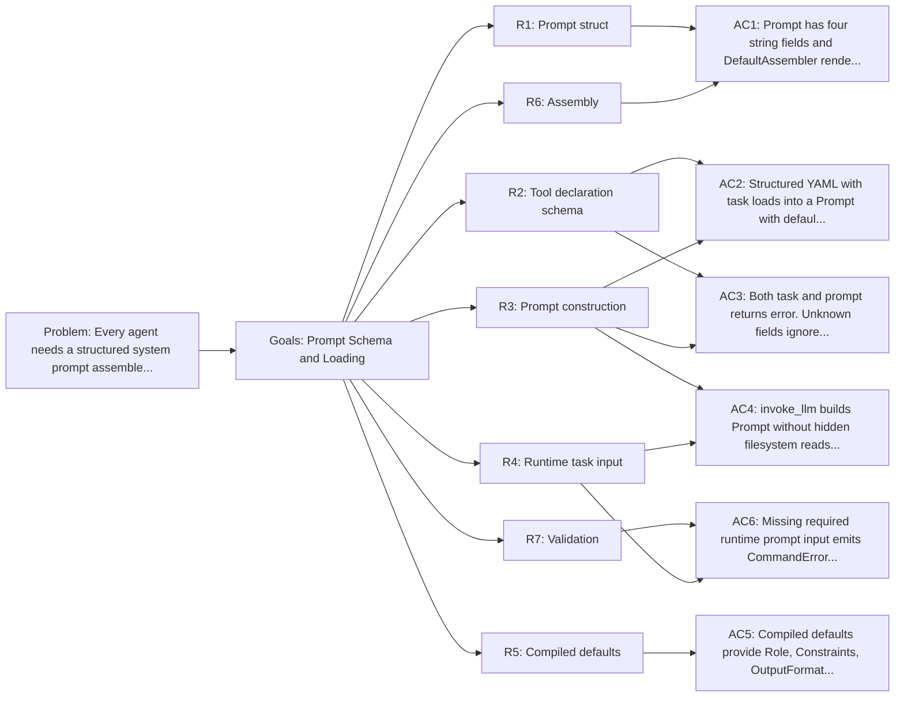

<!-- Copyright (c) 2026 Nokia -->
<!-- SPDX-License-Identifier: BSD-3-Clause -->

<!-- field: problem -->
## Problem

Every agent needs a structured system prompt assembled from multiple
parts: a persona (role), the caller's task, behavioral constraints,
and an output format description. The generator implemented this in
its internal/prompt package with a Prompt struct and compiled defaults.

Without a shared prompt package, each new agent reimplements the same
schema and assembly logic. Moving this to agent-core gives
all agents a consistent prompt format with override points for their
domain-specific defaults.

<!-- field: goals -->
## Goals

- G1: Prompt struct with typed fields for each section of the system message.
- G2: ToolDef config maps structured prompt fields into Prompt.
- G3: Runtime request input supplies the per-run task separately from prompt policy.
- G4: Assembly contract producing the system-role message text.
- G5: Replace generator's internal/prompt package with agent-core internal/model/prompt.

<!-- req: R1 -->
## R1 - Prompt struct

<!-- req: R1.1 -->
### R1.1

Prompt is a Go struct with four string fields: Role, Task, Constraints, OutputFormat.

<!-- req: R1.2 -->
### R1.2

Role is the system persona describing what kind of assistant the LLM is.

<!-- req: R1.3 -->
### R1.3

Task is the caller's objective for the current run.

<!-- req: R1.4 -->
### R1.4

Constraints is a free-text block of behavioral rules.

<!-- req: R1.5 -->
### R1.5

OutputFormat describes the expected response structure.

<!-- req: R2 -->
## R2 - Tool declaration schema

<!-- req: R2.1 -->
### R2.1

invoke_llm ToolDef config MAY declare system_prompt and tool_prompt fields.

<!-- req: R2.2 -->
### R2.2

Runtime request input supplies user task content through the machine data path.

<!-- req: R2.3 -->
### R2.3

Prompt policy and runtime task data SHALL remain distinct.

<!-- req: R2.4 -->
### R2.4

Unknown ToolDef config fields SHALL be rejected by strict config decoding.

<!-- req: R3 -->
## R3 - Prompt construction

<!-- req: R3.1 -->
### R3.1

invoke_llm factory construction maps declared prompt fields into Prompt.

<!-- req: R3.2 -->
### R3.2

Missing optional policy fields select explicit adapter defaults.

<!-- req: R3.3 -->
### R3.3

Runtime task text is appended through Conversation by invoke_llm.

<!-- req: R3.4 -->
### R3.4

Prompt construction performs no hidden filesystem read.

<!-- req: R3.5 -->
### R3.5

The constructed Prompt is consumed by DefaultAssembler.

<!-- req: R4 -->
## R4 - Runtime task input

<!-- req: R4.1 -->
### R4.1

Runtime task text comes from the machine seed, previous result, or declared command-state selector.

<!-- req: R4.2 -->
### R4.2

Missing required runtime input emits CommandError.

<!-- req: R4.3 -->
### R4.3

Runtime input does not choose prompt policy or templates.

<!-- req: R5 -->
## R5 - Compiled defaults

<!-- req: R5.1 -->
### R5.1

DefaultRole describes a general-purpose coding assistant persona.

<!-- req: R5.2 -->
### R5.2

DefaultConstraints provides baseline behavioral rules (JSON-only, single tool per turn, workspace confinement).

<!-- req: R5.3 -->
### R5.3

DefaultOutputFormat describes the expected JSON response structure.

<!-- req: R5.4 -->
### R5.4

Defaults are compiled into the binary. Agents override them with domain-specific values.

<!-- req: R6 -->
## R6 - Assembly

<!-- req: R6.1 -->
### R6.1

DefaultAssembler maps Prompt fields into PromptData and calls RenderSystemPrompt.

<!-- req: R6.2 -->
### R6.2

RenderSystemPrompt uses the embedded template and omits empty optional sections.

<!-- req: R6.3 -->
### R6.3

Rendering is deterministic for fixed PromptData and tool manifest.

<!-- req: R6.4 -->
### R6.4

Custom template parsing is not exposed as an unused runtime surface.

<!-- req: R7 -->
## R7 - Validation

<!-- req: R7.1 -->
### R7.1

Required runtime prompt input SHALL be validated at the invoke_llm boundary.

<!-- req: R7.2 -->
### R7.2

Construction failures return an error rather than a partial command.

<!-- field: non_goals -->
## Non-goals

- System prompt template rendering (srd for system prompt template).
- Tool manifest serialization.
- Conversation history management.
- Loading standalone prompt files or inline prompt strings outside MachineSpec and ToolDef data paths.

<!-- field: acceptance_criteria -->
## Acceptance criteria

<!-- ac: AC1 -->
### AC1

Prompt has four string fields and DefaultAssembler renders them deterministically through the embedded system template.

<!-- field: traces -->
#### Traces

- R1.1
- R1.2
- R1.3
- R1.4
- R1.5
- R6.1
- R6.2
- R6.3
- R6.4

<!-- ac: AC2 -->
### AC2

ToolDef config supplies prompt policy while machine runtime input supplies task data.

<!-- field: traces -->
#### Traces

- R2.1
- R2.2
- R3.1
- R3.2
- R3.3

<!-- ac: AC3 -->
### AC3

Prompt policy and runtime task remain distinct, and unknown ToolDef config fields are rejected.

<!-- field: traces -->
#### Traces

- R2.3
- R2.4
- R3.4

<!-- ac: AC4 -->
### AC4

invoke_llm builds Prompt without hidden filesystem reads and DefaultAssembler consumes it.

<!-- field: traces -->
#### Traces

- R3.5
- R4.1
- R4.3

<!-- ac: AC5 -->
### AC5

Compiled defaults provide Role, Constraints, OutputFormat. They are exported and overridable.

<!-- field: traces -->
#### Traces

- R5.1
- R5.2
- R5.3
- R5.4

<!-- ac: AC6 -->
### AC6

Missing required runtime prompt input emits CommandError without a partial command.

<!-- field: traces -->
#### Traces

- R7.1
- R7.2
- R4.2

<!-- field: diagrams -->
## Diagrams

<!-- field: requirements_trace -->
### Requirements trace

