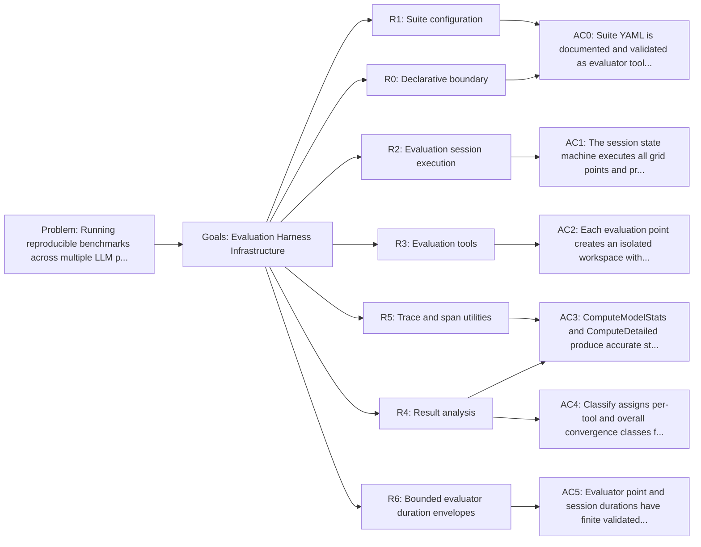

<!-- Copyright (c) 2026 Nokia -->
<!-- SPDX-License-Identifier: BSD-3-Clause -->

<!-- field: problem -->
## Problem

Running reproducible benchmarks across multiple LLM profiles and coding
tasks requires orchestrating workspace preparation, agent subprocess
execution, result validation, metrics collection, and configuration
snapshotting. Without a shared harness, each benchmark script
reimplements this pipeline with inconsistent result formats and no
configuration traceability.

<!-- field: goals -->
## Goals

- G1: Provide a deterministic evaluation pipeline driven by the core state machine.
- G2: Support grid evaluation across agent profiles, samples, grid parameters, and repetitions.
- G3: Capture full experiment configuration alongside results for reproducibility.
- G4: Produce structured metrics (meta.json) and trace data (trace.ndjson) per evaluation point.
- G5: Analyze results with convergence tracking, model statistics, and detailed breakdowns.
- G6: Bound child-point and aggregate-session duration so no valid inner evaluation is preempted by an outer dispatch timeout.

<!-- req: R0 -->
## R0 - Declarative boundary

<!-- req: R0.1 -->
### R0.1

The evaluator program SHALL be defined by agents/critic/machine.yaml, agents/critic/point.yaml, agents/critic/tools.yaml, and tool declarations.

<!-- req: R0.2 -->
### R0.2

Suite YAML SHALL be treated as input data to evaluator tools, not as a third program-definition mechanism.

<!-- req: R0.3 -->
### R0.3

parse_suite_config, discover_suite_samples, expand_eval_grid, init_eval_session, and report_suite_summary SHALL parse and validate suite input data before the evaluator session can iterate points.

<!-- req: R0.4 -->
### R0.4

run_agent SHALL consume each resolved suite profile as subprocess input data for the current evaluation point and SHALL invoke the child agent with --profile when ProfilePath is set.

<!-- req: R0.5 -->
### R0.5

dump_config SHALL snapshot the resolved suite profile, model, harness label, and point configuration into experiment.yaml for reproducibility.

<!-- req: R0.6 -->
### R0.6

init_eval_session SHALL reject an unexpanded grid and SHALL take output_dir, repetitions, and per-point timeout defaults from its ToolDef config; explicit runtime and suite values override those declared defaults.

<!-- req: R1 -->
## R1 - Suite configuration

<!-- req: R1.1 -->
### R1.1

SuiteConfig defines name, profiles, grid parameters, samples directory, timeout, and repetitions. Profile paths are the required suite dimension.

<!-- req: R1.2 -->
### R1.2

SuiteProfile resolves each profile path relative to the suite file, loads the AgentProfile, derives a display name and model from the profile-selected invoke_llm declaration, and uses the agent binary as the harness process.

<!-- req: R1.3 -->
### R1.3

discover_suite_samples SHALL take workspace_dir, doc_dir, prompt_file, shared-prompt fallback, and empty-suite policy from ToolDef config so a different sample layout requires no Go change.

<!-- req: R1.4 -->
### R1.4

LoadSuite reads a YAML suite file and resolves samples relative to the suite's base directory.

<!-- req: R1.5 -->
### R1.5

expandGrid generates the Cartesian product of all grid parameter values.

<!-- req: R1.6 -->
### R1.6

Suite parsing SHALL reject suites without profiles and SHALL reject obsolete suite fields that bypass profile-selected runtime configuration.

<!-- req: R1.7 -->
### R1.7

Suite YAML SHALL NOT define child binary flags directly; each referenced profile owns its machine, tool selection, declarations, and boundary-tool config.

<!-- req: R2 -->
## R2 - Evaluation session execution

<!-- req: R2.1 -->
### R2.1

The session state machine (agents/critic/machine.yaml) initializes the suite, materializes points in (profile, gridPoint, sample, repetition) order, and declares sequential fail-fast for_each dispatch through run_point before report_session; run_point SHALL pass the parent tracer into the nested loop.

<!-- req: R2.2 -->
### R2.2

PointContext holds per-point mutable state (directories, trace path, tokens, results, timing).

<!-- req: R2.3 -->
### R2.3

EvalState is the shared state container whose PC field is updated before each point's loop run.

<!-- req: R2.4 -->
### R2.4

SessionResult and PointResult capture aggregate and per-point outcomes.

<!-- req: R2.5 -->
### R2.5

run_point SHALL require point_machine, point_tools, and point_tool_declarations in its tool config and fail registration when any field is missing.

<!-- req: R3 -->
## R3 - Evaluation tools

<!-- req: R3.1 -->
### R3.1

agents/critic/point.yaml SHALL express workspace preparation as separate tools: create_point_dir, copy_dir, sample_docs, git_init, stage_all, and commit_workspace_baseline.

<!-- req: R3.1.1 -->
### R3.1.1

create_point_dir SHALL create the point directory, set PointContext.PointDir, PointContext.TracePath, and PointContext.ResultPath, and emit copy_dir source and destination parameters.

<!-- req: R3.1.2 -->
### R3.1.2

copy_dir SHALL copy only sample workspace files into PointContext.PointDir through the shared exec runtime.

<!-- req: R3.1.3 -->
### R3.1.3

sample_docs SHALL expose whether docs exist and emit shared copy_dir parameters when present; point.yaml SHALL invoke copy_dir only on the present branch.

<!-- req: R3.1.4 -->
### R3.1.4

git_init SHALL initialize git only in PointContext.PointDir through the shared exec runtime.

<!-- req: R3.1.5 -->
### R3.1.5

stage_all SHALL stage all current point workspace files through the shared exec runtime.

<!-- req: R3.1.6 -->
### R3.1.6

commit_workspace_baseline SHALL be a profile-configured exec alias that creates the baseline commit with deterministic local identity.

<!-- req: R3.2 -->
### R3.2

rev_parse and record_agent_commit resolve commit provenance through the selected exec declaration before dump_config serializes it with the resolved profile path, harness label, model, timeout, repetition, and sample into experiment.yaml.

<!-- req: R3.3 -->
### R3.3

run_agent executes the harness binary as a subprocess with timeout and OTel context, passing --profile <path> for each point. It records exit code, timing, and timeout in PointContext and emits the result-artifact write parameters (path=result.json, content=child stdout); a following declared write transition persists result.json, so run_agent performs no filesystem write of its own (GH-1378).

<!-- req: R3.4 -->
### R3.4

run_oracle_check SHALL be a profile-configured exec declaration whose command and package arguments are not hard-coded in Go; record_oracle_result SHALL map ToolDone or ToolFailed and command output into PointContext independently from trace parsing.

<!-- req: R3.5 -->
### R3.5

collect_trace_tokens parses trace files for token counts and treats a missing trace as a successful zero-token result.

<!-- req: R3.6 -->
### R3.6

check_agent_version compares configured harness version with traced agent version and emits a warning signal on mismatch.

<!-- req: R3.7 -->
### R3.7

summarize_point_results emits ResultsCollected after oracle, trace, and version fields are populated.

<!-- req: R3.8 -->
### R3.8

collect_metrics writes meta.json with exit code, duration, test results, token counts, and convergence data; it SHALL reject an empty point directory, build the path with filepath.Join, and limit receipt-driven removal to the declared owned root.

<!-- req: R3.9 -->
### R3.9

Every point CommandError or infrastructure ToolFailed edge before metrics SHALL route through record_point_failure and collect_metrics before Failed; run_point SHALL perform no direct artifact write, SHALL declare its session-state mutation and stderr progress effects, and SHALL emit CommandError for nested-loop engine failures.

<!-- req: R4 -->
## R4 - Result analysis

<!-- req: R4.1 -->
### R4.1

LoadMultiple reads meta.json and trace.ndjson from session directories into EvalRunResult groups.

<!-- req: R4.2 -->
### R4.2

ComputeModelStats aggregates per-model success rate, clean rate, recovery rate, stuck rate, mean iterations, tokens, and duration.

<!-- req: R4.3 -->
### R4.3

ComputeDetailed produces per-sample-per-model breakdowns.

<!-- req: R4.4 -->
### R4.4

Classify reads provider-neutral structured tool.metrics snapshots for any declared tool name and assigns each tool progression one of six classes (Clean, Converged, Improving, Flat, Regressing, NoData) plus a single overall class per run; no Go-specific output regex or fixed tool-name allowlist participates.

<!-- req: R4.5 -->
### R4.5

Result loading SHALL report missing, unreadable, malformed, duplicate, or partial point artifacts explicitly while retaining any independently valid partial groups.

<!-- req: R4.6 -->
### R4.6

The release evaluator gate SHALL report each failed point's failure stage and cause and SHALL fail when any attempted benchmark point fails.

<!-- req: R5 -->
## R5 - Trace and span utilities

<!-- req: R5.1 -->
### R5.1

ReadTraceFile parses OTLP JSON ndjson files into Span structs.

<!-- req: R5.2 -->
### R5.2

ExtractToolSnapshots extracts ordered tool call summaries from spans.

<!-- req: R5.3 -->
### R5.3

StrAttr and IntAttr extract typed attribute values from spans.

<!-- req: R5.4 -->
### R5.4

AgentVersion extracts the agent.version attribute from trace spans.

<!-- req: R6 -->
## R6 - Bounded evaluator duration envelopes

<!-- req: R6.1 -->
### R6.1

The resolved per-point child runtime timeout SHALL parse strictly as a positive finite duration no greater than 15 minutes. init_eval_session SHALL validate the effective value after ToolDef defaults and suite overrides are resolved.

<!-- req: R6.2 -->
### R6.2

Before creating session artifacts, init_eval_session SHALL calculate the aggregate child runtime as resolved profiles × grid points × samples × repetitions × per-point timeout. It SHALL reject arithmetic overflow and totals greater than 24 hours.

<!-- req: R6.3 -->
### R6.3

run_point SHALL load the point MachineSpec and propagate its budget.command_timeout into the nested LoopParams.CommandTimeout. The point-machine command timeout SHALL exceed the 15-minute child runtime authority by at least one minute so run_agent can consume the full valid child deadline without the point dispatcher cancelling it first.

<!-- req: R6.4 -->
### R6.4

The critic session's run_point dispatch is a sibling outer envelope over the same 15-minute child authority. It SHALL also reserve at least one minute for scheduling, workspace preparation, result persistence, oracle execution, trace and metric collection, and point cleanup. The critic point-machine and session run_point bounds need not be ordered relative to each other.

<!-- req: R6.5 -->
### R6.5

The bench child-session dispatch SHALL exceed the 24-hour aggregate-session authority by at least one hour for session initialization, summary reporting, artifact finalization, and cleanup.

<!-- req: R6.6 -->
### R6.6

Deterministic zero-sleep tests SHALL prove point-timeout propagation, invalid and excessive duration rejection, overflow rejection, and the critic and bench outer-envelope relationships.

<!-- field: non_goals -->
## Non-goals

- LLM-based evaluation (the evaluator is deterministic, no LLM calls).
- Parallel point execution within a single session.
- Automatic LLM artifact management.
- REST machine_request timeout propagation, which is governed by srd030-machine-request-rest-binding.

<!-- field: acceptance_criteria -->
## Acceptance criteria

<!-- ac: AC1 -->
### AC1

The session state machine executes all grid points and produces SessionResult with correct pass/fail/timeout counts.

<!-- field: traces -->
#### Traces

- [R2.1](#r21)
- [R2.2](#r22)
- [R2.3](#r23)
- [R2.4](#r24)
- [R2.5](#r25)

<!-- ac: AC0 -->
### AC0

Suite YAML is documented and validated as evaluator tool input data, with session setup/run_agent/dump_config boundaries clear.

<!-- field: traces -->
#### Traces

- [R0.1](#r01)
- [R0.2](#r02)
- [R0.3](#r03)
- [R0.4](#r04)
- [R0.5](#r05)
- [R0.6](#r06)
- [R1.1](#r11)
- [R1.2](#r12)
- [R1.3](#r13)
- [R1.4](#r14)
- [R1.5](#r15)
- [R1.6](#r16)
- [R1.7](#r17)

<!-- ac: AC2 -->
### AC2

Each evaluation point creates an isolated workspace with git baseline, experiment.yaml config snapshot, trace.ndjson, and meta.json.

<!-- field: traces -->
#### Traces

- [R3.1](#r31)
- [R3.1.1](#r311)
- [R3.1.2](#r312)
- [R3.1.3](#r313)
- [R3.1.4](#r314)
- [R3.1.5](#r315)
- [R3.1.6](#r316)
- [R3.2](#r32)
- [R3.3](#r33)
- [R3.4](#r34)
- [R3.5](#r35)
- [R3.6](#r36)
- [R3.7](#r37)
- [R3.8](#r38)
- [R3.9](#r39)

<!-- ac: AC3 -->
### AC3

Result loading reports incomplete or duplicate point artifacts without silently omitting them, and ComputeModelStats and ComputeDetailed produce accurate statistics from valid session results.

<!-- field: traces -->
#### Traces

- [R4.1](#r41)
- [R4.2](#r42)
- [R4.3](#r43)
- [R4.4](#r44)
- [R4.5](#r45)
- [R4.6](#r46)
- [R5.1](#r51)
- [R5.2](#r52)
- [R5.3](#r53)
- [R5.4](#r54)

<!-- ac: AC4 -->
### AC4

Classify correctly assigns per-tool and overall convergence classes from a run's tool-metric snapshots, and ComputeModelStats derives the recovery and stuck rates consistently from those classes.

<!-- field: traces -->
#### Traces

- [R4.4](#r44)

<!-- ac: AC5 -->
### AC5

Evaluator point and session durations have finite validated authorities, nested point dispatch uses the point MachineSpec timeout, and outer critic and bench boundaries retain explicit processing margin.

<!-- field: traces -->
#### Traces

- [R6.1](#r61)
- [R6.2](#r62)
- [R6.3](#r63)
- [R6.4](#r64)
- [R6.5](#r65)
- [R6.6](#r66)

<!-- field: diagrams -->
## Diagrams

<!-- field: requirements_trace -->
### Requirements trace

