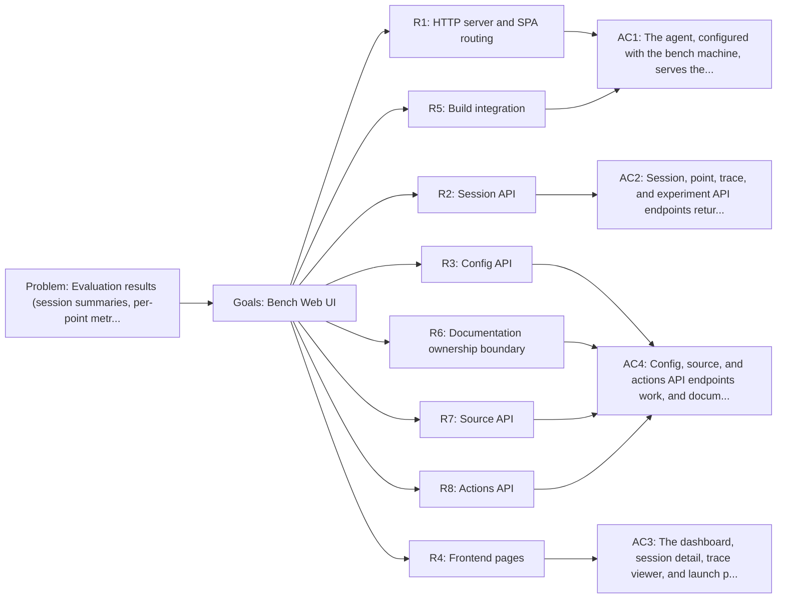

<!-- Copyright (c) 2026 Nokia -->
<!-- SPDX-License-Identifier: BSD-3-Clause -->

<!-- field: problem -->
## Problem

Evaluation results (session summaries, per-point metrics, trace
timelines, experiment configurations) are stored as JSON and YAML
files across nested directories. Without a visualization layer,
analyzing benchmark outcomes requires manual file inspection and
ad-hoc scripting.

<!-- field: goals -->
## Goals

- G1: Serve a profile-owned web UI for interactive evaluation result exploration.
- G2: Declare REST and machine_request endpoints for session, point, trace, experiment, config, source, and action data.
- G3: Keep application assets, routes, and workflow outside the universal Go runtime.
- G4: Display LLM configuration profiles and agent configs alongside results.

<!-- req: R1 -->
## R1 - HTTP server and SPA routing

<!-- req: R1.1 -->
### R1.1

The bench web UI is started via `agent --profile "$AGENT_CATALOG_ROOT/agents/bench/profile.yaml"`. The profile launches the generic REST server and awaits operator events through its host MachineSpec.

<!-- req: R1.2 -->
### R1.2

API routes are namespaced under /api/v1/.

<!-- req: R1.3 -->
### R1.3

Non-API routes serve profile-owned static assets with SPA fallback to index.html (200 OK).

<!-- req: R1.4 -->
### R1.4

The agent binary SHALL NOT embed or import bench frontend assets.

<!-- req: R2 -->
## R2 - Session API

<!-- req: R2.1 -->
### R2.1

GET /api/v1/sessions lists all sessions with pass/fail/timeout counts.

<!-- req: R2.2 -->
### R2.2

GET /api/v1/sessions/{suite}/{ts} returns session detail with model stats and sample stats.

<!-- req: R2.3 -->
### R2.3

GET /api/v1/sessions/{suite}/{ts}/points lists all evaluation points with metrics.

<!-- req: R2.4 -->
### R2.4

GET /api/v1/sessions/{suite}/{ts}/points/{pointId} returns trace data with spans and snapshots.

<!-- req: R2.5 -->
### R2.5

GET /api/v1/sessions/{suite}/{ts}/points/{pointId}/experiment returns the parsed experiment.yaml config.

<!-- req: R2.6 -->
### R2.6

Non-existent data directories return empty arrays, not 500 errors.

<!-- req: R3 -->
## R3 - Config API

<!-- req: R3.1 -->
### R3.1

GET /api/v1/configs lists available configuration files.

<!-- req: R3.2 -->
### R3.2

GET /api/v1/configs/{path} returns the contents of a config file.

<!-- req: R3.3 -->
### R3.3

GET /api/v1/profiles lists available LLM response profiles.

<!-- req: R4 -->
## R4 - Frontend pages

<!-- req: R4.1 -->
### R4.1

Dashboard page lists sessions as cards with pass rate bars.

<!-- req: R4.2 -->
### R4.2

Session detail page shows model leaderboard table, pass count chart, and sample-model heatmap.

<!-- req: R4.3 -->
### R4.3

Trace viewer page shows experiment configuration panel and tool call timeline.

<!-- req: R4.4 -->
### R4.4

Experiment config panel displays model, harness, budget, LLM config (including system prompt), state machine states, registered tools, and expandable transitions table.

<!-- req: R4.5 -->
### R4.5

Launch page allows configuring and launching evaluation suites via the bench state machine.

<!-- req: R4.6 -->
### R4.6

Documentation browsing is outside the bench UI and belongs to the Knowledge Manager documentation-curator profile.

<!-- req: R5 -->
## R5 - Build integration

<!-- req: R5.1 -->
### R5.1

The frontend builds from applications/catalog/agents/bench/ui and emits profile-owned dist assets.

<!-- req: R5.2 -->
### R5.2

Core builds and audits do not require production build tags or bench asset embedding.

<!-- req: R6 -->
## R6 - Documentation ownership boundary

<!-- req: R6.1 -->
### R6.1

The bench server SHALL NOT mount /api/v1/docs routes.

<!-- req: R6.2 -->
### R6.2

Documentation browsing and documentation REST workflows belong to agents/knowledge-manager/documentation-curator/profile.yaml.

<!-- req: R7 -->
## R7 - Source API

<!-- req: R7.1 -->
### R7.1

GET /api/v1/source/{path} serves source code files with language metadata.

<!-- req: R7.2 -->
### R7.2

Path traversal outside the source root is rejected.

<!-- req: R7.3 -->
### R7.3

Only allowed file extensions (.go, .yaml, .ts, .tsx, etc.) are served.

<!-- req: R8 -->
## R8 - Actions API

<!-- req: R8.1 -->
### R8.1

POST /api/v1/actions accepts UserAction payloads from the frontend.

<!-- req: R8.2 -->
### R8.2

Allowed launch and shutdown signals enter the generic REST event queue.

<!-- req: R8.3 -->
### R8.3

Launch input is validated by value_predicate and dispatched through self_invoke with request cancellation and trace propagation.

<!-- field: non_goals -->
## Non-goals

- Real-time streaming of in-progress evaluations.
- Editing configurations through the UI.
- User authentication or multi-tenancy.

<!-- field: acceptance_criteria -->
## Acceptance criteria

<!-- ac: AC1 -->
### AC1

The agent, configured with the bench profile, serves profile-owned React assets and API routes through the generic REST runtime.

<!-- field: traces -->
#### Traces

- R1.1
- R1.2
- R1.3
- R1.4
- R5.1
- R5.2

<!-- ac: AC2 -->
### AC2

Session, point, trace, and experiment API endpoints return correct data from the eval-results directory structure.

<!-- field: traces -->
#### Traces

- R2.1
- R2.2
- R2.3
- R2.4
- R2.5
- R2.6

<!-- ac: AC3 -->
### AC3

The dashboard, session detail, trace viewer, and launch pages render, and documentation browsing is absent from bench.

<!-- field: traces -->
#### Traces

- R4.1
- R4.2
- R4.3
- R4.4
- R4.5
- R4.6

<!-- ac: AC4 -->
### AC4

Config, source, and actions API endpoints work, and documentation API routes are not mounted by bench.

<!-- field: traces -->
#### Traces

- R3.1
- R3.2
- R3.3
- R6.1
- R6.2
- R7.1
- R7.2
- R7.3
- R8.1
- R8.2
- R8.3

<!-- field: diagrams -->
## Diagrams

<!-- field: requirements_trace -->
### Requirements trace

