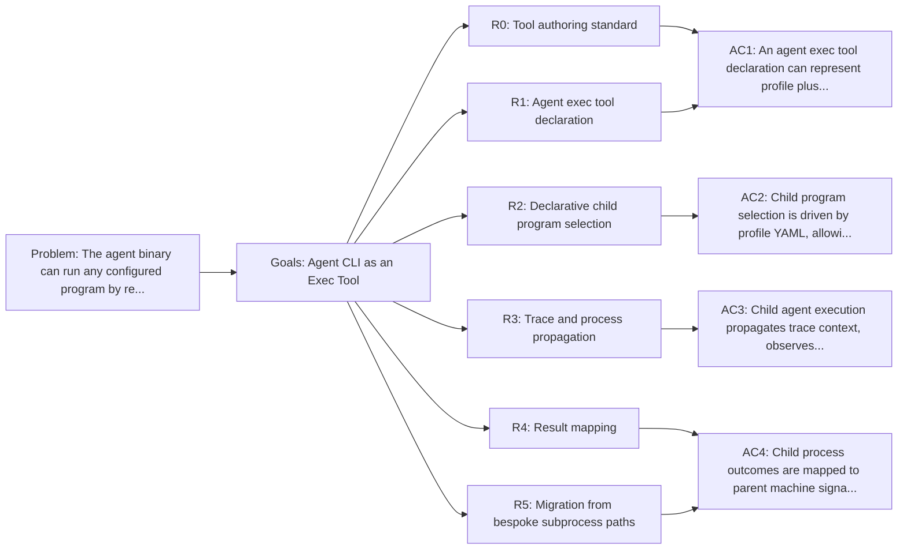

<!-- Copyright (c) 2026 Nokia -->
<!-- SPDX-License-Identifier: BSD-3-Clause -->

<!-- field: problem -->
## Problem

The agent binary can run any configured program by receiving a profile.
Child-agent workflows use self_invoke and profile aliases such as invoke_executor;
still need one shared subprocess contract. Treating `agent` as a configured
exec tool keeps child programs declarative. A parent state machine invokes a
boundary tool whose config names the child profile.

<!-- field: goals -->
## Goals

- G1: Declare the agent binary as an exec tool with a complete parameter schema for child program invocation.
- G2: Keep child program selection in profile YAML.
- G3: Preserve telemetry propagation, working directory isolation, and artifact configuration across parent-child agent runs.
- G4: Provide the requirements basis for replacing bespoke subprocess builders with self_invoke aliases.

<!-- req: R0 -->
## R0 - Tool authoring standard

<!-- req: R0.1 -->
### R0.1

The agent CLI tool declaration SHOULD follow cfg-tool-authoring-standard, with category boundary when it launches a child program or nested machine.

<!-- req: R0.2 -->
### R0.2

Agent CLI invocations SHOULD declare child process side effects, workspace effects, telemetry artifacts, reversibility, undo or compensation, and relationship metadata.

<!-- req: R1 -->
## R1 - Agent exec tool declaration

<!-- req: R1.1 -->
### R1.1

The agent CLI tool declaration SHALL use type exec and binary agent, or an explicitly configured binary path.

<!-- req: R1.2 -->
### R1.2

The declaration SHALL expose a profile parameter mapped to --profile.

<!-- req: R1.3 -->
### R1.3

The declaration SHALL NOT expose machine, tools, or repeated tools-declaration parameters as normal child invocation fields.

<!-- req: R1.4 -->
### R1.4

The declaration SHALL expose --directory for the child workspace root.

<!-- req: R1.5 -->
### R1.5

The declaration SHOULD expose runtime data parameters such as --request and --output.

<!-- req: R1.6 -->
### R1.6

The declaration SHALL NOT expose model or provider overrides as child startup parameters; boundary tool config owns them through the child profile.

<!-- req: R1.7 -->
### R1.7

The declaration SHOULD expose telemetry parameters such as --otel-log-file and --otel-parent-span.

<!-- req: R2 -->
## R2 - Declarative child program selection

<!-- req: R2.1 -->
### R2.1

Parent tools that run child agents SHALL receive a child profile path from YAML tool configuration, not hardcoded Go constants.

<!-- req: R2.2 -->
### R2.2

The referenced child profile SHALL own all program-shaping paths, including machine, tool selection, declarations, tool config directories, and LLM config.

<!-- req: R2.3 -->
### R2.3

A parent state machine SHOULD be able to swap the child program by changing only YAML configuration.

<!-- req: R2.4 -->
### R2.4

Child invocation defaults, when present, SHALL be documented as defaults and validated before execution.

<!-- req: R2.5 -->
### R2.5

Legacy child machine/tools/tools_declarations fields are implementation drift and SHALL NOT appear in new examples.

<!-- req: R3 -->
## R3 - Trace and process propagation

<!-- req: R3.1 -->
### R3.1

Child agent invocation SHALL propagate W3C traceparent when the parent context carries a valid span.

<!-- req: R3.2 -->
### R3.2

The child agent SHOULD receive an --otel-log-file path when trace file capture is required.

<!-- req: R3.3 -->
### R3.3

Child execution SHALL preserve cancellation semantics from the parent command context.

<!-- req: R3.4 -->
### R3.4

Child stdout, stderr, exit code, and duration SHALL be captured and mapped to a core.Result.

<!-- req: R4 -->
## R4 - Result mapping

<!-- req: R4.1 -->
### R4.1

Successful child agent exit SHALL map to a success signal appropriate to the parent machine.

<!-- req: R4.2 -->
### R4.2

Failed child agent exit SHALL map to a failure signal appropriate to the parent machine.

<!-- req: R4.3 -->
### R4.3

Infrastructure errors in launching the child process SHALL map to CommandError.

<!-- req: R4.4 -->
### R4.4

The mapping from child process outcome to parent signal SHOULD be declared or configured rather than embedded in multiple bespoke Go implementations.

<!-- req: R5 -->
## R5 - Migration from bespoke subprocess paths

<!-- req: R5.1 -->
### R5.1

Profile-specific child launches SHOULD be expressible as configured self_invoke words.

<!-- req: R5.2 -->
### R5.2

Planner executor launch SHOULD be a configured self_invoke alias.

<!-- req: R5.3 -->
### R5.3

self_invoke SHOULD use the same configured agent exec tool contract.

<!-- req: R5.4 -->
### R5.4

Duplicate child-agent argument-building logic SHOULD be removed once the exec declaration covers profile plus runtime data and telemetry flags.

<!-- req: R5.5 -->
### R5.5

self_invoke SHALL support profile-owned request and output selectors without application-specific child launchers.

<!-- field: non_goals -->
## Non-goals

- Defining the generic exec tool implementation; see srd013 and the CLI/exec tool SRD work.
- Defining every possible agent mode's child machine configuration.
- Requiring the agent binary to be globally installed when a configured binary path is provided.

<!-- field: acceptance_criteria -->
## Acceptance criteria

<!-- ac: AC1 -->
### AC1

An agent exec tool declaration can represent profile plus runtime data and telemetry flags without normal machine/tools/tools-declaration or model/provider startup flags.

<!-- field: traces -->
#### Traces

- [R0.1](#r01)
- [R0.2](#r02)
- [R1.1](#r11)
- [R1.2](#r12)
- [R1.3](#r13)
- [R1.4](#r14)
- [R1.5](#r15)
- [R1.6](#r16)
- [R1.7](#r17)

<!-- ac: AC2 -->
### AC2

Child program selection is driven by profile YAML, allowing the child machine/tools/declarations to change without recompiling Go code.

<!-- field: traces -->
#### Traces

- [R2.1](#r21)
- [R2.2](#r22)
- [R2.3](#r23)
- [R2.4](#r24)
- [R2.5](#r25)

<!-- ac: AC3 -->
### AC3

Child agent execution propagates trace context, observes parent cancellation, and captures stdout/stderr/exit/duration.

<!-- field: traces -->
#### Traces

- [R3.1](#r31)
- [R3.2](#r32)
- [R3.3](#r33)
- [R3.4](#r34)

<!-- ac: AC4 -->
### AC4

Child process outcomes are mapped to parent machine signals without duplicating argument-building logic across self_invoke aliases.

<!-- field: traces -->
#### Traces

- [R4.1](#r41)
- [R4.2](#r42)
- [R4.3](#r43)
- [R4.4](#r44)
- [R5.1](#r51)
- [R5.2](#r52)
- [R5.3](#r53)
- [R5.4](#r54)
- [R5.5](#r55)

<!-- field: implementation_follow_up | form: "typed table" -->
## Implementation follow up

| issue | title | packages |
| --- | --- | --- |
| agent-core-94su.5 | Remove legacy child-agent config paths | [internal/support/execute, internal/tools/catalog, internal/tools/control, internal/planning/pipeline, external profile child-launch declarations] |

<!-- field: related_documents -->
## Related documents

- cfg-tool-authoring-standard

<!-- field: diagrams -->
## Diagrams

<!-- field: requirements_trace -->
### Requirements trace

