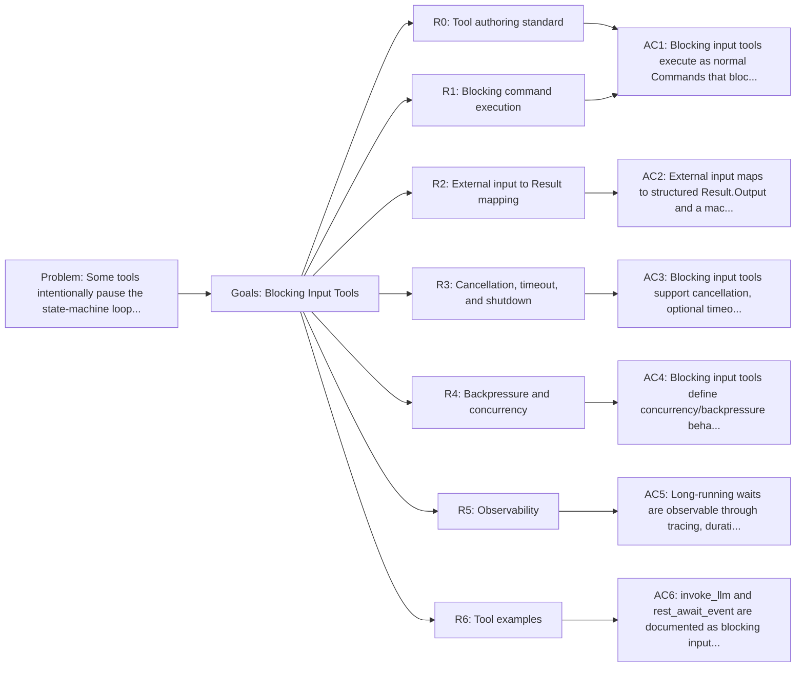

<!-- Copyright (c) 2026 Nokia -->
<!-- SPDX-License-Identifier: BSD-3-Clause -->

<!-- field: problem -->
## Problem

Some tools intentionally pause the state-machine loop while waiting for
an external actor. invoke_llm waits for a model response. rest_await_event
waits for a human action submitted through profile-configured HTTP routes. Future approval or
human-input tools will have the same shape. Without an explicit contract,
these tools can blur the boundary between "tool execution" and "program
control flow", leading to inconsistent cancellation, signal mapping, and
observability.

<!-- field: goals -->
## Goals

- G1: Define the execution contract for tools that block while collecting external input.
- G2: Define how external input maps to core.Result output and Signal.
- G3: Define cancellation, timeout, shutdown, and backpressure expectations.
- G4: Define state-machine routing expectations for signals returned by blocking input tools.
- G5: Define observability expectations for long-running tools.

<!-- req: R0 -->
## R0 - Tool authoring standard

<!-- req: R0.1 -->
### R0.1

Blocking input tool declarations SHOULD follow cfg-tool-authoring-standard for vocabulary category, problem, goals, requirements, non-goals, output, side effects, reversibility, undo, errors, and relationships.

<!-- req: R0.2 -->
### R0.2

Blocking input tools SHOULD be classified as boundary tools when they wait on a model, human, approval gate, server, or other external actor.

<!-- req: R0.3 -->
### R0.3

Blocking input tools SHOULD keep workflow sequencing in machine.yaml transitions and return one declared Signal per completed external interaction.

<!-- req: R1 -->
## R1 - Blocking command execution

<!-- req: R1.1 -->
### R1.1

A blocking input tool SHALL implement core.Command and block inside Execute until input arrives, the context is cancelled, or a configured timeout/shutdown condition occurs.

<!-- req: R1.2 -->
### R1.2

A blocking input tool SHALL keep ownership of the external wait mechanism inside the tool, not inside core.Loop.

<!-- req: R1.3 -->
### R1.3

core.Loop SHALL continue to treat the blocking tool like any other command: dispatch once, receive one core.Result, then transition on the returned Signal.

<!-- req: R1.4 -->
### R1.4

Blocking behavior SHALL be visible in tool documentation and tool declaration descriptions.

<!-- req: R2 -->
## R2 - External input to Result mapping

<!-- req: R2.1 -->
### R2.1

External input SHALL be converted into core.Result.Output in a machine-consumable format, such as JSON for structured actions.

<!-- req: R2.2 -->
### R2.2

External input SHALL be converted into a Signal that is declared in the active machine.

<!-- req: R2.3 -->
### R2.3

Invalid input SHALL return CommandError or another explicitly documented failure signal.

<!-- req: R2.4 -->
### R2.4

Blocking input tools SHOULD declare possible emitted signals once emitted-signal contracts are supported by tool declarations.

<!-- req: R3 -->
## R3 - Cancellation, timeout, and shutdown

<!-- req: R3.1 -->
### R3.1

Blocking input tools SHALL observe parent context cancellation when a context is available.

<!-- req: R3.2 -->
### R3.2

Blocking input tools MAY define a timeout, mapped to a documented timeout/failure signal.

<!-- req: R3.3 -->
### R3.3

Blocking input tools that expose servers or channels SHALL support orderly shutdown.

<!-- req: R3.4 -->
### R3.4

Shutdown input from an external actor SHOULD map to an explicit machine signal such as Shutdown.

<!-- req: R3.5 -->
### R3.5

Cancellation and shutdown SHALL not leave goroutines, sockets, or child processes running.

<!-- req: R4 -->
## R4 - Backpressure and concurrency

<!-- req: R4.1 -->
### R4.1

Blocking input tools SHALL define their pending input policy: one pending input or multiple queued inputs.

<!-- req: R4.2 -->
### R4.2

If only one pending input is supported, additional input SHOULD be rejected or backpressured with a clear response.

<!-- req: R4.3 -->
### R4.3

Long-running tools SHALL avoid unbounded queues unless explicitly configured.

<!-- req: R4.4 -->
### R4.4

State-machine transitions SHALL remain sequential even if the external input source is concurrent.

<!-- req: R5 -->
## R5 - Observability

<!-- req: R5.1 -->
### R5.1

Blocking input tools SHOULD trace wait start, input receipt, cancellation, timeout, and shutdown events.

<!-- req: R5.2 -->
### R5.2

Long waits SHOULD include enough span attributes to identify the tool, input source, and resulting signal.

<!-- req: R5.3 -->
### R5.3

Sensitive external input SHOULD be redacted or included only when verbose tracing is explicitly enabled.

<!-- req: R5.4 -->
### R5.4

Tool duration SHALL reflect the full wait time.

<!-- req: R5.5 -->
### R5.5

Blocking input tools MAY declare specialized monitor metrics for wait duration, cancellation count, timeout count, queue depth, response size, and actor-specific safe counters.

<!-- req: R5.6 -->
### R5.6

Blocking input metrics SHALL use configured low-cardinality attributes and SHALL NOT use raw prompts, full model responses, human-entered text, secrets, or unbounded paths as labels.

<!-- req: R6 -->
## R6 - Tool examples

<!-- req: R6.1 -->
### R6.1

invoke_llm is a blocking input tool whose external actor is an LLM provider; model output is parsed into tool calls or completion signals.

<!-- req: R6.2 -->
### R6.2

rest_await_event is a blocking input tool whose external actor uses a configured REST route; queued actions map to declared machine signals.

<!-- req: R6.3 -->
### R6.3

Future human approval tools SHOULD follow the same Result and Signal mapping contract.

<!-- field: non_goals -->
## Non-goals

- Defining the HTTP API for Bench; see srd020.
- Defining the LLM provider protocol; see srd009.
- Making core.Loop concurrent.

<!-- field: acceptance_criteria -->
## Acceptance criteria

<!-- ac: AC1 -->
### AC1

Blocking input tools execute as normal Commands that block until input, cancellation, timeout, or shutdown and then return one Result.

<!-- field: traces -->
#### Traces

- [R0.1](#r01)
- [R0.2](#r02)
- [R0.3](#r03)
- [R1.1](#r11)
- [R1.2](#r12)
- [R1.3](#r13)
- [R1.4](#r14)

<!-- ac: AC2 -->
### AC2

External input maps to structured Result.Output and a machine-declared Signal, with invalid input mapped to a documented failure path.

<!-- field: traces -->
#### Traces

- [R2.1](#r21)
- [R2.2](#r22)
- [R2.3](#r23)
- [R2.4](#r24)

<!-- ac: AC3 -->
### AC3

Blocking input tools support cancellation, optional timeout, orderly shutdown, and no leaked resources.

<!-- field: traces -->
#### Traces

- [R3.1](#r31)
- [R3.2](#r32)
- [R3.3](#r33)
- [R3.4](#r34)
- [R3.5](#r35)

<!-- ac: AC4 -->
### AC4

Blocking input tools define concurrency/backpressure behavior while preserving sequential state-machine transitions.

<!-- field: traces -->
#### Traces

- [R4.1](#r41)
- [R4.2](#r42)
- [R4.3](#r43)
- [R4.4](#r44)

<!-- ac: AC5 -->
### AC5

Long-running waits are observable through tracing, duration, resulting signal, optional redacted input metadata, and configured monitor metrics with safe labels.

<!-- field: traces -->
#### Traces

- [R5.1](#r51)
- [R5.2](#r52)
- [R5.3](#r53)
- [R5.4](#r54)
- [R5.5](#r55)
- [R5.6](#r56)

<!-- ac: AC6 -->
### AC6

invoke_llm and rest_await_event are documented as blocking input tools following this contract.

<!-- field: traces -->
#### Traces

- [R6.1](#r61)
- [R6.2](#r62)
- [R6.3](#r63)

<!-- field: related_documents -->
## Related documents

- cfg-tool-authoring-standard
- sm-tool-metrics-monitoring

<!-- field: implementation_examples -->
## Implementation examples

- internal/tools/stl/llmtools.go
- internal/tools/rest/server_await.go

<!-- field: diagrams -->
## Diagrams

<!-- field: requirements_trace -->
### Requirements trace

