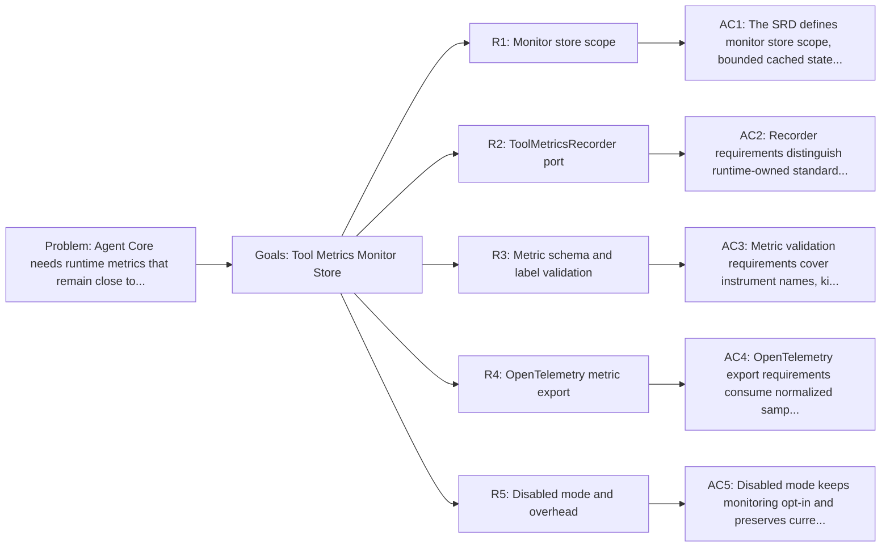

<!-- Copyright (c) 2026 Nokia -->
<!-- SPDX-License-Identifier: BSD-3-Clause -->

<!-- field: problem -->
## Problem

Agent Core needs runtime metrics that remain close to the running agent.
Spans describe execution. Operators still need a small live view.

Without an embedded monitor store, each tool family would choose its own
metric path. The runtime needs one cache for current machine state and recent
events. It also needs per-tool usage, configured metric samples, and recent
errors held within bounds. Ad hoc readers are risky. If every reader builds
that view alone, exporters may learn tool-specific meaning and REST readers
may scrape live tools or workspace files before the runtime can enforce the
recorder boundary. That would blur the boundary between tool-owned metric
meaning, runtime-owned dispatch context, and reader-owned snapshots.

The monitor store contract has an implementation in
internal/observability/monitor. The package provides the in-memory store,
recorder ports, sample validation, diagnostics, disabled-mode recorder, and
OpenTelemetry metric emission. Runtime dispatch passes monitor context to
commands through LoopParams. cmd/agent startup allocates a live store when
profile config enables monitor behavior.

<!-- field: goals -->
## Goals

- G1: Define a bounded in-memory monitor store for current and recent agent state.
- G2: Define a ToolMetricsRecorder path for standard and specialized metric samples.
- G3: Define metric config validation for ToolDef metrics and MachineSpec labels.
- G4: Define OpenTelemetry metric export from normalized samples.
- G5: Define disabled-mode behavior with no monitor store requirement.

<!-- req: R1 -->
## R1 - Monitor store scope

<!-- req: R1.1 -->
### R1.1

The monitor package SHALL provide an in-memory store scoped to one agent process.

<!-- req: R1.2 -->
### R1.2

The store SHALL cache current machine state, current run status, and recent RunEvent data.

<!-- req: R1.3 -->
### R1.3

The store SHALL cache per-tool usage aggregates, accepted metric samples, known metric schemas, monitor diagnostics, and bounded recent errors recorded from failed dispatch results.

<!-- req: R1.4 -->
### R1.4

The store SHALL bound retained events, samples, diagnostics, and errors by configured limits.

<!-- req: R1.5 -->
### R1.5

The store SHALL expose read snapshots without executing tools, re-reading prompts, scraping workspace files, or calling external collectors.

<!-- req: R1.6 -->
### R1.6

The store SHALL be an observability cache, not durable history, not checkpoint state, and not a rollback source.

<!-- req: R2 -->
## R2 - ToolMetricsRecorder port

<!-- req: R2.1 -->
### R2.1

The runtime SHALL pass tools an optional ToolMetricsRecorder when monitor recording is configured.

<!-- req: R2.2 -->
### R2.2

ToolMetricsRecorder SHALL accept normalized standard metrics and specialized tool metrics through one recorder path.

<!-- req: R2.3 -->
### R2.3

Runtime dispatch SHALL own standard identity context such as run ID, agent name, tool name, state, and signal.

<!-- req: R2.4 -->
### R2.4

Runtime dispatch SHALL own standard outcome context such as status, duration, iteration, and budget outcome.

<!-- req: R2.5 -->
### R2.5

Tool families SHALL own specialized metric meaning and choose which safe tool-local values become metric samples.

<!-- req: R2.6 -->
### R2.6

Invalid samples SHALL be rejected or recorded as monitor diagnostics without changing command Result.Signal.

<!-- req: R2.7 -->
### R2.7

Tools SHALL NOT write directly to store internals, OpenTelemetry exporters, REST handlers, or OpenAPI readers.

<!-- req: R3 -->
## R3 - Metric schema and label validation

<!-- req: R3.1 -->
### R3.1

Monitor setup SHALL validate ToolDef metrics fields for instrument name, kind, unit, value source, allowed attributes, redaction policy, and disabled state.

<!-- req: R3.2 -->
### R3.2

Monitor setup SHALL validate MachineSpec metric_labels as trusted workflow labels with bounded value sets.

<!-- req: R3.3 -->
### R3.3

Supported instrument kinds SHALL include counter, up_down_counter, histogram, and gauge.

<!-- req: R3.4 -->
### R3.4

Supported units SHALL include ms, By, "1", "{dispatch}", "{retry}", and tool-family units declared by trusted ToolDef config.

<!-- req: R3.5 -->
### R3.5

Source paths SHALL resolve only to trusted runtime context, ToolDef config, MachineSpec config, or safe structured tool output fields named by the tool family.

<!-- req: R3.6 -->
### R3.6

Attribute values SHALL be low-cardinality and SHALL NOT come from raw prompts, full model responses, full tool output, secrets, or arbitrary URLs.

<!-- req: R3.7 -->
### R3.7

Attribute values SHALL NOT come from request IDs, timestamps, stack traces, command output, or user free text.

<!-- req: R3.8 -->
### R3.8

Validation failures SHALL identify the tool, instrument, attribute, and failure reason before monitor recording starts.

<!-- req: R4 -->
## R4 - OpenTelemetry metric export

<!-- req: R4.1 -->
### R4.1

OpenTelemetry metric export SHALL consume normalized samples or aggregates from the recorder or monitor store.

<!-- req: R4.2 -->
### R4.2

Export SHALL use the same service resource identity as tracing.

<!-- req: R4.3 -->
### R4.3

Export SHALL map validated instruments and attributes to OpenTelemetry metric instruments.

<!-- req: R4.4 -->
### R4.4

Exporter failure SHALL be recorded as monitor diagnostics and SHALL NOT fail command execution.

<!-- req: R4.5 -->
### R4.5

Export SHALL preserve the tracing contract from srd008-telemetry and SHALL NOT add tool-specific meaning to telemetry setup.

<!-- req: R5 -->
## R5 - Disabled mode and overhead

<!-- req: R5.1 -->
### R5.1

When monitoring is not configured, runtime setup SHALL provide a nil or no-op recorder and SHALL NOT allocate a monitor store.

<!-- req: R5.2 -->
### R5.2

Disabled mode SHALL preserve existing loop, dispatch, tracing, and tool behavior.

<!-- req: R5.3 -->
### R5.3

Disabled mode SHALL add no metric processing beyond no-op recorder calls at configured emission points.

<!-- req: R5.4 -->
### R5.4

Tools SHALL treat a missing recorder as normal disabled-mode behavior.

<!-- req: R5.5 -->
### R5.5

Monitor configuration SHALL be opt-in and profile-owned.

<!-- field: non_goals -->
## Non-goals

- Defining REST or OpenAPI monitor read endpoints; see srd033-monitor-rest-api.
- Allocating a monitor store when no monitor profile configuration is present.
- Making monitor data durable history.
- Replacing RunResult, History, checkpoints, traces, or rollback state.
- Letting model text, tool output, or external callers define metric names or labels.
- Requiring an external collector, daemon, sidecar, or separate monitor process.

<!-- field: acceptance_criteria -->
## Acceptance criteria

<!-- ac: AC1 -->
### AC1

The SRD defines monitor store scope, bounded cached state, snapshots, and non-durable observability cache behavior.

<!-- field: traces -->
#### Traces

- [R1.1](#r11)
- [R1.2](#r12)
- [R1.3](#r13)
- [R1.4](#r14)
- [R1.5](#r15)
- [R1.6](#r16)

<!-- field: tests -->
#### Tests

- test-rel04.0-monitor: Monitor store returns bounded snapshots
- test-rel04.0-monitor: End-to-end monitor release proof

<!-- ac: AC2 -->
### AC2

Recorder requirements distinguish runtime-owned standard context from tool-owned specialized metric meaning.

<!-- field: traces -->
#### Traces

- [R2.1](#r21)
- [R2.2](#r22)
- [R2.3](#r23)
- [R2.4](#r24)
- [R2.5](#r25)
- [R2.6](#r26)
- [R2.7](#r27)

<!-- field: tests -->
#### Tests

- test-rel04.0-monitor: Recorder separates runtime and tool-owned metrics
- test-rel04.0-monitor: End-to-end monitor release proof

<!-- ac: AC3 -->
### AC3

Metric validation requirements cover instrument names, kinds, units, source paths, low-cardinality attributes, redaction, and startup diagnostics.

<!-- field: traces -->
#### Traces

- [R3.1](#r31)
- [R3.2](#r32)
- [R3.3](#r33)
- [R3.4](#r34)
- [R3.5](#r35)
- [R3.6](#r36)
- [R3.7](#r37)
- [R3.8](#r38)

<!-- field: tests -->
#### Tests

- test-rel04.0-monitor: Metric config rejects unsafe labels

<!-- ac: AC4 -->
### AC4

OpenTelemetry export requirements consume normalized samples while preserving tracing behavior and command results.

<!-- field: traces -->
#### Traces

- [R4.1](#r41)
- [R4.2](#r42)
- [R4.3](#r43)
- [R4.4](#r44)
- [R4.5](#r45)

<!-- field: tests -->
#### Tests

- test-rel04.0-monitor: OpenTelemetry export reads normalized samples
- test-rel04.0-monitor: End-to-end monitor release proof

<!-- ac: AC5 -->
### AC5

Disabled mode keeps monitoring opt-in and preserves current runtime behavior with no store allocation.

<!-- field: traces -->
#### Traces

- [R5.1](#r51)
- [R5.2](#r52)
- [R5.3](#r53)
- [R5.4](#r54)
- [R5.5](#r55)

<!-- field: tests -->
#### Tests

- test-rel04.0-monitor: Disabled mode avoids monitor allocation

<!-- field: related_documents -->
## Related documents

- sm-tool-metrics-monitoring
- cfg-tool-declaration-format
- cfg-machine-format

<!-- field: implementation_status -->
## Implementation status

<!-- field: current -->
### Current

internal/observability/monitor provides Store, Recorder, NoopRecorder,
snapshots, diagnostics, schema registration, bounded retention, and
OpenTelemetry metric emission. Runtime core can pass an optional monitor
recorder through LoopParams and dispatch context. ToolDef metrics and
MachineSpec metric_labels validation run during loading and spec audit.
Filesystem, LLM, REST, and exec tools emit specialized samples from
declared ToolDef metrics config. MachineSpec and transition metric_labels
apply to standard and specialized samples. cmd/agent allocates the live
monitor store during profile startup. TestMonitorReleaseProfileProof and
mage integration:monitor prove the configured Release 04.0 path.

<!-- field: remaining -->
### Remaining

No remaining Release 04.0 implementation gap is tracked here. Residual
monitor limits are product boundaries: the store is in-process, bounded,
and not durable history.

<!-- field: diagrams -->
## Diagrams

<!-- field: requirements_trace -->
### Requirements trace

