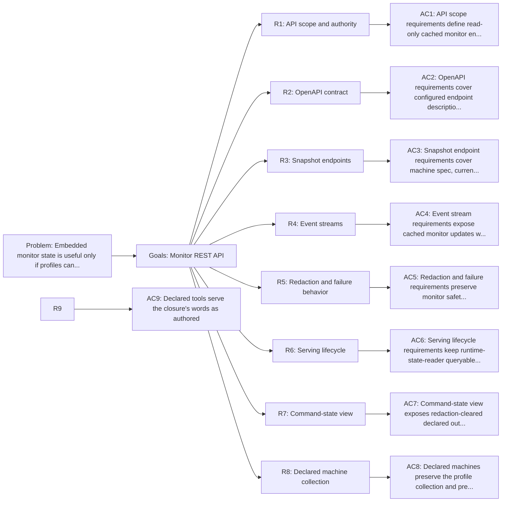

<!-- Copyright (c) 2026 Nokia -->
<!-- SPDX-License-Identifier: BSD-3-Clause -->

<!-- field: problem -->
## Problem

Embedded monitor state is useful only if profiles can expose it safely.
Operators need to inspect a running agent. They need enough context to match
the visible machine with metric snapshots that arrived during the same run.
Recent events matter too. Streams keep the view fresh.

A generic HTTP handler could make this unsafe. A handler that executes tools
or chooses workflow steps becomes another hidden control plane. Prompt reads
and workspace scraping are also outside the monitor contract. The API must
read cached monitor state only. Profile-owned REST configuration and OpenAPI
descriptions must own the exposed routes.

Monitor REST reader support exists on the existing REST server path.
Configured endpoints can read monitor views, expose OpenAPI metadata, and
stream cached monitor updates. The external runtime-state-reader profile may bind to
127.0.0.1:0, so supervisors and tests must discover the actual listener
address from the REST server launch output instead of assuming the configured
address is reachable. The implementation keeps handlers read-only: they do
not execute tools, dispatch MachineSpec actions, inspect prompts, or scrape
workspace files. cmd/agent passes the live monitor store into those routes
when the runtime-state-reader profile runs.

Launching a monitor server alone is not enough. REST server tools start the
listener in the background, but cmd/agent exits when the MachineSpec reaches a
terminal state. To stay observable, the runtime-state-reader profile follows the local
Knowledge Manager pattern: launch, await, accept a configured exit request,
stop the owned listener, and then route to a success terminal state.

<!-- field: goals -->
## Goals

- G1: Define monitor REST endpoints that read cached monitor state.
- G2: Preserve MachineSpec workflow ownership and avoid hidden HTTP workflows.
- G3: Keep REST authority and OpenAPI documentation profile-owned.
- G4: Define endpoint coverage for machine, tool, metric, event, and stream reads.
- G5: Define redaction, caching, and failure behavior for monitor readers.
- G6: Define an opt-in command-state view that exposes the redaction-cleared declared output of profile-named steps from srd038-command-state-store.
- G7: Expose every MachineSpec declared by a profile without implying that request-scoped machines are running.

<!-- req: R1 -->
## R1 - API scope and authority

<!-- req: R1.1 -->
### R1.1

The monitor REST API SHALL expose read-only endpoints over cached monitor store snapshots from srd032-tool-metrics-monitor-store and loaded MachineSpec declarations from the trusted profile closure.

<!-- req: R1.2 -->
### R1.2

Monitor REST handlers SHALL NOT execute tools, dispatch MachineSpec actions, inspect prompts, scrape workspace files, or call external collectors.

<!-- req: R1.3 -->
### R1.3

Profile-owned REST configuration SHALL define server address, route paths, endpoint bindings, auth references, limits, and OpenAPI exposure.

<!-- req: R1.4 -->
### R1.4

Runtime input SHALL NOT choose arbitrary monitor routes, methods, authentication, OpenAPI documents, or network destinations.

<!-- req: R1.5 -->
### R1.5

Monitor REST endpoints SHALL be documented as boundary read endpoints, not workflow actions.

<!-- req: R2 -->
## R2 - OpenAPI contract

<!-- req: R2.1 -->
### R2.1

The monitor API SHALL provide an OpenAPI description for every configured monitor endpoint.

<!-- req: R2.2 -->
### R2.2

OpenAPI operation IDs SHALL be stable and derived from configured monitor endpoint names.

<!-- req: R2.3 -->
### R2.3

Response schemas SHALL describe root machine spec metadata, declared machine collections, current state, selected tools, per-tool metrics, aggregate metrics, recent events, event stream frames, errors, and diagnostics.

<!-- req: R2.4 -->
### R2.4

OpenAPI output SHALL omit secrets, raw prompts, full tool output, arbitrary workspace paths, and unbounded labels. A command_state endpoint (R7) is the one bounded exception, and its schema SHALL describe a map of the endpoint's declared labels to entry objects carrying the redaction-cleared declared output and run envelope, and SHALL NOT describe receipts or undeclared step output.

<!-- req: R2.5 -->
### R2.5

OpenAPI generation SHALL NOT generate Go server code in the first implementation.

<!-- req: R2.6 -->
### R2.6

OpenAPI output SHALL include profile-owned lifecycle control endpoints configured for the monitor server, including POST /monitor/control/exit when that route exists.

<!-- req: R2.7 -->
### R2.7

OpenAPI schemas SHALL use JSON Schema scalar types for scalar monitor fields, including string, integer, number, and boolean.

<!-- req: R2.8 -->
### R2.8

OpenAPI schemas SHALL use array schemas for repeated monitor fields and object schemas with additionalProperties for map-shaped monitor fields.

<!-- req: R2.9 -->
### R2.9

Timestamp fields such as updated_at and timestamp SHALL be strings with date-time format.

<!-- req: R2.10 -->
### R2.10

Schema names and property names SHALL match runtime JSON lower_snake_case fields.

<!-- req: R2.11 -->
### R2.11

/monitor/openapi SHALL NOT describe scalar fields such as run_id, state, status, iteration, accepted, and signal as shallow all-object schemas.

<!-- req: R2.12 -->
### R2.12

/monitor/openapi SHALL describe /monitor/events/stream as an SSE endpoint with text/event-stream response content when that configured stream route exists.

<!-- req: R3 -->
## R3 - Snapshot endpoints

<!-- req: R3.1 -->
### R3.1

GET machine spec endpoint SHALL return configured machine name, states, signals, transitions, terminal states, and safe metric_labels metadata.

<!-- req: R3.2 -->
### R3.2

GET current state endpoint SHALL return current run ID, status, state, last signal, iteration, updated_at, and bounded diagnostics.

<!-- req: R3.3 -->
### R3.3

GET tools endpoint SHALL return selected tool names, categories, visibility, emitted signals, configured metric instruments, and safe relationship metadata.

<!-- req: R3.4 -->
### R3.4

GET per-tool metrics endpoint SHALL return per-tool aggregates and recent samples grouped only by allowed low-cardinality attributes.

<!-- req: R3.5 -->
### R3.5

GET aggregate metrics endpoint SHALL return run-level counters, histograms, gauges, status summaries, and monitor diagnostics.

<!-- req: R3.6 -->
### R3.6

GET recent events endpoint SHALL return a bounded recent event window with state, signal, tool name, timestamp, status, and redacted diagnostics.

<!-- req: R3.7 -->
### R3.7

Metric sample responses SHALL include the runtime envelope for both dispatch metrics and tool-owned specialized samples with run_id, state, signal, status, tool_name, and workflow labels where available.

<!-- req: R3.8 -->
### R3.8

JSON response field names SHALL use stable API lower_snake_case names and SHALL NOT expose Go struct field names such as RunID, ToolName, or UpdatedAt.

<!-- req: R3.9 -->
### R3.9

/monitor/state OpenAPI response schema SHALL define run as an object with run_id, status, state, signal, iteration, and updated_at, plus diagnostics and errors arrays.

<!-- req: R3.10 -->
### R3.10

/monitor/metrics OpenAPI response schema SHALL define tools, metrics, and schemas as map-shaped objects, recent_samples and diagnostics as arrays, and sample values as numbers.

<!-- req: R3.11 -->
### R3.11

/monitor/events OpenAPI response schema SHALL define recent_events as an array of event objects with string, integer, number, and timestamp fields that match runtime output.

<!-- req: R3.12 -->
### R3.12

POST /monitor/control/exit OpenAPI schemas SHALL define the optional request reason as a string and the accepted response as an object with accepted boolean and signal string fields.

<!-- req: R4 -->
## R4 - Event streams

<!-- req: R4.1 -->
### R4.1

The monitor API MAY expose an event stream endpoint for cached monitor updates.

<!-- req: R4.2 -->
### R4.2

Event stream frames SHALL be derived from accepted monitor samples, run state changes, diagnostics, or recent events already present in the monitor store.

<!-- req: R4.3 -->
### R4.3

Event streams SHALL use configured limits for subscriber count, frame size, heartbeat interval, and idle timeout.

<!-- req: R4.4 -->
### R4.4

Event streams SHALL NOT create workflow signals, enqueue server events for MachineSpec routing, or keep tools running.

<!-- req: R4.5 -->
### R4.5

Event stream disconnects SHALL clean up subscriptions without changing agent state.

<!-- req: R4.6 -->
### R4.6

Monitor SSE frames SHALL use event names run_event and metric_sample for cached run events and cached metric samples.

<!-- req: R4.7 -->
### R4.7

Each monitor SSE frame SHALL include one JSON data payload whose fields match the corresponding /monitor/events recent event object or /monitor/metrics recent sample object.

<!-- req: R5 -->
## R5 - Redaction and failure behavior

<!-- req: R5.1 -->
### R5.1

Monitor responses SHALL apply the attribute safety rules from sm-tool-metrics-monitoring before returning labels or samples.

<!-- req: R5.2 -->
### R5.2

Responses SHALL NOT include raw prompts, full model responses, full tool output, secrets, arbitrary URLs, request IDs as labels, timestamps as labels, stack traces, command output, or user free text. A command_state endpoint (R7) MAY return the declared param output that srd038 CommandStateView exposes for its profile-named labels, because that output has already passed the srd038 typed redaction boundary; this exception SHALL NOT extend to receipts, secrets, prompts, or the output of any step the endpoint does not name.

<!-- req: R5.3 -->
### R5.3

Missing monitor state SHALL return a configured empty snapshot or a documented not-ready response.

<!-- req: R5.4 -->
### R5.4

Handler failures SHALL return structured errors with endpoint name, failure stage, redacted message, and correlation metadata.

<!-- req: R5.5 -->
### R5.5

REST API failures SHALL NOT change command Result.Signal, monitor store state, or MachineSpec state.

<!-- req: R6 -->
## R6 - Serving lifecycle

<!-- req: R6.1 -->
### R6.1

The external runtime-state-reader profile SHALL keep cmd/agent alive after the monitor REST listener starts.

<!-- req: R6.2 -->
### R6.2

The runtime-state-reader MachineSpec SHALL route ServerLaunched to a non-terminal serving or awaiting state with a blocking await action.

<!-- req: R6.3 -->
### R6.3

Monitor control routes SHALL be profile-owned and separate from read-only monitor snapshot routes.

<!-- req: R6.4 -->
### R6.4

A configured control exit request SHALL route to a stop step that releases the owned monitor listener.

<!-- req: R6.5 -->
### R6.5

After the stop step releases the listener, the runtime-state-reader MachineSpec SHALL route to Done or Succeeded so the run status is succeeded. Releasing the listener is the property that matters, because the server stops accepting requests once its listeners close, and whether every in-flight connection finished inside the shutdown budget is a separate quality of the drain covered by R6.10. A stop that cannot release the listener, or that fails for any reason other than an expired drain budget, SHALL remain a command failure.

<!-- req: R6.6 -->
### R6.6

CLI proofs and automated tests SHOULD bind the monitor listener to an isolated localhost address from generated profile config or an explicit runtime override.

<!-- req: R6.7 -->
### R6.7

A checked-in fixed monitor port is a profile default, not a test isolation guarantee; tests SHALL document or avoid conflicts from parallel runs and stale listeners.

<!-- req: R6.8 -->
### R6.8

When the monitor server is configured with 127.0.0.1:0, supervisors and automated proofs SHALL discover the bound address from the REST server launch output before querying monitor endpoints.

<!-- req: R6.9 -->
### R6.9

The real cmd/agent proof SHALL use agents/runtime-state-reader/profile.yaml or an equivalent profile-owned path that preserves the full monitor serving lifecycle.

<!-- req: R6.10 -->
### R6.10

The stop step SHALL report the drain outcome as a structured field of its output, separating a drain that completed from one the shutdown budget cut short, so a machine can branch on the difference. An incomplete drain SHALL be reported rather than suppressed, because the run succeeds on the released listener and not on the condition going unnoticed.

<!-- req: R7 -->
## R7 - Command-state view

<!-- req: R7.1 -->
### R7.1

A read_state monitor endpoint MAY declare monitor_view command_state with a required, non-empty labels allowlist naming authored transition labels or command names from the running MachineSpec; the endpoint SHALL expose the latest recorded output of each named step through the srd038-command-state-store CommandStateView.

<!-- req: R7.2 -->
### R7.2

The command_state response SHALL be an object keyed by the endpoint's declared labels; each present entry SHALL carry the selected step's redaction-cleared declared output and the run envelope fields state, signal, iteration, and updated_at, and SHALL NOT carry receipts, which remain structurally unaddressable through srd038 R3.3.

<!-- req: R7.3 -->
### R7.3

A declared label with no recorded step yet SHALL return an explicit absent entry for that label rather than an error or a failed response, consistent with the not-ready behavior in R5.3.

<!-- req: R7.4 -->
### R7.4

The command_state view SHALL read only output that srd038 CommandStateView exposes under a recognized redaction version and applied status; output_omitted, unversioned legacy, and unknown-version entries SHALL surface as a typed unavailable entry per srd038 R5.6, never as raw output.

<!-- req: R7.5 -->
### R7.5

The command_state response SHALL be bounded by the server's configured limits_ref maximum response size; an entry whose output would exceed the bound SHALL be replaced by an explicit unavailable marker for that label rather than failing the whole response.

<!-- req: R7.6 -->
### R7.6

The labels allowlist SHALL be required and non-empty when monitor_view is command_state and SHALL NOT be accepted on any other monitor_view; configuration validation SHALL reject a command_state endpoint that declares no labels and any non-command_state endpoint that declares labels.

<!-- req: R7.7 -->
### R7.7

The command_state view SHALL remain read-only under R1.2; it SHALL NOT execute tools, dispatch MachineSpec actions, inspect prompts, or scrape workspace files, and its exposure SHALL be limited to the opt-in, profile-declared labels of the endpoint.

<!-- req: R8 -->
## R8 - Declared machine collection

<!-- req: R8.1 -->
### R8.1

A read_state endpoint MAY declare monitor_view declared_machines to expose MachineSpec declarations loaded from the trusted profile closure; the conventional profile-owned route SHALL be GET /monitor/machines.

<!-- req: R8.2 -->
### R8.2

The declared machine collection SHALL contain the running root MachineSpec followed by every distinct MachineSpec referenced by a REST server machine_request endpoint in the same profile closure.

<!-- req: R8.3 -->
### R8.3

The collection SHALL place the root first and order the remaining machines by machine name; repeated references to the same resolved machine path SHALL produce one entry.

<!-- req: R8.4 -->
### R8.4

A profile with no machine_request references SHALL return a one-element collection containing its root MachineSpec.

<!-- req: R8.5 -->
### R8.5

Each entry SHALL contain name, initial_state, states, signals, terminal_states, and transitions, and MAY contain view_tags when authored.

<!-- req: R8.6 -->
### R8.6

Each state in the declared_machines response SHALL be an object containing name and MAY contain authored tags; the response SHALL NOT collapse states to the names-only projection used by monitor_view machine_spec.

<!-- req: R8.7 -->
### R8.7

view_tags SHALL preserve the authored ordered list of tag and label objects, and state tags SHALL preserve the authored ordered string list. Both fields are presentation metadata that SHALL NOT affect transition validation, dispatch, or run state.

<!-- req: R8.8 -->
### R8.8

The declared_machines view SHALL expose declarations only. It SHALL NOT report or imply live state for request-scoped machines; request runs remain observable through their spans.

<!-- req: R8.9 -->
### R8.9

GET /monitor/machine and monitor_view machine_spec SHALL remain the running-root projection defined by R3.1.

<!-- req: R8.10 -->
### R8.10

OpenAPI SHALL describe declared_machines as an array of machine objects with typed scalar, array, object, and map fields under R2.7 through R2.10.

<!-- req: R9 -->
## R9 - Declared tool records

<!-- req: R9.1 -->
### R9.1

A read_state endpoint MAY declare monitor_view declared_tools to expose the tool declarations of the trusted profile closure as authored; the conventional profile-owned route SHALL be GET /monitor/tools/declared.

<!-- req: R9.2 -->
### R9.2

The declared tool collection SHALL contain every word declared by the root profile's tool_declarations files and by the tool_declarations files of every profile a REST server machine_request endpoint references in the same closure.

<!-- req: R9.3 -->
### R9.3

Each entry SHALL be the declaration mapping as authored -- name, description, config, emits, and every other authored field -- rather than a registration-time projection, so a consumer reads the contract the executor loads. Fields the runtime does not interpret SHALL ride through.

<!-- req: R9.4 -->
### R9.4

The collection SHALL be ordered by word name; a declarations file referenced by more than one profile SHALL contribute each word once, and two files declaring the same word name SHALL keep the first in file-resolution order.

<!-- req: R9.5 -->
### R9.5

The declared_tools view SHALL expose declarations only. It SHALL NOT report registration, run state, or metrics for any word; monitor_view tools remains the registered-tool projection of R3.

<!-- req: R9.6 -->
### R9.6

The view SHALL serve no secret material; a declaration references credentials by environment or auth_ref and the served mapping is the authored reference, never a resolved value.

<!-- req: R9.7 -->
### R9.7

OpenAPI SHALL describe declared_tools as an array of objects with a required name and additional authored properties under R2.7 through R2.10.

<!-- field: non_goals -->
## Non-goals

- Writing monitor state through REST.
- Creating workflow signals from monitor REST read endpoints.
- Executing tools or MachineSpec actions from monitor HTTP handlers.
- Replacing REST server tool contracts in srd029-rest-server-tools.
- Exposing raw prompts, full outputs, secrets, or arbitrary workspace files. The command_state view is bounded to redaction-cleared declared output of profile-named labels and does not weaken this boundary.
- Defining durable metric history.
- Exposing current, recent, or historical run state for request-scoped machines through the declared_machines view.
- Defining the command-state store, its label grammar, or its redaction boundary; that belongs to srd038-command-state-store, which the command_state view reads.

<!-- field: acceptance_criteria -->
## Acceptance criteria

<!-- ac: AC1 -->
### AC1

API scope requirements define read-only cached monitor endpoints with profile-owned REST authority and no hidden workflow execution.

<!-- field: traces -->
#### Traces

- [R1.1](#r11)
- [R1.2](#r12)
- [R1.3](#r13)
- [R1.4](#r14)
- [R1.5](#r15)

<!-- field: tests -->
#### Tests

- test-rel04.0-monitor: Monitor REST routes read cached state
- test-rel04.0-monitor: End-to-end monitor release proof

<!-- ac: AC2 -->
### AC2

OpenAPI requirements cover configured endpoint descriptions, stable operation IDs, type-accurate response schemas, profile-owned control endpoints, redaction, lower_snake_case field names, and no generated Go server code.

<!-- field: traces -->
#### Traces

- [R2.1](#r21)
- [R2.2](#r22)
- [R2.3](#r23)
- [R2.4](#r24)
- [R2.5](#r25)
- [R2.6](#r26)
- [R2.7](#r27)
- [R2.8](#r28)
- [R2.9](#r29)
- [R2.10](#r210)
- [R2.11](#r211)
- [R2.12](#r212)

<!-- field: tests -->
#### Tests

- test-rel04.0-monitor: Monitor OpenAPI omits unsafe fields
- test-rel04.0-monitor: End-to-end monitor release proof

<!-- ac: AC3 -->
### AC3

Snapshot endpoint requirements cover machine spec, current state, tools, per-tool metrics, aggregate metrics, recent events, stable lower_snake_case response fields, precise OpenAPI schema shapes, and the runtime envelope on specialized samples.

<!-- field: traces -->
#### Traces

- [R3.1](#r31)
- [R3.2](#r32)
- [R3.3](#r33)
- [R3.4](#r34)
- [R3.5](#r35)
- [R3.6](#r36)
- [R3.7](#r37)
- [R3.8](#r38)
- [R3.9](#r39)
- [R3.10](#r310)
- [R3.11](#r311)
- [R3.12](#r312)

<!-- field: tests -->
#### Tests

- test-rel04.0-monitor: Monitor snapshot endpoints return configured views
- test-rel04.0-monitor: End-to-end monitor release proof

<!-- ac: AC4 -->
### AC4

Event stream requirements expose cached monitor updates without creating workflow signals or retaining tool execution.

<!-- field: traces -->
#### Traces

- [R4.1](#r41)
- [R4.2](#r42)
- [R4.3](#r43)
- [R4.4](#r44)
- [R4.5](#r45)
- [R4.6](#r46)
- [R4.7](#r47)

<!-- field: tests -->
#### Tests

- test-rel04.0-monitor: Monitor event stream reads cached updates
- test-rel04.0-monitor: End-to-end monitor release proof

<!-- ac: AC5 -->
### AC5

Redaction and failure requirements preserve monitor safety and do not change command or machine state.

<!-- field: traces -->
#### Traces

- [R5.1](#r51)
- [R5.2](#r52)
- [R5.3](#r53)
- [R5.4](#r54)
- [R5.5](#r55)

<!-- field: tests -->
#### Tests

- test-rel04.0-monitor: Monitor REST failures stay observational

<!-- ac: AC6 -->
### AC6

Serving lifecycle requirements keep the runtime-state-reader profile queryable until a configured control exit request releases the listener, routes to a success terminal state whether or not the drain completed inside its budget, reports the drain outcome as a structured field, and uses isolated binding for automated proofs.

<!-- field: traces -->
#### Traces

- [R6.1](#r61)
- [R6.2](#r62)
- [R6.3](#r63)
- [R6.4](#r64)
- [R6.5](#r65)
- [R6.6](#r66)
- [R6.7](#r67)
- [R6.8](#r68)
- [R6.9](#r69)
- [R6.10](#r610)

<!-- field: tests -->
#### Tests

- test-rel04.0-monitor: Real CLI monitor process stays queryable until exit

<!-- ac: AC7 -->
### AC7

The command_state view exposes only the redaction-cleared declared output of the endpoint's profile-named labels through the srd038 CommandStateView, returns an explicit absent entry for a label with no recorded step, surfaces omitted and legacy output as typed unavailable entries, bounds each entry by the configured response size, and is accepted only with a non-empty labels allowlist that no other view may carry.

<!-- field: traces -->
#### Traces

- [R7.1](#r71)
- [R7.2](#r72)
- [R7.3](#r73)
- [R7.4](#r74)
- [R7.5](#r75)
- [R7.6](#r76)
- [R7.7](#r77)

<!-- field: tests -->
#### Tests

- test-rel04.0-monitor: Monitor command_state view returns declared labeled output
- test-rel04.0-monitor: Monitor command_state view rejects misuse of labels
- test-rel04.0-monitor: Monitor command_state view redacts omitted and legacy output

<!-- ac: AC8 -->
### AC8

The declared_machines view returns the root first and each distinct machine_request MachineSpec by name, preserves authored view_tags and per-state tags in a typed OpenAPI-described declaration shape, leaves the existing machine_spec root projection unchanged, and exposes no request-machine run state.

<!-- field: traces -->
#### Traces

- [R8.1](#r81)
- [R8.2](#r82)
- [R8.3](#r83)
- [R8.4](#r84)
- [R8.5](#r85)
- [R8.6](#r86)
- [R8.7](#r87)
- [R8.8](#r88)
- [R8.9](#r89)
- [R8.10](#r810)

<!-- field: tests -->
#### Tests

- test-rel04.0-monitor: MachineSpec retains declared presentation metadata
- test-rel04.0-monitor: Monitor declared_machines view returns the profile machine collection

<!-- ac: AC9 -->
### AC9

The declared_tools view returns every word the profile closure declares, as authored with unknown fields riding through, name-ordered and deduplicated across shared declaration files, exposing no registration state and no resolved credential, with the registered-tools view unchanged.

<!-- field: traces -->
#### Traces

- [R9.1](#r91)
- [R9.2](#r92)
- [R9.3](#r93)
- [R9.4](#r94)
- [R9.5](#r95)
- [R9.6](#r96)
- [R9.7](#r97)

<!-- field: tests -->
#### Tests

- test-rel04.0-monitor: Monitor declared_tools view returns the closure declarations as authored

<!-- field: related_documents -->
## Related documents

- sm-tool-metrics-monitoring
- cfg-rest-tool-format
- docs/guides/boundary-tools-and-async.md

<!-- field: implementation_status -->
## Implementation status

<!-- field: current -->
### Current

internal/tools/rest supports monitor_view on read_state, static_metadata,
and stream_events endpoints. agents/runtime-state-reader defines a profile-owned REST
server with machine, state, tools, metrics, events, event stream, OpenAPI,
and control exit routes. The checked-in monitor REST configuration binds
127.0.0.1:0, so the launch output address is the supervisor discovery
source. Tests cover cached-state reads, OpenAPI redaction, snapshot
endpoint response shape, event stream frames, observational failure
behavior, and profile-owned control endpoint documentation. The external
runtime-state-reader profile uses the same REST server launch path as other configured server
tools, so there is no separate monitor server stack.
A supervisor can call /monitor/metrics after launch and see samples from
the same run, not a seeded fixture. The real CLI proof generates an
isolated loopback listener while preserving the checked-in operator profile
path and discovering the bound address from profile-owned launch output.
TestMonitorReleaseProfileProof and mage integration:monitor prove the path
through cmd/agent with the live store.

<!-- field: remaining -->
### Remaining

/monitor/openapi currently documents monitor routes and redacts unsafe
fields. Precise JSON Schema generation for scalar fields, arrays, maps,
timestamps, and nested objects remains follow-up work. The generated schema
must reject shallow all-object descriptions for runtime scalar fields.

Residual product boundaries remain unchanged: monitor readers are
profile-owned, read cached state only, and do not provide durable metric
history.

The command_state view (R7) is specified and pending implementation under
GH-1297: a read_state endpoint declaring monitor_view command_state and a
labels allowlist exposes the redaction-cleared declared output of the named
steps through the srd038 CommandStateView. The fleet observer of
GH-1270 is its first consumer.

The declared_machines runtime view (R8) retains named presentation
metadata and collects the root plus the distinct machine_request machines
from the trusted profile closure without exposing live request-machine
state. Shipped monitor profiles declare the conventional
GET /monitor/machines route.

The declared_tools runtime view (R9) serves the closure's tool
declarations as authored, loaded once beside the declared machines, so a
fleet surface renders a request machine's words -- description and
configuration -- from the pod that runs them rather than from a shipped
copy. Shipped monitor profiles declare the conventional
GET /monitor/tools/declared route.

<!-- field: diagrams -->
## Diagrams

<!-- field: requirements_trace -->
### Requirements trace

