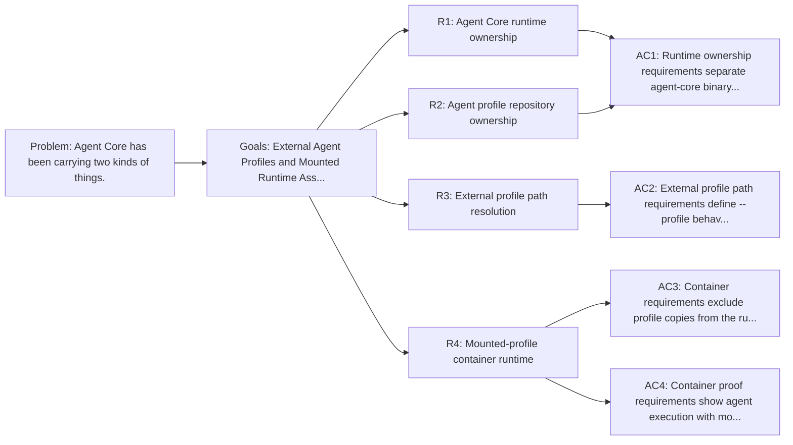

<!-- Copyright (c) 2026 Nokia -->
<!-- SPDX-License-Identifier: BSD-3-Clause -->

<!-- field: problem -->
## Problem

Agent Core has been carrying two kinds of things. One kind is the reusable Go
runtime: cmd/agent and loop execution. Runtime ownership also covers tool
loading, observability, release scripts, and shared declarations. The other
kind is product behavior expressed as profiles, demos, UI config, and
integration fixtures.

Keeping both in one release image makes the runtime contract harder to read.
A container that already has generator and evaluator profiles inside
/opt/agent-core looks like it owns those programs, even when a caller intends
to mount a profile from another repository.

The migration moves agent programs to applications/catalog. Before code and Docker
changes follow, Agent Core needs a narrow contract. It must say which assets
stay in the runtime image. It must also say which assets arrive from an
external path at execution time.

<!-- field: goals -->
## Goals

- G1: Define agent-core as the owner of the runtime binary and core-owned runtime assets.
- G2: Define applications/catalog as the owner of agent YAML programs and profile-local assets.
- G3: Specify mounted-profile execution for containers and local tests.
- G4: Preserve profile-relative path resolution for tools, REST definitions, UX config, and request machines.

<!-- field: migration_notes -->
## Migration notes

Short rule: profiles are inputs.

A runtime image may still be convenient to run, but convenience should come
from a clear command and stable mounted paths, not from stale profile copies
baked into the image weeks before the profile repository changes again. This
keeps the core image smaller, makes profile updates reviewable in the owning
repository, and lets tests prove the same path operators use.

<!-- req: R1 -->
## R1 - Agent Core runtime ownership

<!-- req: R1.1 -->
### R1.1

Agent Core SHALL own the cmd/agent binary and Go runtime packages that execute MachineSpec programs.

<!-- req: R1.2 -->
### R1.2

Agent Core SHALL own core-owned tool declarations and runtime assets needed by many profiles, including shared builtin and exec tool declarations under tools/.

<!-- req: R1.3 -->
### R1.3

Agent Core SHALL own build, audit, Docker, and release machinery for the runtime image.

<!-- req: R1.4 -->
### R1.4

Agent Core SHALL NOT define product behavior by copying generator, evaluator, planner, bench, jurist, or Knowledge Manager profile directories into the runtime image.

<!-- req: R2 -->
## R2 - Agent profile repository ownership

<!-- req: R2.1 -->
### R2.1

applications/catalog SHALL own agent YAML programs, including profile.yaml, machine.yaml, tools.yaml, tool declarations, REST definitions, request machines, model-boundary configs, and profile-local UX config.

<!-- req: R2.2 -->
### R2.2

applications/catalog SHALL own demo files and agent integration fixtures whose purpose is to exercise a configured agent program rather than a core runtime package.

<!-- req: R2.3 -->
### R2.3

Profile-local UX config such as agents/knowledge-manager/documentation-curator/ui/ux.yaml SHALL move with the owning profile.

<!-- req: R2.4 -->
### R2.4

Profile repositories MAY reference core-owned tool declaration roots from an installed Agent Core runtime when those declarations are stable runtime vocabulary.

<!-- req: R3 -->
## R3 - External profile path resolution

<!-- req: R3.1 -->
### R3.1

cmd/agent SHALL accept an explicit --profile path that points to a profile supplied outside the Agent Core source tree.

<!-- req: R3.2 -->
### R3.2

Relative paths inside profile.yaml SHALL resolve from the directory that contains that profile.yaml.

<!-- req: R3.3 -->
### R3.3

Tests and Mage targets that need standard profiles SHALL resolve an external applications/catalog checkout or bundle path, then pass explicit file paths (for example --profile) rather than assuming agents/ exists in agent-core or relying on process environment variables as the semantic profile-root channel.

<!-- req: R3.4 -->
### R3.4

Profile root discovery SHALL fail with a clear diagnostic when a required external profile path is missing.

<!-- req: R4 -->
## R4 - Mounted-profile container runtime

<!-- req: R4.1 -->
### R4.1

Runtime container images SHALL include the agent binary and core-owned runtime assets only.

<!-- req: R4.2 -->
### R4.2

Runtime container images SHALL NOT copy agents/executor, agents/critic, agents/planner, agents/bench, agents/specification-critic, Knowledge Manager profiles, demos, or profile integration fixtures from agent-core.

<!-- req: R4.3 -->
### R4.3

Container callers SHALL provide profiles by bind mount, image layer supplied by another repository, release asset unpack, or another explicit external path.

<!-- req: R4.4 -->
### R4.4

Container proof commands SHALL run cmd/agent with --profile pointing at the mounted profile path and --directory pointing at the mounted workspace.

<!-- req: R4.5 -->
### R4.5

The runtime image SHALL install core-owned assets under a fixed path such as /opt/agent-core. That install path SHALL NOT imply that agent profiles are present there. Operators reference core-owned declaration trees with absolute paths in configuration when needed.

<!-- field: non_goals -->
## Non-goals

- Rewriting runtime package boundaries while profile ownership moves.
- Introducing a compatibility layer for profile paths that have not shipped.
- Requiring a specific distribution mechanism for applications/catalog.
- Moving core-owned shared tool declarations out of agent-core.
- Rewriting git history as part of the profile ownership contract.

<!-- field: acceptance_criteria -->
## Acceptance criteria

<!-- ac: AC1 -->
### AC1

Runtime ownership requirements separate agent-core binary and core-owned assets from profile-owned agent programs.

<!-- field: traces -->
#### Traces

- [R1.1](#r11)
- [R1.2](#r12)
- [R1.3](#r13)
- [R1.4](#r14)
- [R2.1](#r21)
- [R2.2](#r22)
- [R2.3](#r23)
- [R2.4](#r24)

<!-- field: tests -->
#### Tests

- test-rel06.0-profile-migration: Specification index includes external profile contracts

<!-- ac: AC2 -->
### AC2

External profile path requirements define --profile behavior, profile-relative resolution, Mage/test root configuration, and missing-path diagnostics.

<!-- field: traces -->
#### Traces

- [R3.1](#r31)
- [R3.2](#r32)
- [R3.3](#r33)
- [R3.4](#r34)

<!-- field: tests -->
#### Tests

- test-rel06.0-profile-migration: Runtime resolves profiles from external roots

<!-- ac: AC3 -->
### AC3

Container requirements exclude profile copies from the runtime image and require mounted or otherwise provided profile paths.

<!-- field: traces -->
#### Traces

- [R4.1](#r41)
- [R4.2](#r42)
- [R4.3](#r43)
- [R4.5](#r45)

<!-- field: tests -->
#### Tests

- test-rel06.0-profile-migration: Runtime image excludes migrated profile assets

<!-- ac: AC4 -->
### AC4

Container proof requirements show agent execution with mounted profiles and mounted workspace data.

<!-- field: traces -->
#### Traces

- [R4.3](#r43)
- [R4.4](#r44)

<!-- field: tests -->
#### Tests

- test-rel06.0-profile-migration: Container runs with mounted profile and workspace

<!-- field: related_documents -->
## Related documents

- docs/guides/repository-migration.md
- docs/specs/config-formats/runtime-contract.md
- rel06.0-uc001-mounted-profile-container-runtime
- test-rel06.0-profile-migration
- docs/ARCHITECTURE.md
- docs/road-map.md

<!-- field: implementation_status -->
## Implementation status

<!-- field: current -->
### Current

Agent Core no longer stores standard agent profile directories, demos, or
profile-owned integration fixtures. Docker packaging, Mage integration
targets, tests, and README examples consume those assets from an external
applications/catalog checkout or bundle using explicit paths passed to --profile,
bind mounts, and documented mage inputs.

<!-- field: planned -->
### Planned

Future runtime work should keep this boundary: profile-owned agent programs
move in applications/catalog, while agent-core keeps the binary, Go runtime,
shared tool implementations, core-owned tool declarations, and runtime
packaging.

<!-- field: diagrams -->
## Diagrams

<!-- field: requirements_trace -->
### Requirements trace

