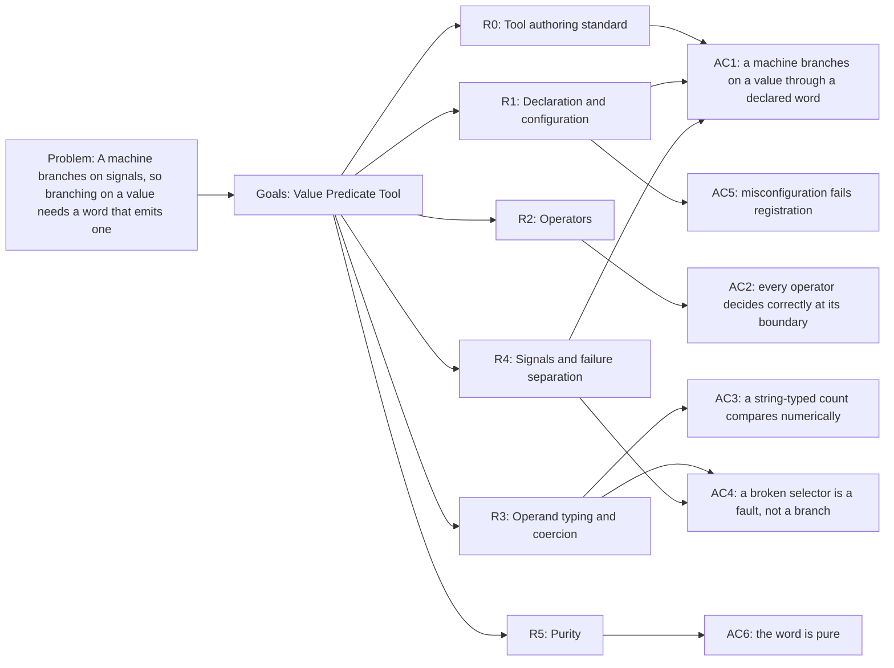

<!-- Copyright (c) 2026 Nokia -->
<!-- SPDX-License-Identifier: BSD-3-Clause -->

<!-- field: problem -->
## Problem

A machine branches on signals, and signals come from words. Branching on a
value therefore needs a word that emits a different signal depending on that
value, and no such word exists. Nothing in the declarative vocabulary can
express "reject when the count is zero" or "retry while the queue is
non-empty".

The workarounds each fail for a different reason. REST response schema
validation (srd028) implements only required and type, and a schema failure
raises CommandError rather than a domain signal, so it cannot say "this value
means reject" as distinct from "the call broke". Client status mapping
branches on the HTTP status, which is unchanged whether a counted collection
holds zero documents or five hundred. Exec tools emit exactly ToolDone and
ToolFailed from a process exit code (srd023), so the comparison has to live
inside a child program that happens to exist and happens to be the right place
for it. The former planner check_result word was built around a retry budget,
illustrating why a reusable predicate was needed instead.

Without the primitive the fallback is a bespoke Go tool per comparison, or a
contract distortion: pushing a caller's decision into an unrelated agent so
its exit code carries the answer. Both put a decision the machine should own
somewhere the machine cannot read.

<!-- field: goals -->
## Goals

- G1: Declare a builtin word that resolves two operands and emits a machine-declared signal from their comparison.
- G2: Keep the emitted signal names in configuration, so the word composes into any grammar rather than imposing a vocabulary.
- G3: Separate an infrastructure fault from a legitimate negative, so a broken selector is never read as a false comparison.
- G4: Define operand typing and coercion explicitly, because values read from REST responses arrive as strings.
- G5: Reuse the existing selector and typed-config primitives rather than introducing parallel ones.

<!-- req: R0 -->
## R0 - Tool authoring standard

<!-- req: R0.1 -->
### R0.1

The declaration SHALL follow cfg-tool-authoring-standard for category, problem, goals, requirements, non-goals, output, side effects, reversibility, undo, errors, and relationships (srd022 R0.1).

<!-- req: R0.2 -->
### R0.2

The word SHALL be category word and visibility internal; a predicate is machine flow control, not a model-callable capability.

<!-- req: R1 -->
## R1 - Declaration and configuration

<!-- req: R1.1 -->
### R1.1

The declaration SHALL set type builtin and an init name resolved through BuiltinRegistry (srd022 R1.1, R1.3, R2.1).

<!-- req: R1.2 -->
### R1.2

Configuration SHALL name the left operand, the comparison operator, and the right operand.

<!-- req: R1.3 -->
### R1.3

An operand SHALL be either a selector or a literal. A value beginning with the current-value selector prefix SHALL resolve against the previous Result, a value beginning with the $from(label) prefix SHALL resolve against the command-state view (srd038 R2), and any other value is a literal. Both forms are needed because a predicate's operands are not always adjacent. Measuring a change across an action rather than a level after one puts a word between them, and a word whose Result carries nothing forward -- an exec word running a child, for instance -- leaves the earlier value reachable only through command state.

<!-- req: R1.4 -->
### R1.4

Configuration SHALL name the signal emitted when the comparison holds and the signal emitted when it does not.

<!-- req: R1.5 -->
### R1.5

Configuration SHALL be decoded into a typed struct by DecodeToolConfig at registration time, and a decode failure SHALL name the tool (srd022 R3.1, R3.3).

<!-- req: R1.6 -->
### R1.6

Registration SHALL fail when the operator is not one this SRD names, or when either signal name is absent, so a misconfigured predicate never reaches a run.

<!-- req: R1.7 -->
### R1.7

No operand, operator, or signal name SHALL be supplied by runtime input; a predicate's decision is declared, not chosen by a model or a request body.

<!-- req: R1.8 -->
### R1.8

A malformed $from(label).path operand SHALL fail registration, so an empty label, an empty path, or unbalanced parentheses is refused before a run rather than at dispatch (srd038 R2.5).

<!-- req: R2 -->
## R2 - Operators

<!-- req: R2.1 -->
### R2.1

The operator set SHALL be closed and SHALL comprise eq, ne, lt, lte, gt, gte, empty, and non_empty.

<!-- req: R2.2 -->
### R2.2

eq and ne SHALL compare for equality; lt, lte, gt, and gte SHALL compare ordering.

<!-- req: R2.3 -->
### R2.3

empty and non_empty SHALL test the left operand alone and SHALL ignore any right operand; an absent right operand SHALL NOT fail registration for these operators.

<!-- req: R2.4 -->
### R2.4

An operand that resolves to a string of zero length, an empty list, an empty object, or a null SHALL be empty; every other resolved value SHALL be non-empty.

<!-- req: R2.5 -->
### R2.5

Extending the set SHALL amend this requirement rather than adding an escape hatch, so the vocabulary a machine may branch on stays enumerable from the specification.

<!-- req: R3 -->
## R3 - Operand typing and coercion

<!-- req: R3.1 -->
### R3.1

Configuration MAY declare an operand type of number or string, and SHALL default to number when absent, because the ordering operators are the reason to reach for this word.

<!-- req: R3.2 -->
### R3.2

Under the number type, both operands SHALL be coerced to numbers before comparison, including operands that arrive as strings. A REST read of a scalar body yields a string -- a bare integer body lands under raw (srd028) -- so a count read back from a store arrives as "6", and comparing it as a string would order "10" below "6".

<!-- req: R3.3 -->
### R3.3

Under the string type, both operands SHALL be compared as strings, and the ordering operators SHALL use lexicographic order.

<!-- req: R3.4 -->
### R3.4

A coercion that fails SHALL emit CommandError and SHALL NOT emit either declared signal (R4.2).

<!-- req: R3.5 -->
### R3.5

Coercion SHALL NOT be inferred from the operand values at runtime; a predicate that compares numerically for one response and lexicographically for the next is not a contract.

<!-- req: R4 -->
## R4 - Signals and failure separation

<!-- req: R4.1 -->
### R4.1

The word SHALL emit the configured satisfied signal when the comparison holds and the configured unsatisfied signal when it does not.

<!-- req: R4.2 -->
### R4.2

An operand selector that does not resolve -- including a $from(label) naming a step that never ran, or a path absent from the step it names -- and a coercion that fails, SHALL emit CommandError. Neither SHALL emit the unsatisfied signal. A broken selector answering "the value was false" is the failure mode this requirement exists to prevent, and it is a silent one -- the machine takes a legitimate-looking branch on a comparison that never happened. The distinction is the one srd030 R4.6 draws between a broken read and a real outcome.

<!-- req: R4.3 -->
### R4.3

The declaration's emits SHALL list the configured signals and CommandError.

<!-- req: R4.4 -->
### R4.4

Output SHALL be a JSON object containing the raw resolved left operand, operator, operand type, and boolean comparison outcome under the fields left, op, operand_type, and held. A binary comparison SHALL also contain the raw resolved right operand under right; a unary empty or non_empty comparison SHALL omit right. The object leaves each part addressable to a later word or machine_request response mapping while preserving what arrived before coercion.

<!-- req: R5 -->
## R5 - Purity

<!-- req: R5.1 -->
### R5.1

The word SHALL have no side effects; it reads a prior Result and returns a signal.

<!-- req: R5.2 -->
### R5.2

Reversibility SHALL be reversible and undo SHALL be noop, because a comparison changes nothing.

<!-- req: R5.3 -->
### R5.3

The word SHALL NOT mutate command state, workspace, or history.

<!-- field: non_goals -->
## Non-goals

- Defining the selector grammar; operands resolve through the existing selector primitive (srd038).
- Defining the BuiltinRegistry factory mechanism; that is srd022 R2.
- Arithmetic, string manipulation, or any transformation of operands; the word compares and does nothing else.
- Multi-clause predicates with boolean connectives; a machine composes several predicate words across states, which keeps the branch visible in the grammar rather than inside a word.
- Defining planner retry policy; planner MachineSpec composes this generic predicate with its own declared count and limit.
- Dividing an array by the same scalar comparison; srd022 R7.1 defines partition as the array-valued form and requires it to reuse this word's comparison and coercion helpers.

<!-- field: acceptance_criteria -->
## Acceptance criteria

<!-- ac: AC1 -->
### AC1

A machine branches on a value read from a REST response into two declared signals, through a declared word, with no bespoke Go tool and no comparison hidden in a child program; the terminal predicate output leaves its resolved operand addressable to a response mapping.

<!-- field: traces -->
#### Traces

- [R0.1](#r01)
- [R0.2](#r02)
- [R1.1](#r11)
- [R1.2](#r12)
- [R1.3](#r13)
- [R1.4](#r14)
- [R4.1](#r41)
- [R4.3](#r43)
- [R4.4](#r44)

<!-- ac: AC2 -->
### AC2

Every operator the SRD names decides correctly at its boundary, empty and non_empty test the left operand alone, and the set a machine may branch on stays enumerable from this specification rather than from the implementation.

<!-- field: traces -->
#### Traces

- [R2.1](#r21)
- [R2.2](#r22)
- [R2.3](#r23)
- [R2.4](#r24)
- [R2.5](#r25)

<!-- ac: AC3 -->
### AC3

A count that arrives from a REST read as a string is compared numerically under the default operand type, so "10" orders above "6"; a string-typed comparison orders lexicographically.

<!-- field: traces -->
#### Traces

- [R3.1](#r31)
- [R3.2](#r32)
- [R3.3](#r33)
- [R3.5](#r35)

<!-- ac: AC4 -->
### AC4

An unresolvable operand selector and a failed coercion each emit CommandError rather than the unsatisfied signal, so a broken predicate is visible as a fault instead of a branch.

<!-- field: traces -->
#### Traces

- [R3.4](#r34)
- [R4.2](#r42)
- [R4.4](#r44)

<!-- ac: AC5 -->
### AC5

A malformed operator or a missing signal name fails registration with the tool name in the error, before any run.

<!-- field: traces -->
#### Traces

- [R1.5](#r15)
- [R1.6](#r16)
- [R1.7](#r17)
- [R1.8](#r18)

<!-- ac: AC6 -->
### AC6

The word records no side effect, reverses as a noop, and mutates no command state, workspace, or history.

<!-- field: traces -->
#### Traces

- [R5.1](#r51)
- [R5.2](#r52)
- [R5.3](#r53)

<!-- field: related_documents -->
## Related documents

- cfg-tool-authoring-standard

<!-- field: implementation_status -->
## Implementation status

<!-- field: implemented -->
### Implemented

- The predicate word (internal/tools/control), its declaration (tools/builtin/value-predicate.yaml), and its factory registration under the control family shipped for release rel10.0 with GH-770. Operands resolve through the existing selector primitive against the previous Result, and config is validated at registration so an unknown operator or a missing signal name never reaches a run. GH-773 made successful comparison output a JSON object whose raw operands and outcome remain selectable after the predicate becomes the terminal word.

<!-- field: planned -->
### Planned

- Mapping the chatbot-mesh creator's successful corpus-ingest response count from the predicate's left field. The profile already uses this word to reject a run that wrote nothing; adopting the newly selectable field in that response is a separate profile change.

<!-- field: diagrams -->
## Diagrams

<!-- field: requirements_trace -->
### Requirements trace

