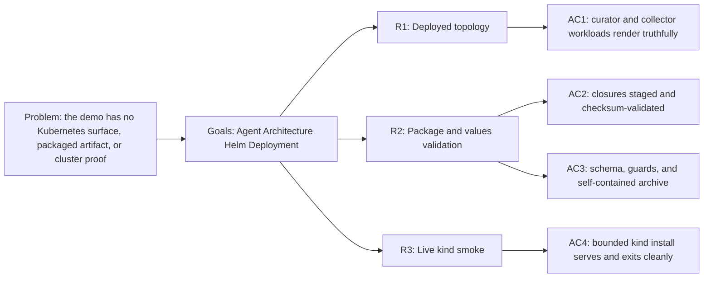
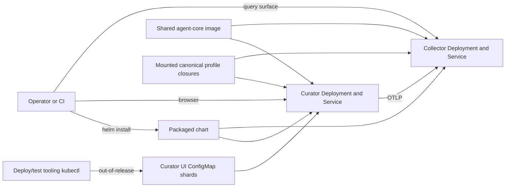

<!-- Copyright (c) 2026 Nokia -->
<!-- SPDX-License-Identifier: BSD-3-Clause -->

<!-- field: context -->
## Context

Release 00.0 and Release 01.0 run the guided demo as local processes: mage
run builds agent-core, starts the canonical collector agent and the canonical
documentation-curator, and the operator drives the curator through its
catalog-owned browser interface. The next capability moves that same
composition onto Kubernetes. A chart runs the documentation-curator and the
collector as persistent workloads, a deterministic package stages the
catalog-owned profile closures the workloads mount, a values schema owns the
shape of the deployment values, and a bounded kind target proves the packaged
chart installs and serves on a real cluster.

The chart deploys canonical profiles by reference. It copies neither the
documentation-curator profile config nor the collector profile; it stages
their prepared closures and mounts them into the shared agent-core image both
workloads run, the same ownership boundary the local demo keeps. The curator's
browser UI exceeds the profile ConfigMap payload limit, so it ships as gzipped,
sharded ConfigMaps the curator init container unpacks into its workspace,
keeping the application off any per-app runtime image (R1.2, GH-1368).

<!-- field: problem -->
## Problem

The demo has no Kubernetes surface. Its managed services run only as local
processes, so the composition cannot be installed, upgraded, or proven on a
cluster, and there is no packaged artifact an operator can validate
independently of the source checkout. A Helm topology needs to preserve the
mounted-profile, canonical-reference, lifecycle-health, and trace-export
contracts the local demo already keeps, reject unsafe or incoherent values
before it renders, and carry enough of its own closure that the archive
installs without the repository present.

<!-- field: goals -->
## Goals

- G1: Render a Kubernetes topology that runs the canonical documentation-curator and the canonical collector agent as persistent workloads from mounted profile closures.
- G2: Stage the catalog-owned curator and collector profile closures as a deterministic, checksum-validated package that the chart mounts, and own the deployment values with a values schema.
- G3: Prove the packaged chart on a bounded kind cluster, installing only the validated archive and observing curator and collector readiness, a browsable curator surface, an exported trace, and clean lifecycle exit.
- G4: Keep the ownership boundary the local demo keeps, mounting canonical profile config into the shared agent-core image rather than copying it into the chart; the curator's oversized browser UI ships as sharded ConfigMaps unpacked at startup, not baked into a per-app image (R1.2, GH-1368).

<!-- req: R1 -->
## R1 - Deployed topology

<!-- req: R1.1 -->
### R1.1

The chart shall render one Deployment and one ClusterIP Service for the documentation-curator and one Deployment and one ClusterIP Service for the collector agent.

<!-- req: R1.2 -->
### R1.2

Both workloads shall run the shared agent-core image and shall select their mounted canonical profile config at startup rather than embedding the profile in the image. The documentation-curator's browser UI and catalog docs assets exceed the profile ConfigMap payload limit; they shall ship as gzipped, sharded ConfigMaps provisioned out-of-release by the deploy/test tooling and referenced by name (curatorUI.shards), which the curator init container concatenates and unpacks into its writable workspace at startup so the profile's static_assets roots and document root resolve. They are provisioned outside the Helm release, not baked into a per-app runtime image, because the incompressible gzipped UI would otherwise push the Helm release Secret past the apiserver's request limit (GH-1368, GH-1402).

<!-- req: R1.3 -->
### R1.3

The curator Service shall expose the documentation, lifecycle-control, and monitor ports, and the collector Service shall expose the receiver, control, and query ports the local demo binds.

<!-- req: R1.4 -->
### R1.4

Readiness and liveness probes shall call each workload's real lifecycle health endpoint; process existence alone shall not satisfy readiness.

<!-- req: R1.5 -->
### R1.5

The curator shall export OTLP traces to the in-cluster collector by a values-selected endpoint and service name, and the collector shall spool traces and serve its query surface.

<!-- req: R1.6 -->
### R1.6

Both pods shall use non-root, no-privilege-escalation, dropped-capability, read-only-root, and disabled service-account-token defaults.

<!-- req: R2 -->
## R2 - Package and values validation

<!-- req: R2.1 -->
### R2.1

A mage preparation target shall regenerate the catalog-owned curator and collector profile closures and atomically stage them as the chart's only profile source.

<!-- req: R2.2 -->
### R2.2

Role manifests shall carry a deterministic checksum over ordered path and content bytes, and preparation shall reject stale roles, unknown fields, missing or extra files, checksum mismatch, and out-of-bound ConfigMap partitions before staging.

<!-- req: R2.3 -->
### R2.3

A values.schema.json shall reject unknown keys and malformed image, replica, port, resource, storage, URL, mount, security, and telemetry values, and template guards shall retain mount, fixed-port, and telemetry invariants when schema validation is bypassed.

<!-- req: R2.4 -->
### R2.4

A package target shall stage the chart, run the default and CI render matrix, and create one self-contained archive whose validation requires Chart.yaml, values, schema, core templates, and every generated profile file and rejects links.

<!-- req: R2.5 -->
### R2.5

The resulting archive shall lint and render from a directory with no source checkout present.

<!-- req: R3 -->
## R3 - Live kind smoke

<!-- req: R3.1 -->
### R3.1

A kind target shall skip with a named missing prerequisite when Docker, kind, Helm, kubectl, required checkouts, or Docker health are unavailable, own only clusters it creates, and use a temporary kubeconfig.

<!-- req: R3.2 -->
### R3.2

The target shall install only the validated archive, build and load the shared agent-core image the chart references for both workloads, mount the packaged curator and collector closures, and provision the curator UI shard ConfigMaps out-of-release (kubectl) so the curator mounts and unpacks them.

<!-- req: R3.3 -->
### R3.3

The curator and collector Deployments and their real lifecycle health endpoints shall become ready, the curator surface shall serve its documentation interface, and a declarative lifecycle-exit request shall stop the curator cleanly.

<!-- req: R3.4 -->
### R3.4

The collector shall retain a trace the curator exports under the curator service name, proving the in-cluster trace path end to end.

<!-- req: R3.5 -->
### R3.5

Smoke-owned namespace, release, forwards, temporary files, and any owned cluster shall be cleaned in all terminal paths, and failure diagnostics shall share one deadline and include Helm status, workloads, events, and targeted curator and collector logs.

<!-- field: non_goals -->
## Non-goals

- Forking the canonical documentation-curator or collector profiles into this application.
- Baking application profile or UI assets into a per-application runtime image.
- Moving application-owned applier behavior into the deployment chart.

<!-- field: acceptance_criteria -->
## Acceptance criteria

<!-- ac: AC1 -->
### AC1

Helm renders exactly one curator and one collector workload with the shared profile-free agent-core image, mounted canonical closures, the curator UI shard ConfigMaps, fixed Services, truthful lifecycle probes, curator-to-collector OTLP export, and hardened pod security.

<!-- field: traces -->
#### Traces

- R1

<!-- ac: AC2 -->
### AC2

Preparation regenerates and checksum-validates the catalog-owned curator and collector closures and rejects stale, tampered, or out-of-bound package inputs before staging.

<!-- field: traces -->
#### Traces

- R2.1
- R2.2

<!-- ac: AC3 -->
### AC3

The values schema and template guards accept every valid fixture and reject each invalid fixture by its offending field, and the self-contained archive lints and renders without a source checkout.

<!-- field: traces -->
#### Traces

- R2.3
- R2.4
- R2.5

<!-- ac: AC4 -->
### AC4

A bounded kind install of the validated archive brings the curator and collector to real readiness, serves the curator surface, exits it cleanly, retains an exported curator trace in the collector, skips on missing prerequisites, and cleans up on every terminal path.

<!-- field: traces -->
#### Traces

- R3

<!-- field: external_contracts | form: "tree" -->
## External contracts

1. - id: srd002-managed-application-services
   - owner: applications
   - symbols_used:
     1. R4
     1. R5
     1. R6
   - usage:
     This document supplies the packaged, helm_managed, and kind_demo evidence
     the shared capability contract requires, citing R4 through R6 rather than
     copying them.
1. - id: srd011-knowledge-manager
   - owner: applications/catalog
   - usage:
     Defines the canonical documentation-curator profile, catalog-owned user
     interface, and lifecycle outcomes the chart deploys by reference.

<!-- field: implementation_status -->
## Implementation status

<!-- field: implemented | form: "empty list" -->
### Implemented

None

<!-- field: planned -->
### Planned

- The chart -- the curator and collector Deployments and Services on the shared agent-core image, the mounted-closure ConfigMaps, the curatorUI.shards references to the out-of-release UI shard ConfigMaps, the lifecycle probes, and the curator-to-collector OTLP wiring -- the mage preparation and package targets that stage and checksum the catalog-owned closures, the deploy/test tooling that provisions the curator UI shard ConfigMaps out-of-release, the values.schema.json and template guards, the self-contained archive validation, and the bounded kind smoke target. The code lands in later sub-issues of the release; this document and its use cases and test suites land first.

<!-- field: diagrams -->
## Diagrams

<!-- field: requirements_trace -->
### Requirements trace

<!-- field: deployed_topology -->
### Deployed topology

