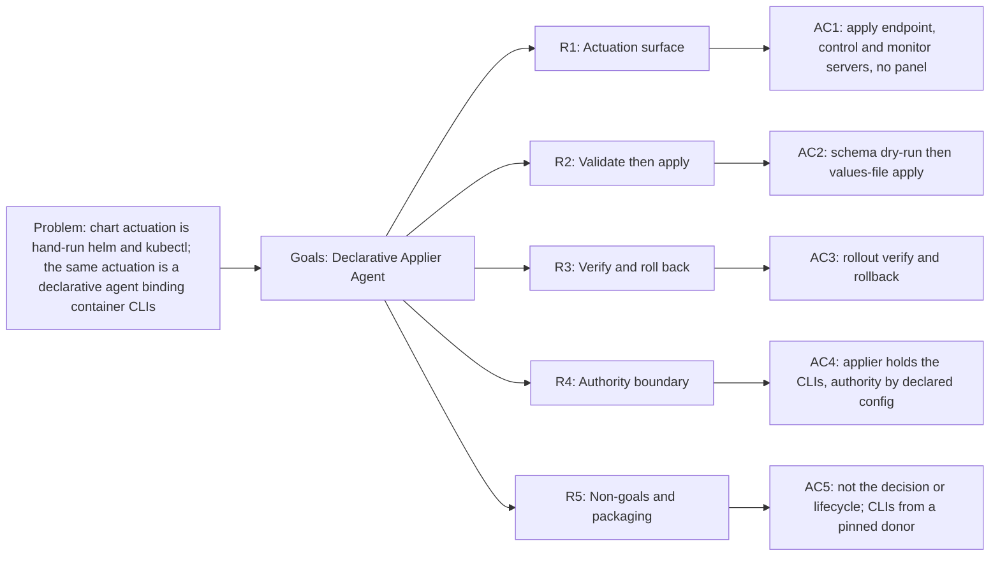
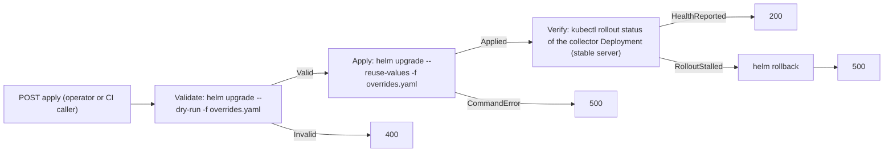

<!-- Copyright (c) 2026 Nokia -->
<!-- SPDX-License-Identifier: BSD-3-Clause -->

<!-- field: context -->
## Context

The applier is the Agent Architecture deployment-plane actuator: a standalone
declarative agent that realizes a decided values-plane change against the
chart (srd001) on Kubernetes. The Agent Architecture chart serves the
documentation-curator and the collector; it runs no control plane, no
in-cluster creator, and no provisioning panel. The applier therefore takes its
decided input from outside the cluster. An authorized operator or CI caller
reaches the apply surface, submits a values-plane patch for the chart, and the
applier validates it, applies it as a rollout, verifies the rollout, and rolls
back on failure.

The applier acts; it decides nothing. The caller decides the values change and
submits it; the applier receives that decided document and realizes it. It
edits deployment values and triggers rollouts only. It never submits a host,
URL, method, or credential to a running curator or collector. Authority is set
by declared, validated config, never by this actuation surface. The reusable
lifecycle and validate-apply-verify-rollback machines and shared ToolDefs live
in the catalog applier family (srd022). This application owns its endpoint,
chart, schema, Helm and kubectl bindings, collector rollout target, RBAC, and
caller authorization; agent-core owns runtime execution.

<!-- field: problem -->
## Problem

The chart (srd001) is installed and upgraded by an operator running helm and
kubectl by hand or from a CI script. The same actuation is expressible as a
declarative agent: a state machine binding the helm and kubectl CLIs present
in its container, with values validation moved to the chart's native
values.schema.json (srd001 R2) and the rollout phase read from a CLI exit
code. The requirements must name the actuation surface, the validate-then-apply
and verify-then-rollback machine, the authority boundary that keeps helm and
kubectl off the serving pods, and how the applier receives its CLIs without an image of its
own: it runs the shared agent-core image, a digest-pinned CLI donor delivers
helm and kubectl at pod start into a read-only volume, and the chart arrives as
a mounted volume rather than baked in (GH-2222). Because the Agent
Architecture has no control plane, the applier is a standalone actuator with no
panel state view and no in-cluster caller.

<!-- field: goals -->
## Goals

- G1: Model the applier as a standalone deployment-plane agent that exposes an apply surface an authorized operator or CI caller reaches from outside the serving pods.
- G2: Validate a submitted values patch against the chart's values.schema.json before applying, and apply it as a values-file rollout rather than per-field --set construction.
- G3: Verify the rollout of the collector Deployment -- the application's persistent, k8s-ready server -- from a CLI status read and roll the release back on an apply or verify failure. The bounded documentation-curator is a demo agent that recycles every control window and holds no durable rollout, so it is not a stable readiness target.
- G4: Hold helm and kubectl authority in the applier alone; the curator and collector carry none, and authority is set by declared, validated config.
- G5: Run the applier on the shared agent-core image, receive the helm and kubectl CLIs at pod start from a digest-pinned CLI donor into a read-only volume, and deliver the chart to the applier pod as a mounted volume, so no image diverges from the profile-free, binary-only image contract.

<!-- req: R1 -->
## R1 - Actuation surface

<!-- req: R1.1 -->
### R1.1

The applier shall expose one apply endpoint bound as a request-scoped machine_request (agent-core srd030) that accepts a decided values-plane patch for the chart and maps terminal signals to HTTP status.

<!-- req: R1.2 -->
### R1.2

The applier shall run a control server for health and lifecycle exit and a monitor server (agent-core srd033), with loopback-configurable bind addresses.

<!-- req: R1.3 -->
### R1.3

The apply request shall carry a schema_version-tagged, values-plane overrides document as its only content; the applier shall reject an unknown schema_version.

<!-- req: R1.4 -->
### R1.4

The applier shall serve no panel state view and shall depend on no in-cluster creator, orchestrator, or provisioning panel, because the Agent Architecture runs no control plane; the caller is an authorized operator or CI process reaching the apply surface.

<!-- req: R2 -->
## R2 - Validate then apply

<!-- req: R2.1 -->
### R2.1

The applier shall validate a submitted values document against the chart's values.schema.json (srd001 R2) by a helm upgrade dry-run before applying, rejecting a non-conforming document with a client error and no rollout.

<!-- req: R2.2 -->
### R2.2

The applier shall write the validated values document to an overrides file and apply it with helm upgrade --reuse-values -f overrides.yaml, returning without waiting so the rollout is verified separately, re-rendering the prepared topology, rather than constructing per-field --set arguments.

<!-- req: R2.3 -->
### R2.3

The apply request shall be values-plane only; the applier shall not submit a host, URL, method, or credential to a running curator or collector.

<!-- req: R3 -->
## R3 - Verify and roll back

<!-- req: R3.1 -->
### R3.1

After an apply, the applier shall verify the collector Deployment via kubectl rollout status and report the phase from its exit outcome. The collector is the verify target because it is the application's persistent, k8s-ready server; the bounded documentation-curator recycles every control window and never holds a durable rollout, so verifying it would time out on every healthy apply. The rollout-read endpoint reads the same collector Deployment for the same reason.

<!-- req: R3.2 -->
### R3.2

On a verify failure, the applier shall roll the release back with an explicit helm rollback and report the failure; an apply that fails at the helm upgrade command shall be reported as a failure for operator attention.

<!-- req: R3.3 -->
### R3.3

A rollout status the cluster cannot serve shall return a gateway error rather than a phase, so a broken read is never reported as a progressing rollout.

<!-- req: R4 -->
## R4 - Authority boundary

<!-- req: R4.1 -->
### R4.1

The applier alone shall hold the helm and kubectl CLIs bound as exec tools (agent-core srd021); the curator and collector profiles shall carry no deployment CLI and no actuation authority.

<!-- req: R4.2 -->
### R4.2

Authority shall be set by declared, validated config, never by this actuation surface (agent-core srd028 V30); the applier shall accept no endpoint or credential for a running agent, and REST authority shall live in the applier's declared configuration with no runtime input supplying transport authority.

<!-- req: R4.3 -->
### R4.3

The apply surface shall be unreachable from the curator and collector pods, enforced at the network layer rather than in the profile, because the declarative REST servers carry no inbound authentication; the reachable caller is an authorized operator or CI process alone.

<!-- req: R5 -->
## R5 - Non-goals and packaging

<!-- req: R5.1 -->
### R5.1

The applier shall not decide the values change; the authorized operator or CI caller decides it and submits it as the apply request's values-plane content.

<!-- req: R5.2 -->
### R5.2

The applier shall not select workload profiles or own agent lifecycle; those remain the packaging and chart's (srd001).

<!-- req: R5.3 -->
### R5.3

The applier shall run the shared agent-core image and receive the helm and kubectl CLIs at pod start from a digest-pinned CLI donor image (applier.cliDonor.image) that an init container copies into a volume mounted read-only at /opt/tools and placed first on the applier's PATH, so the binaries it execs cannot be replaced at runtime; the chart shall be delivered to the applier pod as a mounted volume rather than baked into an image. No image diverges from the profile-free, binary-only image contract (srd001 R1.2, GH-2222).

<!-- field: non_goals -->
## Non-goals

- The applier does not decide the values change; the authorized operator or CI caller decides it and submits it as the apply request's values-plane content.
- The applier does not select workload profiles or own agent lifecycle; those remain the packaging and chart's (srd001).
- The applier runs the shared agent-core image and receives the helm and kubectl CLIs at pod start from a digest-pinned CLI donor image (applier.cliDonor.image) that an init container copies into a volume mounted read-only at /opt/tools and placed first on the applier's PATH, so the binaries it execs cannot be replaced at runtime; the chart is delivered to the applier pod as a mounted volume rather than baked into an image. No image diverges from the profile-free, binary-only image contract (srd001 R1.2, GH-2222).

<!-- field: acceptance_criteria -->
## Acceptance criteria

<!-- ac: AC1 -->
### AC1

The applier exposes an apply endpoint bound as a request-scoped machine_request that accepts a schema_version-tagged values-plane document, alongside control and monitor servers on loopback-configurable addresses, and serves no panel state view and depends on no in-cluster caller.

<!-- field: traces -->
#### Traces

- [R1.1](#r11)
- [R1.2](#r12)
- [R1.3](#r13)
- [R1.4](#r14)

<!-- ac: AC2 -->
### AC2

A submitted values document is validated against the chart's values.schema.json by a helm dry-run and, when valid, written to an overrides file and applied with helm upgrade --reuse-values -- values-plane only, with no per-field --set construction and no endpoint submitted to a running agent.

<!-- field: traces -->
#### Traces

- [R2.1](#r21)
- [R2.2](#r22)
- [R2.3](#r23)

<!-- ac: AC3 -->
### AC3

The rollout of the collector Deployment -- the application's stable, k8s-ready server, chosen over the bounded documentation-curator -- is verified via kubectl rollout status and its phase reported, a status the cluster cannot serve returns a gateway error rather than a phase, and an apply or verify failure rolls the release back and reports the failure.

<!-- field: traces -->
#### Traces

- [R3.1](#r31)
- [R3.2](#r32)
- [R3.3](#r33)

<!-- ac: AC4 -->
### AC4

The applier alone holds helm and kubectl bound as exec tools, the curator and collector carry none, authority is set by declared validated config and never by this surface (agent-core srd028 V30), and the apply surface is unreachable from the serving pods at the network layer.

<!-- field: traces -->
#### Traces

- [R4.1](#r41)
- [R4.2](#r42)
- [R4.3](#r43)

<!-- ac: AC5 -->
### AC5

Deciding the values (the operator or CI caller) and profile selection or lifecycle (packaging and chart) are non-goals, and the applier runs the shared agent-core image with helm and kubectl delivered at pod start from the pinned CLI donor into a read-only /opt/tools, and the chart delivered to the applier pod as a mounted volume, so no image diverges from the binary-only image contract.

<!-- field: traces -->
#### Traces

- [R5.1](#r51)
- [R5.2](#r52)
- [R5.3](#r53)

<!-- field: platform_dependencies_note -->
## Platform dependencies note

agent-core runtime contracts this agent builds on. External references, owned by agent-core, not part of this application's corpus.

<!-- field: platform_dependencies | form: "typed table" -->
## Platform dependencies

| srd_id | provider | symbols_used |
| --- | --- | --- |
| srd022-applier | applications/catalog | [R1, R2, R3, R4, R5] |
| srd029-rest-server-tools | agent-core | [R1] |
| srd030-machine-request-rest-binding | agent-core | [R1] |
| srd033-monitor-rest-api | agent-core | [R1] |
| srd021-agent-cli-exec-tool | agent-core | [R2, R3, R4] |
| srd028-rest-client-tools | agent-core | [V30] |

<!-- field: implementation_status -->
## Implementation status

<!-- field: implemented | form: "empty list" -->
### Implemented

None

<!-- field: planned -->
### Planned

- The applier profile -- its apply, control, and monitor servers, the validate-apply-verify-rollback request machine, and the declared helm and kubectl exec bindings -- a chart values.schema.json validate step, the applier Deployment, image, and NetworkPolicy that keep the apply surface off the serving pods, and an integration target that drives a values patch through validate, apply, verify, and rollback against the packaged chart on the kind rig (srd001 R3). The applier runs the shared agent-core image; helm and kubectl arrive at pod start from a pinned CLI donor into a read-only volume, and the chart as a mounted volume (GH-2222). The code lands in later sub-issues of the release; this document and its use case and test suite land first.

<!-- field: diagrams -->
## Diagrams

<!-- field: requirements_trace -->
### Requirements trace

<!-- field: actuation_machine -->
### Actuation machine

