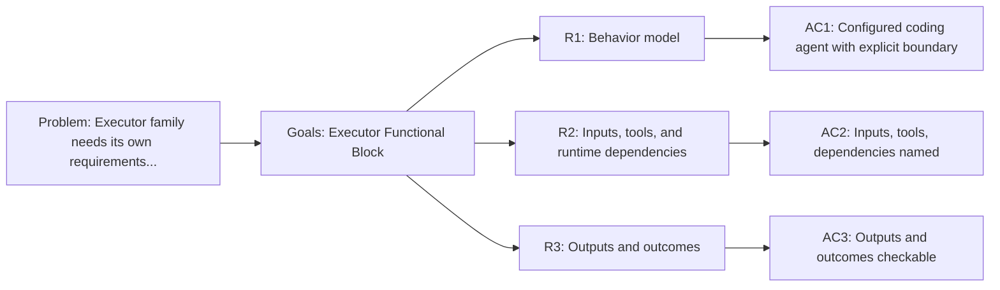

<!-- Copyright (c) 2026 Nokia -->
<!-- SPDX-License-Identifier: BSD-3-Clause -->

<!-- field: context -->
## Context

The executor profile is a coding agent. It receives a task and a workspace,
invokes a model boundary, dispatches filesystem and validation tools, and lets
machine-declared validation decide the terminal outcome. This SRD owns the
executor family requirements that srd001-agent-functional-blocks previously
held as block R2.

The block names the contract the executor presents to the rest of the profile
system. It does not own the Go code that executes a word; that runtime stays in
agent-core.

<!-- field: problem -->
## Problem

The executor family needs its own requirements document so that changes to
executor behavior do not churn a shared cross-family file. The requirements
must name profile-owned configured behavior separately from agent-core-owned
runtime capability.

<!-- field: goals -->
## Goals

- G1: Model the executor profile as a configured coding agent functional block.
- G2: Record the executor actor boundary, inputs, tool selections, runtime dependencies, outputs, and terminal outcomes.
- G3: Keep executor behavior profile-owned while agent-core supplies loop runtime and builtin tools.

<!-- req: R1 -->
## R1 - Behavior model

<!-- req: R1.1 -->
### R1.1

The executor profile must model a coding agent that receives a task and workspace, invokes an LLM boundary, dispatches file and validation tools, and ends only after machine-declared validation.

<!-- req: R1.2 -->
### R1.2

The executor actor boundary is the model boundary plus workspace filesystem and validation commands.

<!-- req: R2 -->
## R2 - Inputs, tools, and runtime dependencies

<!-- req: R2.1 -->
### R2.1

Executor inputs must include a task prompt, a mounted workspace, and a selected model config.

<!-- req: R2.2 -->
### R2.2

The executor profile must select the filesystem, LLM, and Go exec validation tool families.

<!-- req: R2.3 -->
### R2.3

Executor runtime dependencies are the agent-core loop runtime, the agent-core builtin filesystem and LLM tools, and agent-core exec tool declarations for Go validation.

<!-- req: R3 -->
## R3 - Outputs and outcomes

<!-- req: R3.1 -->
### R3.1

Executor outputs must include a changed workspace, terminal status, tool results, validation results, and a traceable task summary.

<!-- req: R3.2 -->
### R3.2

Executor terminal outcomes must be Succeeded, Failed, or BudgetExceeded.

<!-- field: non_goals -->
## Non-goals

- Define Go package APIs for the agent-core loop runtime.
- Reimplement builtin filesystem, LLM, or exec tool behavior in applications/catalog.
- Own cross-profile dependency-direction invariants; those stay in srd001.

<!-- field: acceptance_criteria -->
## Acceptance criteria

<!-- ac: AC1 -->
### AC1

The executor profile is described as a configured coding agent with an explicit actor boundary rather than a Go package.

<!-- field: traces -->
#### Traces

- R1.1
- R1.2

<!-- ac: AC2 -->
### AC2

Executor inputs, selected tool families, and runtime dependencies are named and separated from agent-core runtime capability.

<!-- field: traces -->
#### Traces

- R2.1
- R2.2
- R2.3

<!-- ac: AC3 -->
### AC3

Executor outputs and terminal outcomes are checkable by mounted execution or integration targets.

<!-- field: traces -->
#### Traces

- R3.1
- R3.2

<!-- field: diagrams -->
## Diagrams

<!-- field: requirements_trace -->
### Requirements trace

