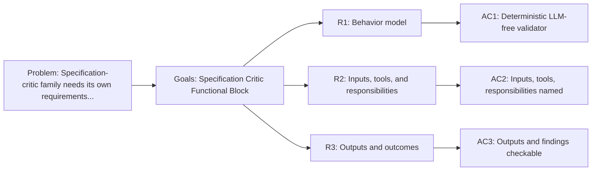

<!-- Copyright (c) 2026 Nokia -->
<!-- SPDX-License-Identifier: BSD-3-Clause -->

<!-- field: historical_aliases -->
## Historical aliases

- srd005-jurist

<!-- field: context -->
## Context

The specification-critic profile is a specification validator. It runs deterministic charter
suites over a target directory with no LLM boundary and reports provenance-rich
findings. This SRD owns the specification-critic family requirements that
srd001-agent-functional-blocks previously held as block R5.

The block names the contract the specification critic presents to the rest of the profile
system. Spec validation tools stay in agent-core; charter suites stay
profile-owned.

<!-- field: problem -->
## Problem

The specification-critic family needs its own requirements document so that changes to
charter validation behavior do not churn a shared cross-family file. The
requirements must name profile-owned charter suites separately from the
agent-core spec validation tools.

<!-- field: goals -->
## Goals

- G1: Model the specification-critic profile as a deterministic, LLM-free specification validator functional block.
- G2: Record the specification-critic actor boundary, inputs, tool selection, runtime dependencies, outputs, and terminal outcomes.
- G3: Keep charter suites profile-owned while agent-core supplies spec validation tools.

<!-- req: R1 -->
## R1 - Behavior model

<!-- req: R1.1 -->
### R1.1

The specification-critic profile must model deterministic specification corpus validation with no LLM boundary.

<!-- req: R1.2 -->
### R1.2

Jurist charter checks must remain LLM-free, network-free, read-only, and deterministic across repeated runs over the same target directory and suite files.

<!-- req: R2 -->
## R2 - Inputs, tools, and responsibilities

<!-- req: R2.1 -->
### R2.1

Specification-critic inputs must include a filesystem target directory and one or more deterministic charter suite paths.

<!-- req: R2.2 -->
### R2.2

The specification-critic profile must select the specification validation tool family backed by agent-core spec validation tools.

<!-- req: R2.3 -->
### R2.3

Specification-critic responsibilities must cover corpus loading, graph validation, consistency checks, external rg search, finding reduction, and report formatting.

<!-- req: R2.4 -->
### R2.4

grep_check search and reduction must be visible machine steps; the search word must declare rg as its executable dependency and consume charter pattern, root, include, and exclude inputs.

<!-- req: R2.5 -->
### R2.5

The specification-critic audit variant must load formal test claims, declare Go module, package, test-list, and test-run exec words, normalize package inventory through bounded command-state stdin, resolve claims visibly against inventory, reduce run events visibly, and share the specification-critic report path; pkg/spec must remain a pure reducer with no Go subprocess execution.

<!-- req: R3 -->
## R3 - Outputs and outcomes

<!-- req: R3.1 -->
### R3.1

Specification-critic outputs must include a formatted validation report and a passed or failed status.

<!-- req: R3.2 -->
### R3.2

Specification-critic findings must identify the suite, check, severity, message, and any available file and line provenance so consumers can act on failures without reading Go code.

<!-- req: R3.3 -->
### R3.3

Specification-critic terminal outcomes must be Passed or Failed.

<!-- field: non_goals -->
## Non-goals

- Define Go package APIs for the agent-core spec validation tools.
- Introduce an LLM boundary or network access into charter validation.
- Own cross-profile dependency-direction invariants; those stay in srd001.
- Rename the stable Jurist charter format or jurist_rg tool word; these name capability vocabulary, not profile identity.

<!-- field: acceptance_criteria -->
## Acceptance criteria

<!-- ac: AC1 -->
### AC1

The specification-critic profile is described as a deterministic, LLM-free validator rather than a Go package.

<!-- field: traces -->
#### Traces

- R1.1
- R1.2

<!-- ac: AC2 -->
### AC2

Specification-critic inputs, selected tool family, visible rg and test-evidence execution/reduction steps, and responsibilities are named and separated from agent-core runtime capability.

<!-- field: traces -->
#### Traces

- R2.1
- R2.2
- R2.3
- R2.4
- R2.5

<!-- ac: AC3 -->
### AC3

Specification-critic outputs, provenance-rich findings, and terminal outcomes are checkable by profile validation.

<!-- field: traces -->
#### Traces

- R3.1
- R3.2
- R3.3

<!-- field: diagrams -->
## Diagrams

<!-- field: requirements_trace -->
### Requirements trace

