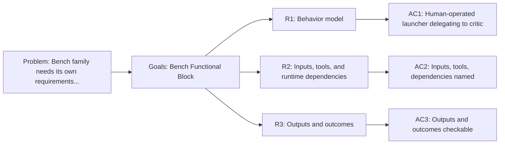

<!-- Copyright (c) 2026 Nokia -->
<!-- SPDX-License-Identifier: BSD-3-Clause -->

<!-- field: context -->
## Context

The bench profile is a human-operated evaluation launcher. It serves a web UI
for experiment browsing, launches critic runs as detached children through a
launch capability, and keeps serving while they run. This SRD owns the bench family requirements that
srd001-agent-functional-blocks previously held as block R6.

The block names the contract the bench presents to the rest of the profile
system. Experiment execution launches the critic profile; the bench does not
own evaluation session logic.

<!-- field: problem -->
## Problem

The bench family needs its own requirements document so that changes to bench
UI or launch behavior do not churn a shared cross-family file. The requirements
must name profile-owned bench UI behavior separately from the critic profile
and generic agent-core REST, filesystem, evaluation-query, predicate, and
child-agent primitives.

<!-- field: goals -->
## Goals

- G1: Model the bench profile as a human-operated evaluation launcher functional block.
- G2: Record the bench actor boundary, inputs, tool selections, runtime dependencies, outputs, and terminal outcomes.
- G3: Keep bench UI behavior profile-owned while delegating evaluation session logic to the critic profile.

<!-- req: R1 -->
## R1 - Behavior model

<!-- req: R1.1 -->
### R1.1

The bench profile must model a human-operated web UI block that serves experiment browsing, launches critic runs as detached children through a launch capability, and keeps serving while they run.

<!-- req: R1.2 -->
### R1.2

The bench actor boundary is a human HTTP operator, not an LLM.

<!-- req: R1.3 -->
### R1.3

Bench relationships must show that experiment execution launches the critic profile rather than owning evaluation session logic.

<!-- req: R2 -->
## R2 - Inputs, tools, and runtime dependencies

<!-- req: R2.1 -->
### R2.1

Bench inputs must include a human UI action and an experiment configuration.

<!-- req: R2.2 -->
### R2.2

The bench profile must declare its UI assets, REST routes, host machine as a serve-machine-template instance, request machine, experiments launch capability profile, and control and monitor servers.

<!-- req: R2.3 -->
### R2.3

Bench runtime dependencies are generic REST lifecycle and machine_request, the serve lifecycle and monitor fragments, filesystem resources, deterministic evaluation queries, the service-child words start_service and list_services (srd040 R7), compose, and exec.

<!-- req: R2.4 -->
### R2.4

No bench-specific HTTP server, action channel, or child launcher may be linked into the agent executable.

<!-- req: R2.5 -->
### R2.5

Model-profile summaries exposed by the bench UI must be profile-owned, non-empty, and independent of process working directory or an agent-core source checkout.

<!-- req: R3 -->
## R3 - Outputs and outcomes

<!-- req: R3.1 -->
### R3.1

Bench outputs must include a served UI, a detached critic run handle, and a listing of runs with their outcomes.

<!-- req: R3.2 -->
### R3.2

Bench terminal outcomes must be Done or Failed.

<!-- req: R3.3 -->
### R3.3

The model-profile route must return the deterministic profile-owned summary catalog or fail visibly; missing external source trees must not become an empty success.

<!-- req: R3.4 -->
### R3.4

Concurrent runs must be bounded by a max_running declared on the launch word; a launch at the bound must return HTTP 429 and start nothing.

<!-- req: R3.5 -->
### R3.5

The experiments listing must report each run started since the host launched as running, or as exited with its exit code.

<!-- field: non_goals -->
## Non-goals

- Define a bench-specific Go HTTP or workflow package.
- Reimplement critic session logic inside the bench profile.
- Own cross-profile dependency-direction invariants; those stay in srd001.
- Make concurrent runs comparable to serialized ones. Runs taken at the same time share host CPU and any fixture their suites touch; an operator who needs serialized results launches one run at a time.

<!-- field: acceptance_criteria -->
## Acceptance criteria

<!-- ac: AC1 -->
### AC1

The bench profile is described as a human-operated launcher that delegates to critic rather than a Go package.

<!-- field: traces -->
#### Traces

- R1.1
- R1.2
- R1.3

<!-- ac: AC2 -->
### AC2

Bench inputs, selected tool families, and runtime dependencies are named and separated from agent-core runtime capability.

<!-- field: traces -->
#### Traces

- R2.1
- R2.2
- R2.3
- R2.5

<!-- ac: AC3 -->
### AC3

Bench outputs and terminal outcomes are checkable by mounted execution or integration targets, including overlapping runs, the declared bound, and the listed outcomes.

<!-- field: traces -->
#### Traces

- R3.1
- R3.2
- R3.3
- R3.4
- R3.5

<!-- ac: AC4 -->
### AC4

The agent executable carries no bench package, HTTP server, action channel, or child launcher, and the shipped bench profile serves its UI, routes, and children on the stock binary from a working directory that is not an agent-core checkout.

<!-- field: traces -->
#### Traces

- R2.4

<!-- field: diagrams -->
## Diagrams

<!-- field: requirements_trace -->
### Requirements trace

