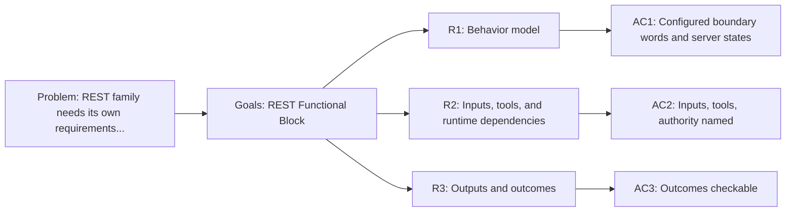

<!-- Copyright (c) 2026 Nokia -->
<!-- SPDX-License-Identifier: BSD-3-Clause -->

<!-- field: context -->
## Context

The REST profile is a configured HTTP boundary sample. It models client and
server boundary words as explicit MachineSpec steps and keeps REST authority in
profile-owned definitions. This SRD owns the REST family requirements that
srd001-agent-functional-blocks previously held as block R7.

The block names the contract the REST profile presents to the rest of the
profile system. The reusable HTTP runtime stays in agent-core; the REST
definitions stay profile-owned.

<!-- field: problem -->
## Problem

The REST family needs its own requirements document so that changes to REST
boundary behavior do not churn a shared cross-family file. The requirements
must name profile-owned REST definitions separately from the agent-core HTTP
runtime.

<!-- field: goals -->
## Goals

- G1: Model the REST profile as a configured HTTP client and server boundary functional block.
- G2: Record the REST actor boundary, inputs, tool selections, runtime dependencies, outputs, and terminal outcomes.
- G3: Keep REST authority profile-owned while agent-core supplies the reusable HTTP runtime.

<!-- req: R1 -->
## R1 - Behavior model

<!-- req: R1.1 -->
### R1.1

The REST profile must model configured client and server boundary words as explicit MachineSpec steps.

<!-- req: R1.2 -->
### R1.2

REST server launch, await, and stop must be explicit machine states.

<!-- req: R2 -->
## R2 - Inputs, tools, and runtime dependencies

<!-- req: R2.1 -->
### R2.1

REST inputs must include REST definitions, OpenAPI import data, and inbound webhook events.

<!-- req: R2.2 -->
### R2.2

The REST profile must select the REST client, REST async client, and REST server tool families.

<!-- req: R2.3 -->
### R2.3

REST authority must live in profile-owned REST definitions, declarations, and machine transitions while agent-core supplies the reusable HTTP runtime.

<!-- req: R3 -->
## R3 - Outputs and outcomes

<!-- req: R3.1 -->
### R3.1

REST outcomes must include configured response signals, async completion, inbound event signals, listener lifecycle, and failure or timeout states.

<!-- req: R3.2 -->
### R3.2

REST terminal outcomes must be Succeeded or Failed.

<!-- field: non_goals -->
## Non-goals

- Define Go package APIs for the agent-core HTTP runtime.
- Reimplement HTTP client or server transport in applications/catalog.
- Own cross-profile dependency-direction invariants; those stay in srd001.

<!-- field: acceptance_criteria -->
## Acceptance criteria

<!-- ac: AC1 -->
### AC1

The REST profile is described as configured boundary words and explicit server states rather than a Go package.

<!-- field: traces -->
#### Traces

- R1.1
- R1.2

<!-- ac: AC2 -->
### AC2

REST inputs, selected tool families, and profile-owned authority are named and separated from agent-core runtime capability.

<!-- field: traces -->
#### Traces

- R2.1
- R2.2
- R2.3

<!-- ac: AC3 -->
### AC3

REST outcomes and terminal outcomes are checkable by profile validation or integration targets.

<!-- field: traces -->
#### Traces

- R3.1
- R3.2

<!-- field: diagrams -->
## Diagrams

<!-- field: requirements_trace -->
### Requirements trace

