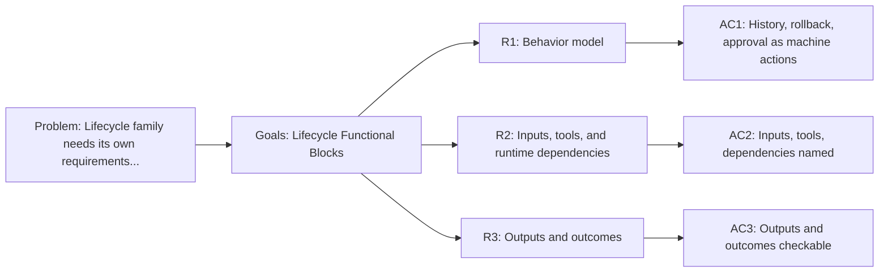

<!-- Copyright (c) 2026 Nokia -->
<!-- SPDX-License-Identifier: BSD-3-Clause -->

<!-- field: context -->
## Context

The lifecycle profiles cover checkpoint history inspection, rollback, and
approval. Each behavior is expressed as machine actions and visible signals.
This SRD owns the lifecycle family requirements that
srd001-agent-functional-blocks previously held as block R9.

The block names the contract the lifecycle profiles present to the rest of the
profile system. Lifecycle ports and the checkpoint store stay in agent-core; the
selected vocabulary and machine wiring stay profile-owned.

<!-- field: problem -->
## Problem

The lifecycle family needs its own requirements document so that changes to
history, rollback, or approval behavior do not churn a shared cross-family file.
The requirements must name profile-owned machine actions separately from the
agent-core lifecycle ports and checkpoint store.

<!-- field: goals -->
## Goals

- G1: Model lifecycle history, rollback, and approval as configured machine-action functional blocks.
- G2: Record the lifecycle actor boundary, inputs, tool selections, runtime dependencies, outputs, and terminal outcomes.
- G3: Keep lifecycle vocabulary profile-owned while agent-core supplies lifecycle ports and the checkpoint store.

<!-- req: R1 -->
## R1 - Behavior model

<!-- req: R1.1 -->
### R1.1

Lifecycle history must model checkpoint history inspection as a machine action that reads checkpoint state and reports success or failure.

<!-- req: R1.2 -->
### R1.2

Lifecycle rollback must model rollback as a machine action with explicit checkpoint and target inputs.

<!-- req: R1.3 -->
### R1.3

Lifecycle approval must model suspend, resume approval, resume rejection, and terminal outcomes through visible machine signals.

<!-- req: R2 -->
## R2 - Inputs, tools, and runtime dependencies

<!-- req: R2.1 -->
### R2.1

Lifecycle inputs must include a checkpoint ID, a target iteration, and an approval signal.

<!-- req: R2.2 -->
### R2.2

The lifecycle profiles must select the checkpoint_history, checkpoint_rollback, suspend, and done tool families.

<!-- req: R2.3 -->
### R2.3

Lifecycle runtime dependencies are the agent-core lifecycle ports, the checkpoint store, and receipt-backed rollback (opaque persisted receipts consumed by a receipt-walk Undo, replacing the earlier workspace-restore model).

<!-- req: R3 -->
## R3 - Outputs and outcomes

<!-- req: R3.1 -->
### R3.1

Lifecycle outputs must include a history report, a rewritten checkpoint, a suspended checkpoint, and an approved or rejected terminal state.

<!-- req: R3.2 -->
### R3.2

Lifecycle terminal outcomes must be Done, Succeeded, Rejected, or Failed.

<!-- field: non_goals -->
## Non-goals

- Define Go package APIs for the agent-core lifecycle ports or checkpoint store.
- Reimplement checkpoint or rollback storage in applications/catalog.
- Own cross-profile dependency-direction invariants; those stay in srd001.

<!-- field: acceptance_criteria -->
## Acceptance criteria

<!-- ac: AC1 -->
### AC1

Lifecycle history, rollback, and approval are described as machine actions and visible signals rather than Go packages.

<!-- field: traces -->
#### Traces

- R1.1
- R1.2
- R1.3

<!-- ac: AC2 -->
### AC2

Lifecycle inputs, selected tool families, and runtime dependencies are named and separated from agent-core runtime capability.

<!-- field: traces -->
#### Traces

- R2.1
- R2.2
- R2.3

<!-- ac: AC3 -->
### AC3

Lifecycle outputs and terminal outcomes are checkable by mounted execution or integration targets.

<!-- field: traces -->
#### Traces

- R3.1
- R3.2

<!-- field: diagrams -->
## Diagrams

<!-- field: requirements_trace -->
### Requirements trace

