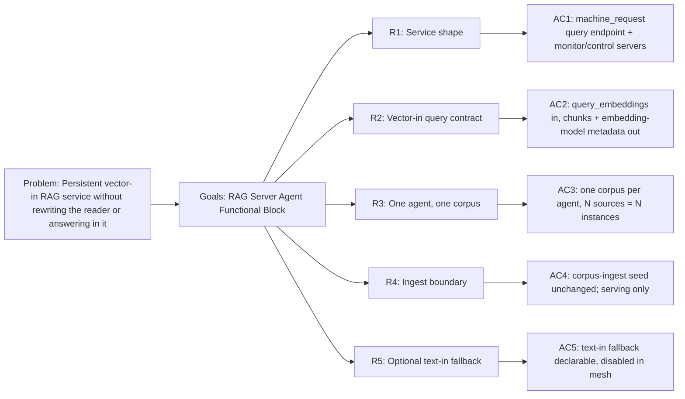

<!-- Copyright (c) 2026 Nokia -->
<!-- SPDX-License-Identifier: BSD-3-Clause -->

<!-- field: role_realization_decision -->
## Role realization decision

<!-- field: current_actor -->
### Current actor

rag-server

<!-- field: implemented_responsibility -->
### Implemented responsibility

Serve one configured corpus through a persistent vector-in retrieval boundary and return ranked chunks with embedding metadata.

<!-- field: canonical_role_sub_role -->
### Canonical role sub role

Knowledge Manager / Recommendation Generator.

<!-- field: retained_or_proposed_name -->
### Retained or proposed name

Retain `rag-server` as a descriptive serving actor.

<!-- field: authority_boundary -->
### Authority boundary

Reads one declared Chroma collection; it does not ingest, answer, manage another agent, or choose transport authority.

<!-- field: evidence -->
### Evidence

- agents/rag-server/profile.yaml
- agents/rag-server/request-machine.yaml
- srd001 R1-R4

<!-- field: migration_impact -->
### Migration impact

None; each values-named Helm RAG unit is a deployment instance that inherits this binding.

<!-- field: context -->
## Context

The `rag-server` actor assumes Knowledge Manager / Recommendation Generator
and re-hosts the Chroma reader as a persistent
retrieval service. The reader's deterministic chain -- chroma_ready,
ollama_ready, embed_query, create-or-get collection, chroma_query, answer -- is
a one-shot machine run today. The RAG server keeps the same retrieval chain but
places it behind a machine_request query endpoint (agent-core srd030), so each
inbound query is a request-scoped machine run against a long-lived process.

Two contract changes distinguish the server from the reader. First, the query
API is vector-in: the caller supplies query_embeddings rather than question
text, because in the chatbot mesh one embedding fans out to N RAG servers and
re-embedding per server would waste work and risk embedding-space drift.
Second, the LLM answering step moves out: the RAG server returns retrieved
chunks (ids, distances, metadata), and the chatbot agent composes and answers.
The RAG server is a retrieval boundary, not an answering agent.

The reusable HTTP runtime, machine_request binding, monitor server, and
embedding transport stay in agent-core. The Chroma REST definitions, the
collection identity, the served database, the query endpoint mapping, and the
bind addresses stay profile-owned.

<!-- field: problem -->
## Problem

The mesh needs a persistent RAG service with a stable, vector-in query contract
and observable, controllable lifetime, without rewriting the reader or folding
answering into the retrieval boundary. The requirements must name the service
shape, the vector-in query contract and embedding-model metadata, the
one-agent-one-corpus rule, the unchanged ingest path, and the optional text-in
fallback, separately from the agent-core request and monitor runtime.

<!-- field: goals -->
## Goals

- G1: Model a persistent RAG service that hosts the Chroma reader retrieval chain behind a machine_request query endpoint with monitor and control servers.
- G2: Define a vector-in query contract that returns chunks with the collection's embedding-model metadata so callers detect embedding-space mismatch.
- G3: Fix one agent to one served Chroma database and collection set, with multiple RAGs modeled as multiple instances rather than in-agent multiplexing.
- G4: Keep the corpus-ingest seed agent as the unchanged loading path and scope srd001 to serving.
- G5: Keep the query endpoint mapping, collection identity, served database, and bind addresses profile-owned while agent-core supplies the request, monitor, and embedding runtime.

<!-- req: R1 -->
## R1 - Service shape

<!-- req: R1.1 -->
### R1.1

The RAG server SHALL expose a machine_request query endpoint (agent-core srd030) that binds one inbound HTTP request to one request-scoped run of the retrieval machine and maps terminal signals to HTTP status.

<!-- req: R1.2 -->
### R1.2

The RAG server SHALL run a monitor server exposing the srd033 read-only views and SSE stream over cached monitor state.

<!-- req: R1.3 -->
### R1.3

The RAG server SHALL run a control server exposing lifecycle exit and a health check.

<!-- req: R1.4 -->
### R1.4

The query, monitor, and control server bind addresses SHALL be loopback-configurable inputs rather than agent-authored values.

<!-- req: R1.5 -->
### R1.5

The retrieval machine SHALL reuse the Chroma reader chain up to chroma_query -- chroma_ready, ollama_ready (for the text-in fallback only), create-or-get collection, and chroma_query -- without the invoke_llm answering step.

<!-- req: R2 -->
## R2 - Vector-in query contract

<!-- req: R2.1 -->
### R2.1

The query endpoint SHALL accept query_embeddings (a caller-supplied embedding vector) and a configured or request-supplied n_results, and SHALL NOT require question text on the mesh query path.

<!-- req: R2.2 -->
### R2.2

The query response SHALL return retrieved chunks with their record ids, distances, and metadata.

<!-- req: R2.3 -->
### R2.3

The query response metadata SHALL name the served collection's embedding model, so a caller can detect an embedding-space mismatch between its query vector and the collection.

<!-- req: R2.4 -->
### R2.4

The query endpoint SHALL thread query_embeddings into the chroma_query body using the single-token vector reshape (srd028 R12.5 / command_state), because a raw vector cannot be authored by a model.

<!-- req: R3 -->
## R3 - One agent, one corpus

<!-- req: R3.1 -->
### R3.1

A single RAG server agent SHALL serve exactly one Chroma database and its collection set; it SHALL NOT multiplex across databases or embedding models within one process.

<!-- req: R3.2 -->
### R3.2

A mesh of N RAG sources SHALL be N RAG server agent instances, each addressed as its own service, rather than one agent selecting among corpora at request time.

<!-- req: R4 -->
## R4 - Ingest boundary

<!-- req: R4.1 -->
### R4.1

The corpus-ingest seed agent SHALL remain the unchanged loading path for the served collection; srd001 SHALL define serving only and SHALL NOT alter ingest behavior.

<!-- req: R4.2 -->
### R4.2

The served Chroma database and collection SHALL be treated as an external precondition loaded out of band, surfaced through chroma_ready rather than created by the query path.

<!-- req: R5 -->
## R5 - Optional text-in fallback

<!-- req: R5.1 -->
### R5.1

A text-in query operation (embed the question locally through embed_query, then chroma_query) MAY be declared for standalone use of a single RAG server outside the mesh.

<!-- req: R5.2 -->
### R5.2

The text-in fallback SHALL be disabled in the mesh topology, where callers supply query_embeddings, so one embedding fans out to every RAG source unchanged.

<!-- field: non_goals -->
## Non-goals

- Define Go package APIs for the agent-core request, monitor, or embedding runtime.
- Compose or answer over retrieved chunks; the chatbot agent (srd002) owns answering.
- Change the corpus-ingest seed agent's ingest machine or its loading behavior.
- In-agent multiplexing across databases, collections, or embedding models.
- Define source-routing descriptions; those are deployment-topology metadata owned by the chatbot/deployment profile, not the one-agent-one-corpus RAG server contract.
- Durable per-session query state; the query path is request-scoped and stateless.

<!-- field: acceptance_criteria -->
## Acceptance criteria

<!-- ac: AC1 -->
### AC1

The RAG server is described as a persistent service hosting the reader retrieval chain behind a machine_request query endpoint, with monitor and control servers and loopback-configurable bind addresses.

<!-- field: traces -->
#### Traces

- [R1.1](#r11)
- [R1.2](#r12)
- [R1.3](#r13)
- [R1.4](#r14)
- [R1.5](#r15)

<!-- ac: AC2 -->
### AC2

The vector-in query contract is specified with query_embeddings and n_results in, chunks with ids/distances/metadata out, the served collection's embedding-model name in the metadata, and the single-token vector reshape into chroma_query.

<!-- field: traces -->
#### Traces

- [R2.1](#r21)
- [R2.2](#r22)
- [R2.3](#r23)
- [R2.4](#r24)

<!-- ac: AC3 -->
### AC3

The one-agent-one-corpus rule and the multiple-instances model for N RAG sources are stated, with no in-agent multiplexing.

<!-- field: traces -->
#### Traces

- [R3.1](#r31)
- [R3.2](#r32)

<!-- ac: AC4 -->
### AC4

The corpus-ingest seed agent is named as the unchanged loading path and the served collection as an external precondition, scoping srd001 to serving.

<!-- field: traces -->
#### Traces

- [R4.1](#r41)
- [R4.2](#r42)

<!-- ac: AC5 -->
### AC5

The optional text-in fallback is specified as declarable for standalone use and disabled in the mesh topology so one embedding fans out unchanged.

<!-- field: traces -->
#### Traces

- [R5.1](#r51)
- [R5.2](#r52)

<!-- field: platform_dependencies_note -->
## Platform dependencies note

agent-core runtime contracts this agent builds on. External references, owned by agent-core, not part of this application's corpus.

<!-- field: related_agents -->
## Related agents

| agent | role |
| --- | --- |
| corpus-ingest | The in-example seed agent that loads the served Chroma collection. The RAG server serves what corpus-ingest ingests and does not alter its loading behavior; the served collection is an external precondition. |

<!-- field: platform_dependencies | form: "typed table" -->
## Platform dependencies

| srd_id | provider | symbols_used |
| --- | --- | --- |
| srd030-machine-request-rest-binding | agent-core | [R1] |
| srd033-monitor-rest-api | agent-core | [R1] |
| srd028-rest-client-tools | agent-core | [R12] |

<!-- field: implementation_status -->
## Implementation status

<!-- field: done -->
### Done

- The rag-server agent implements the persistent vector-in query service: a machine_request query endpoint over the Chroma reader chain, monitor and control servers, query_embeddings in, chunks with embedding-model metadata out, and wrong-dimension vectors mapped to a 400. Verified end to end against a live Chroma and hermetically against a mock Chroma by the application-local rag-query-critic Critic / Output Evaluator realization. The query scenario remains configuration under agents/rag-server/tests/query, not part of the actor's role identity.

<!-- field: planned -->
### Planned

- The optional text-in fallback (R5). Request-supplied n_results is now threaded from the query request through command state into the Chroma query (bounded at minimum 1); the ragServer tracer asserts the returned chunk cardinality honors it.

<!-- field: diagrams -->
## Diagrams

<!-- field: requirements_trace -->
### Requirements trace

