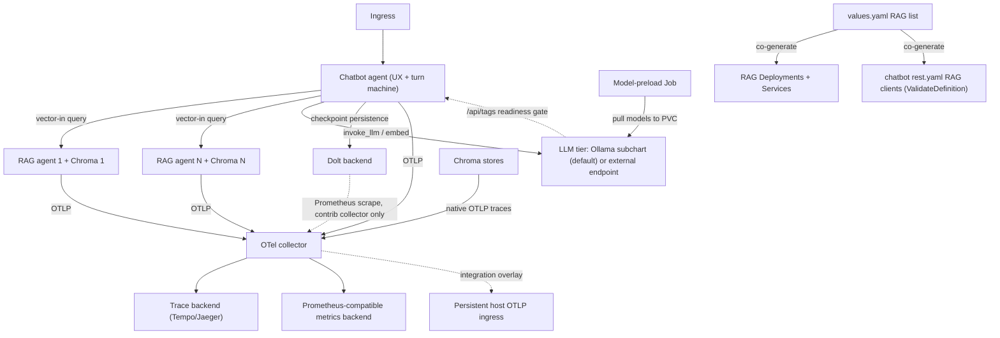

<!-- Copyright (c) 2026 Nokia -->
<!-- SPDX-License-Identifier: BSD-3-Clause -->

<!-- field: role_realization_decision -->
## Role realization decision

<!-- field: current_actor -->
### Current actor

Helm chart and rendered workloads

<!-- field: implemented_responsibility -->
### Implemented responsibility

Render profile-backed actors, values-named RAG instances, wrapper closure, and infrastructure adapters into one deployment topology.

<!-- field: canonical_role_sub_role -->
### Canonical role sub role

Workload names inherit mounted profile bindings; Helm names are not canonical roles or sub-roles.

<!-- field: retained_or_proposed_name -->
### Retained or proposed name

Retain workload names; GH-1077 renamed the provisioning workflow realization to provisioning-workflow-orchestrator.

<!-- field: authority_boundary -->
### Authority boundary

Values and templates select deployment identity and configuration but do not define semantic role identity.

<!-- field: evidence -->
### Evidence

- helm/templates/chatbot.yaml
- helm/templates/rag-units.yaml
- helm/templates/provisioning-workflow-orchestrator.yaml
- helm/templates/creator.yaml
- helm/templates/applier.yaml
- helm/templates/collector.yaml

<!-- field: migration_impact -->
### Migration impact

GH-1077 renamed the provisioning-workflow-orchestrator workload and all selectors, policies, telemetry identities, integrations, and packaging references together.

<!-- field: context -->
## Context

The chatbot mesh runs as a set of container agents on Kubernetes: one chatbot
agent (srd002) fronting N RAG server agents (srd001), each RAG paired with its
Chroma database, plus a chat LLM (in-cluster or external), a Dolt checkpoint
backend, and an OTel collector with trace and metric backends. This SRD owns the Helm
topology, the values-driven co-generation of RAG topology and chatbot client
config, the tiered hot-swap model and the observability wiring.

Images follow the rel06.0 mounted-profile contract: the runtime image is
binary-only (agent-core srd034), and each agent's profile is supplied from
ConfigMaps mounted at the profile path rather than baked into the image. This
keeps one runtime image across every profile-backed workload and lets a values change
re-render profiles without rebuilding images.

Chart location: the top-level applications/chatbot-mesh/helm/ directory. The chart,
values schema, and rollout scripting are deployment-plane artifacts; nothing
here feeds hosts or URLs into a running agent.

<!-- field: problem -->
## Problem

The mesh needs a reproducible deployment whose topology and the chatbot's RAG
client configuration cannot drift, a hot-swap model that repoints and adds or
removes RAG sources without hand-editing agent config. The requirements must name the chart topology, the
co-generation source-of-truth rule, the tiered swap tiers and the observability wiring, separately from agent-core
runtime capability.

<!-- field: goals -->
## Goals

- G1: Define one Helm chart deploying the chatbot agent, N RAG (agent + Chroma) pairs from a values list, the chat LLM, the Dolt backend, and the OTel collector, using rel06.0 binary-only images with profiles from ConfigMaps.
- G2: Co-generate the chatbot's declared runtime topology, REST network allowlist, and monitor upstreams from the same values list that creates the RAG Deployments and Services, while one selected-target REST operation serves every unit.
- G3: Define a tiered hot-swap model -- Service repoint, values re-render plus a request-draining rollout -- and exclude in-process client-registry mutation.
- G4: Define the provisioning surface as a config-plane deployment API, authenticated apart from the chat path, that never submits an endpoint to a running agent.
- G5: Define self-contained production observability and an explicit integration overlay that retains trace and metric evidence in a shared host sink.
- G6: Define an in-cluster LLM tier -- an optional Ollama subchart, enabled by default, with model preload, readiness gating, and GPU scheduling -- so a fresh-cluster install is self-contained, while an operator-supplied external endpoint remains a values switch that leaves the co-generation contract (R2) unchanged.

<!-- req: R1 -->
## R1 - Chart topology

<!-- req: R1.1 -->
### R1.1

One Helm chart SHALL deploy the chatbot agent, N RAG server agents each paired with a Chroma database from a values list, a chat LLM (in-cluster Ollama or an external endpoint reference), a Dolt checkpoint backend, and an OTel collector.

<!-- req: R1.2 -->
### R1.2

The chart SHALL expose ingress to the chatbot UX and internal Services for each RAG, the LLM, the Dolt backend, and the collector.

<!-- req: R1.3 -->
### R1.3

Agent images SHALL follow the rel06.0 mounted-profile contract (agent-core srd034), a binary-only runtime image with each agent's profile supplied from ConfigMaps mounted at the profile path.

<!-- req: R1.4 -->
### R1.4

The number and identity of RAG pairs SHALL be values-driven, so adding a source is a values edit rather than a chart edit.

<!-- req: R2 -->
## R2 - Values-to-config co-generation

<!-- req: R2.1 -->
### R2.1

The values list that creates the RAG Deployments and Services SHALL also render the chatbot's ordered runtime topology, REST network allowlist, and monitor upstreams. The chatbot SHALL retain one selected-target RAG operation and one source-count-independent for_each regardless of list length.

<!-- req: R2.2 -->
### R2.2

The rendered chatbot rest.yaml SHALL pass ValidateDefinition, enforced by a chart-level check or an init-container validation before the chatbot serves.

<!-- req: R2.3 -->
### R2.3

Each rendered RAG client entry SHALL carry the served collection's embedding-model identity (srd001 R2.3) so the chatbot can apply embedding-space mismatch handling (srd002 R3.3).

<!-- req: R3 -->
## R3 - Tiered hot swap

<!-- req: R3.1 -->
### R3.1

Repointing an existing RAG source SHALL be a Kubernetes Service selector or endpoint change that touches no agent configuration and requires no agent restart.

<!-- req: R3.2 -->
### R3.2

Adding or removing a RAG source SHALL be a values change that re-renders the ConfigMaps followed by a rollout whose old chatbot pod stops accepting new work, drains every active machine_request through its declared REST shutdown path, and exits only after those HTTP responses complete. A replacement pod SHALL serve subsequent turns. Dolt persistence SHALL NOT be described as preserving an existing HTTP connection: --resume-checkpoint starts a new process from selected machine state and cannot reattach a client socket.

<!-- req: R3.3 -->
### R3.3

In-process client-registry mutation of a running agent SHALL be a non-goal, deferred until rollout latency is shown inadequate.

<!-- req: R4 -->
## R4 - Provisioning authority boundary

<!-- req: R4.1 -->
### R4.1

The UX provisioning panel SHALL drive values edits and rollouts by submitting the desired values-plane document to the provisioning-workflow-orchestrator's intent endpoint (srd004 R1.1), which is the panel's only provisioning intake. The control plane realizes it -- the provisioning-workflow-orchestrator sequences, the creator executes (srd005 R3.2) -- and the applier agent (srd006) realizes the deployment API the creator drives (release rel06.0).

<!-- req: R4.2 -->
### R4.2

The provisioning surface SHALL NOT submit hosts, URLs, methods, or credentials to any running agent endpoint; it changes deployment values and triggers rollouts only.

<!-- req: R4.3 -->
### R4.3

R4.2 is the deployment-plane counterpart of agent-core srd028 V30 (runtime input cannot acquire transport authority), so authority is set by declared and validated config, whether at render time or dispatch time, never by a running control surface. The provisioning-workflow-orchestrator (srd004) and creator (srd005) are the mesh control plane that sequences and executes intents behind this surface.

<!-- req: R4.4 -->
### R4.4

The panel SHALL NOT reach the deployment API directly. Exactly one path reaches the apply surface -- panel to provisioning-workflow-orchestrator to creator to applier -- so the creator remains its only caller (srd006 R4.1) whether the change originated with the provisioning-workflow-orchestrator or with the operator.

<!-- req: R4.5 -->
### R4.5

The provisioning surface SHALL be authenticated separately from the chat path. That separation is deployment-realized by a distinct ingress route reaching only the provisioning-workflow-orchestrator's intent port, and by NetworkPolicy admitting the apply surface only from the creator. The declarative REST servers carry no inbound authentication, so a requirement resting on application auth alone would be enforced nowhere.

<!-- req: R5 -->
## R5 - Observability wiring

<!-- req: R5.1 -->
### R5.1

Every agent SHALL export OTLP to the in-cluster OTel collector.

<!-- req: R5.2 -->
### R5.2

A trace backend (for example Tempo or Jaeger) SHALL be a chart dependency that the observability panel queries for cross-agent traces.

<!-- req: R5.3 -->
### R5.3

Cross-agent trace continuity SHALL rely on HTTP traceparent propagation (agent-core srd016 R4/R5); without it the observability panel v1 SHALL fall back to per-agent monitor SSE correlated by request id.

<!-- req: R5.4 -->
### R5.4

Production defaults SHALL remain self-contained: the chart-local Collector and Jaeger SHALL work without a host observability stack.

<!-- req: R5.5 -->
### R5.5

The integration values overlay SHALL retain the chart-local Collector as a gateway where useful and SHALL export through it to the pre-existing host integration ingress. The overlay SHALL NOT make the external sink a production default.

<!-- req: R5.6 -->
### R5.6

Integration services SHALL use stable service.name values for chatbot, each RAG agent, each Chroma instance, and enabled Kubernetes control-plane components. Every signal SHALL carry repository, module, target, commit, and unique run identity.

<!-- req: R5.7 -->
### R5.7

Chroma SHALL export native OTLP traces through the gateway. Agent-to-Chroma HTTP calls SHALL inject traceparent so Chroma spans join the caller trace.

<!-- req: R5.8 -->
### R5.8

Dolt SHALL continue to expose Prometheus metrics on its metrics port. Only the opt-in `contrib` collector MAY scrape and export them; the default `agent` collector has no Prometheus scrape capability, so agent mode does not collect in-cluster Dolt metrics (GH-1366).

<!-- req: R5.9 -->
### R5.9

Kind integration configuration SHALL enable supported control-plane tracing to the shared ingress. Because helm and kubectl do not propagate traceparent, those traces SHALL be correlated by run identity and time rather than claimed as one agent waterfall.

<!-- req: R5.10 -->
### R5.10

Integration evidence SHALL remain queryable after chart and cluster teardown. It SHALL record sink health, run identity, representative trace ids and services, and agent metric availability; Dolt metric availability applies only under the opt-in contrib collector (GH-1366).

<!-- req: R5.11 -->
### R5.11

Native Ollama server tracing and OTel Logs are explicit limitations. Ollama evidence SHALL use agent-core GenAI client spans until native server tracing is available.

<!-- req: R6 -->
## R6 - In-cluster LLM tier

<!-- req: R6.1 -->
### R6.1

The chart SHALL include an optional Ollama subchart, enabled by default, that deploys Ollama in-cluster with PVC-backed model storage; when disabled (ollama.enabled=false) the embedding and chat endpoint values SHALL point at an operator-supplied service. Both paths SHALL render into the same co-generated client entries, so R2 is unchanged either way.

<!-- req: R6.2 -->
### R6.2

A model-preload Job (or init container) SHALL pull the embedding model, every declared chat model, and the tier-selector model into the PVC before the tier reports ready; the model names SHALL be declared once in values and flow to both the preload and the agents' rendered config, so a model cannot be preloaded but unrendered or vice versa.

<!-- req: R6.3 -->
### R6.3

Agent pods SHALL gate their readiness on the LLM tier reporting the required models present (Ollama /api/tags), so a missing model is a deploy-time gate rather than a runtime turn failure.

<!-- req: R6.4 -->
### R6.4

GPU scheduling (nodeSelector, tolerations, resource requests/limits) SHALL be values; a CPU-only deployment SHALL be permitted for the kind smoke path.

<!-- req: R6.5 -->
### R6.5

The single-instance-vs-per-model topology SHALL be a values decision; the default SHALL be a single Ollama instance serving all models, with per-model instances mapping to the two-logical-services (embedding vs chat) split when set. The choice and its rationale SHALL be recorded.

<!-- field: non_goals -->
## Non-goals

- Define Go package APIs for agent-core runtime, the checkpoint port, or the monitor.
- In-process client-registry mutation of a running agent (R3.3).
- Owning the SPA panel content; the observability panel is its own issue.
- Replacing the rel06.0 mounted-profile image contract or building per-role images.
- Matching GPU production sizing on the kind smoke path; the smoke path runs CPU-only small models and diverges from production sizing by design (R6.4).
- Replacing the self-contained production Collector and Jaeger defaults with an integration-only host dependency.
- Claiming one propagated trace across helm or kubectl and the Kubernetes API server.
- Introducing OTel Logs or claiming native Ollama server tracing.

<!-- field: acceptance_criteria -->
## Acceptance criteria

<!-- ac: AC1 -->
### AC1

One chart is specified deploying the chatbot, N values-driven RAG (agent + Chroma) pairs, the LLM, the Dolt backend, and the collector, with ingress and internal Services, over rel06.0 binary-only images with ConfigMap-mounted profiles.

<!-- field: traces -->
#### Traces

- [R1.1](#r11)
- [R1.2](#r12)
- [R1.3](#r13)
- [R1.4](#r14)

<!-- ac: AC2 -->
### AC2

Co-generation renders the chatbot topology data, REST allowlist, and monitor upstreams from the same values list that creates the RAG objects; rest.yaml retains one validated selected-target operation, and a third unit changes no chatbot word or state count.

<!-- field: traces -->
#### Traces

- [R2.1](#r21)
- [R2.2](#r22)
- [R2.3](#r23)

<!-- ac: AC3 -->
### AC3

The tiered swap is specified -- Service repoint with no agent change, add/remove via values re-render plus a request-draining rollout -- with in-process registry mutation excluded.

<!-- field: traces -->
#### Traces

- [R3.1](#r31)
- [R3.2](#r32)
- [R3.3](#r33)

<!-- ac: AC4 -->
### AC4

The provisioning surface is a separately-authenticated deployment API that edits values and triggers rollouts and never submits an endpoint to a running agent, stated as the deployment-plane counterpart of agent-core srd028 V30 with the cross-reference.

<!-- field: traces -->
#### Traces

- [R4.1](#r41)
- [R4.2](#r42)
- [R4.3](#r43)

<!-- ac: AC7 -->
### AC7

The panel reaches the deployment API through the control plane only -- provisioning-workflow-orchestrator, then creator -- so exactly one path reaches the apply surface, and the separation from the chat path is named as deployment-realized rather than application-enforced.

<!-- field: traces -->
#### Traces

- [R4.1](#r41)
- [R4.4](#r44)
- [R4.5](#r45)

<!-- field: tests -->
#### Tests

- test-rel06.0-applier: The panel route reaches only the authorized surface

<!-- ac: AC5 -->
### AC5

The observability wiring preserves self-contained production defaults and defines an integration-only gateway to a persistent host sink, stable run and service identity, Chroma trace propagation, Dolt metrics under the opt-in contrib collector only, separately correlated kind control-plane traces, retained evidence, and the Ollama and OTel Logs limitations.

<!-- field: traces -->
#### Traces

- [R5.1](#r51)
- [R5.2](#r52)
- [R5.3](#r53)
- [R5.4](#r54)
- [R5.5](#r55)
- [R5.6](#r56)
- [R5.7](#r57)
- [R5.8](#r58)
- [R5.9](#r59)
- [R5.10](#r510)
- [R5.11](#r511)

<!-- ac: AC6 -->
### AC6

The in-cluster LLM tier is specified -- an optional Ollama subchart enabled by default with PVC model storage and an enabled/external switch that leaves R2 unchanged, a model-preload Job pulling the embedding, chat, and tier-selector models named once in values, agent readiness gated on model presence, GPU scheduling as values with a CPU-only path, and a recorded single-instance default topology.

<!-- field: traces -->
#### Traces

- [R6.1](#r61)
- [R6.2](#r62)
- [R6.3](#r63)
- [R6.4](#r64)
- [R6.5](#r65)

<!-- field: platform_dependencies_note -->
## Platform dependencies note

agent-core runtime contracts this chart deploys against. External references, owned by agent-core, not part of this application's corpus.

<!-- field: platform_dependencies | form: "typed table" -->
## Platform dependencies

| srd_id | provider | symbols_used |
| --- | --- | --- |
| srd034-external-agent-profiles | agent-core | [R1] |
| srd035-checkpoint-port | agent-core | [R1] |
| srd036-dolt-state-persistence | agent-core | [R6] |
| srd016-traceparent | agent-core | [R5] |
| srd008-telemetry | agent-core | [R5] |
| srd018-cli-flag-contract | agent-core | [R5] |

<!-- field: implementation_status -->
## Implementation status

<!-- field: done -->
### Done

- Helm chart topology (R1): one chart deploys the chatbot, a values-driven ragUnits list each rendering a rag-server and a Chroma store, a Dolt checkpoint backend, and an OTel collector with a Jaeger backend, all over the rel06.0 mounted-profile image with profiles projected from ConfigMaps.
- Values-to-config co-generation (R2): the ragUnits list renders the chatbot rest.yaml RAG clients, the fan-out machine, and the UX monitored-agents from one source, validated by a --validate-config init container and a helm template diff lock, so topology and client config cannot drift.
- Tiered hot swap (R3): repoint is a Kubernetes Service change touching no agent config; add or remove a RAG re-renders the ConfigMaps and rolls the chatbot; the old pod drains active machine_request responses before it exits, and the replacement pod serves subsequent turns.
- Observability wiring (R5) and the in-cluster LLM tier (R6): every agent exports OTLP to the collector and on to Jaeger; an optional Ollama tier (enabled by default) preloads the models and gates agent readiness on their presence, with an external-endpoint switch that leaves R2 unchanged.

<!-- field: planned -->
### Planned

- A live on-cluster hot-swap turn citing a newly added corpus, paired with a Docker and Ollama host run.
- The integration-only shared-sink overlay, native Chroma tracing, Dolt metric scraping, kind control-plane tracing, and retained evidence assertions specified by R5.5-R5.11.

<!-- field: diagrams -->
## Diagrams

<!-- field: deployment -->
### Deployment

