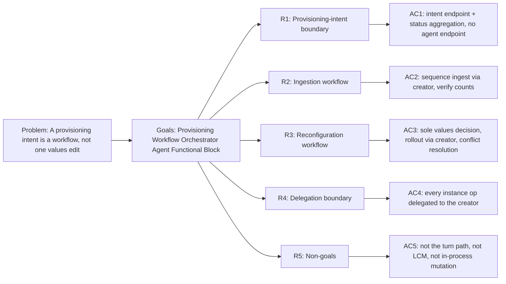

<!-- Copyright (c) 2026 Nokia -->
<!-- SPDX-License-Identifier: BSD-3-Clause -->

<!-- field: role_realization_decision -->
## Role realization decision

<!-- field: current_actor -->
### Current actor

provisioning-workflow-orchestrator

<!-- field: implemented_responsibility -->
### Implemented responsibility

Sequence an optional corpus-ingest request followed by a values rollout request through the creator and aggregate the terminal result.

<!-- field: canonical_role_sub_role -->
### Canonical role sub role

Executor / Workflow Orchestrator; explicitly not Coordinator.

<!-- field: retained_or_proposed_name -->
### Retained or proposed name

Use `provisioning-workflow-orchestrator`; implemented in GH-1077.

<!-- field: authority_boundary -->
### Authority boundary

Holds no deployment API, child-process, synchronization, conflict-resolution, negotiation, or consensus authority.

<!-- field: evidence -->
### Evidence

- agents/provisioning-workflow-orchestrator/request-machine.yaml
- agents/provisioning-workflow-orchestrator/rest.yaml
- helm/templates/provisioning-workflow-orchestrator.yaml

<!-- field: migration_impact -->
### Migration impact

GH-1077 migrated profile and directory names, Helm objects and policies, SRD004 and references, integrations, packaging closure, release artifacts, and compatibility metadata together.

<!-- field: context -->
## Context

The mesh control plane is two agents. The provisioning-workflow-orchestrator is the workflow
orchestrator: the UX agent (chatbot, srd002) accomplishes a user's provisioning
intent by delegating it to the provisioning-workflow-orchestrator, which sequences the ingestion and
reconfiguration workflows, realizes the caller's desired mesh state (the full
values-plane document, decided by the operator through the provisioning panel),
and aggregates status for the provisioning panel. The implemented actor assumes
Executor / Workflow Orchestrator. It does not currently synchronize concurrent
workflows, resolve conflicts, negotiate, or facilitate consensus, so its bare
`provisioning-workflow-orchestrator` name does not establish the reference-architecture Coordinator
role. GH-1077 completed the actor and workload rename while retaining that binding.

The provisioning-workflow-orchestrator orchestrates; the creator (srd005) acts. Every instance operation --
creating a child ingest run, restarting a reconfigured agent, terminating an
instance -- is a declared-client request to the creator, never a direct call to
the deployment API or a run_agent word. The provisioning-workflow-orchestrator holds no deployment-API
credentials and runs no instances. The reusable request runtime, monitor server,
and REST client transport stay in agent-core; the intent endpoint mapping, the
workflow machines, and the declared creator client stay profile-owned.

<!-- field: problem -->
## Problem

The provisioning surface (srd003 R4) edits deployment values and triggers
rollouts, but a user's intent -- "add this directory as a knowledge source" --
is a workflow, not a single values edit: it ingests corpora, realizes the
caller's desired values, restarts affected agents, and reports progress. The mesh
needs an agent that owns that workflow, sequences it, and aggregates its status,
while keeping the orchestration-versus-action split and the authority boundary of
srd003 R4 intact.
The requirements must name the intent boundary, the ingestion and reconfiguration
workflows, the delegation-to-creator rule, and what the provisioning-workflow-orchestrator does not do,
separately from the agent-core request and REST runtime.

<!-- field: goals -->
## Goals

- G1: Model the provisioning-workflow-orchestrator as a persistent workflow orchestrator that binds a user provisioning intent from the UX agent to a request-scoped workflow run.
- G2: Sequence the ingestion workflow -- given directories and target collections, drive corpus-ingest instance requests through the creator and verify the outcomes.
- G3: Sequence the reconfiguration workflow -- decide the values and config changes, request rollout of the affected agents through the creator, and confirm reported health.
- G4: Keep every instance operation a declared-client request to the creator, so the provisioning-workflow-orchestrator never holds deployment-API authority or runs an instance directly.
- G5: Aggregate per-step status and progress so the provisioning panel can render a running intent, while keeping the intent endpoint and workflow machines profile-owned.

<!-- req: R1 -->
## R1 - Provisioning-intent boundary

<!-- req: R1.1 -->
### R1.1

The provisioning-workflow-orchestrator SHALL expose a machine_request intent endpoint (agent-core srd030) that binds one inbound provisioning intent from the UX agent (srd002) to one request-scoped run of a workflow machine and maps terminal signals to HTTP status.

<!-- req: R1.2 -->
### R1.2

The intent endpoint SHALL accept a declared intent (add or remove a knowledge source, reconfigure a parameter) and SHALL NOT accept a host, URL, method, or credential for a running agent (srd003 R4.2 lineage, agent-core srd028 V30).

<!-- req: R1.3 -->
### R1.3

The provisioning-workflow-orchestrator SHALL run a monitor server (agent-core srd033) and a control server (health + lifecycle exit), and SHALL aggregate per-step status and progress into a form the provisioning panel can render. The aggregate SHALL be readable by the panel, which polls it while a reconfiguration proceeds; the panel SHALL NOT read rollout progress from the deployment API directly (srd003 R4.4).

<!-- req: R1.4 -->
### R1.4

The intent, monitor, and control server bind addresses SHALL be loopback-configurable inputs rather than agent-authored values.

<!-- req: R1.5 -->
### R1.5

The intent endpoint SHALL be the panel's only provisioning intake (srd003 R4.1). No other agent SHALL expose a browser-facing provisioning surface, so an operator intent enters the mesh in one place and follows one path to the apply surface.

<!-- req: R1.6 -->
### R1.6

The intent endpoint SHALL accept a values-only edit as well as an intent that names a new source to ingest. A values-plane document is replaced wholesale on apply (R3.1), so requiring source fields on every intent would make a pure reconfiguration inexpressible; an intent that does name a source SHALL still carry its collection, its directory, and the embedding family it expects. The creator judges that family against the one it ingests at and refuses a mismatch (srd005 R3.1), which it can do only if the intent states one.

<!-- req: R2 -->
## R2 - Ingestion workflow

<!-- req: R2.1 -->
### R2.1

Given directories and their target collections, the provisioning-workflow-orchestrator SHALL sequence one corpus-ingest instance request per directory to the creator (srd005) and collect the per-directory outcomes.

<!-- req: R2.2 -->
### R2.2

The provisioning-workflow-orchestrator SHALL verify each ingested collection's count against the requested source before treating the ingestion step as complete.

<!-- req: R2.3 -->
### R2.3

A failed or partial ingest SHALL be reported in the aggregated status and SHALL NOT silently advance the reconfiguration workflow.

<!-- req: R3 -->
## R3 - Reconfiguration workflow

<!-- req: R3.1 -->
### R3.1

The provisioning-workflow-orchestrator SHALL accept the full desired mesh state -- the complete values-plane document (the whole ragUnits list, parameters, and LLM config) -- from the intent and realize it, forwarding it unchanged as the values document the creator applies (srd006 R1.4). The desired-state decision is the operator's, made through the provisioning panel (srd002), because a values-plane list is replaced wholesale on apply and a partial patch would drop unlisted units; the provisioning-workflow-orchestrator remains the sole orchestrator of the workflow (R3.2, R3.3).

<!-- req: R3.2 -->
### R3.2

The provisioning-workflow-orchestrator SHALL request rollout or restart of the affected agents from the creator (srd005) and SHALL confirm the health the creator reports before completing the intent.

<!-- req: R3.3 -->
### R3.3

The provisioning-workflow-orchestrator SHALL eventually resolve conflicts between concurrent intents so two intents do not apply contradictory values, serializing or rejecting as needed. Until that behavior is implemented and evidenced, it SHALL NOT claim Coordinator / Conflict Resolver or Workflow Synchronizer.

<!-- req: R4 -->
## R4 - Delegation boundary

<!-- req: R4.1 -->
### R4.1

Every instance operation -- create, restart, terminate -- SHALL be a declared rest.yaml client request to the creator (srd005), never a direct deployment-API call or a run_agent word from the provisioning-workflow-orchestrator.

<!-- req: R4.2 -->
### R4.2

The provisioning-workflow-orchestrator SHALL hold no deployment-API credentials and SHALL authenticate its intent endpoint apart from the chat path.

<!-- req: R4.3 -->
### R4.3

All provisioning-workflow-orchestrator clients SHALL be declared rest.yaml entries; no endpoint reaches the provisioning-workflow-orchestrator from runtime input (agent-core srd028 V30).

<!-- req: R5 -->
## R5 - Non-goals

<!-- req: R5.1 -->
### R5.1

The provisioning-workflow-orchestrator SHALL NOT orchestrate the chat turn path (route, embed, fan-out, compose); that stays in the chatbot (srd002).

<!-- req: R5.2 -->
### R5.2

The provisioning-workflow-orchestrator SHALL NOT perform agent lifecycle mechanics (template selection, instance creation, rollout execution, health probing); those are the creator (srd005).

<!-- req: R5.3 -->
### R5.3

The provisioning-workflow-orchestrator SHALL NOT mutate a running agent's client registry in process; reconfiguration is a rollout (srd003 R3.3).

<!-- field: non_goals -->
## Non-goals

- The provisioning-workflow-orchestrator does not orchestrate the chat turn path (route, embed, fan-out, compose); that stays in the chatbot (srd002).
- The provisioning-workflow-orchestrator does not perform agent lifecycle mechanics (template selection, instance creation, rollout execution, health probing); those are the creator (srd005).
- The provisioning-workflow-orchestrator does not mutate a running agent's client registry in process; reconfiguration is a rollout (srd003 R3.3).

<!-- field: acceptance_criteria -->
## Acceptance criteria

<!-- ac: AC1 -->
### AC1

The provisioning-workflow-orchestrator is described as a persistent workflow orchestrator with a machine_request intent endpoint from the UX agent, monitor and control servers, aggregated status, and loopback-configurable bind addresses, accepting no agent endpoint or credential.

<!-- field: traces -->
#### Traces

- [R1.1](#r11)
- [R1.2](#r12)
- [R1.3](#r13)
- [R1.4](#r14)

<!-- ac: AC6 -->
### AC6

The intent endpoint is the panel's only provisioning intake, it serves the panel's status polling rather than the deployment API doing so, and it accepts a values-only edit as well as an intent naming a source to ingest.

<!-- field: traces -->
#### Traces

- [R1.3](#r13)
- [R1.5](#r15)
- [R1.6](#r16)

<!-- field: tests -->
#### Tests

- test-rel06.0-applier: The panel route reaches only the authorized surface

<!-- ac: AC2 -->
### AC2

The ingestion workflow sequences one corpus-ingest instance request per directory through the creator, verifies collection counts, and reports partial failures without advancing.

<!-- field: traces -->
#### Traces

- [R2.1](#r21)
- [R2.2](#r22)
- [R2.3](#r23)

<!-- ac: AC3 -->
### AC3

The reconfiguration workflow makes the provisioning-workflow-orchestrator realize the caller's full desired mesh state as the forwarded values document, requests rollout from the creator, confirms reported health, and resolves conflicts between concurrent intents.

<!-- field: traces -->
#### Traces

- [R3.1](#r31)
- [R3.2](#r32)
- [R3.3](#r33)

<!-- ac: AC4 -->
### AC4

Every instance operation is a declared-client request to the creator; the provisioning-workflow-orchestrator holds no deployment-API credentials, authenticates apart from chat, and receives no endpoint from runtime input.

<!-- field: traces -->
#### Traces

- [R4.1](#r41)
- [R4.2](#r42)
- [R4.3](#r43)

<!-- ac: AC5 -->
### AC5

The turn-path, LCM-mechanics, and in-process-mutation boundaries are stated as non-goals, cross-referencing srd002, srd005, and srd003 R3.3.

<!-- field: traces -->
#### Traces

- [R5.1](#r51)
- [R5.2](#r52)
- [R5.3](#r53)

<!-- field: platform_dependencies_note -->
## Platform dependencies note

agent-core runtime contracts this agent builds on. External references, owned by agent-core, not part of this application's corpus.

<!-- field: platform_dependencies | form: "typed table" -->
## Platform dependencies

| srd_id | provider | symbols_used |
| --- | --- | --- |
| srd030-machine-request-rest-binding | agent-core | [R1] |
| srd033-monitor-rest-api | agent-core | [R1] |
| srd028-rest-client-tools | agent-core | [V30] |

<!-- field: implementation_status -->
## Implementation status

<!-- field: implemented -->
### Implemented

- The provisioning-workflow-orchestrator profile (agents/provisioning-workflow-orchestrator) and its intent endpoint, ingestion and reconfiguration workflow machines, and declared creator clients. mage integration:controlPlane proves the values-only path through the real provisioning-workflow-orchestrator and creator against a recording fake deployment API. The ingest path delegates to the creator's implemented corpus-ingest child endpoint and checks the returned count. These paths have independent evidence; no live integration yet joins ingest, rollout, and a grounded turn from the newly added source.

<!-- field: planned -->
### Planned

- R3.3 concurrent-intent serialization or rejection. The shipped request machine contains only ingest and rollout sequencing and no lock, conflict, negotiation, synchronization, or consensus state; planned behavior does not confer a canonical Coordinator binding.

<!-- field: diagrams -->
## Diagrams

<!-- field: requirements_trace -->
### Requirements trace



<!-- field: control_plane -->
### Control plane

```mermaid
flowchart LR
  User["User"] --> Chatbot["Chatbot (UX, srd002)"]
  Chatbot -->|provisioning intent| Provisioning Workflow Orchestrator["Provisioning Workflow Orchestrator (srd004)"]
  Provisioning Workflow Orchestrator -->|instance requests| Creator["Creator (srd005)"]
  Creator -->|values edit + rollout| DeployAPI["Deployment API (srd003 R4)"]
  Provisioning Workflow Orchestrator -->|status| Chatbot
```
